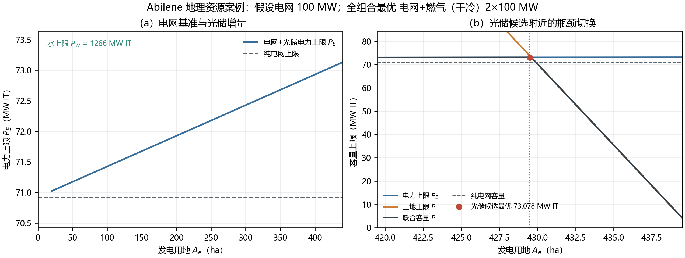
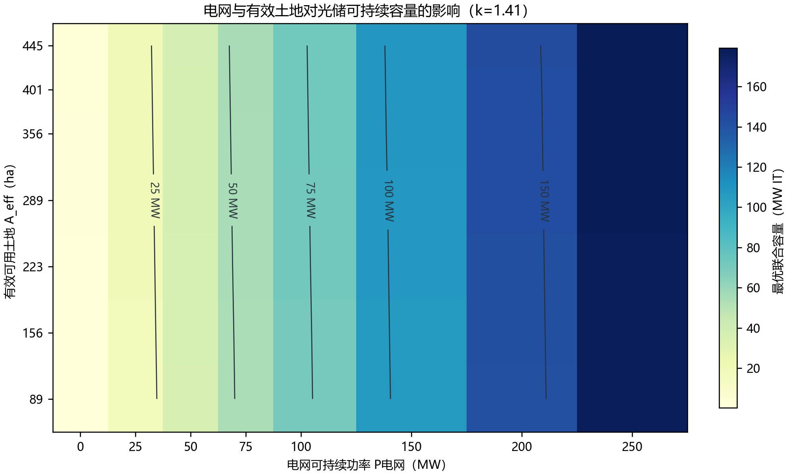
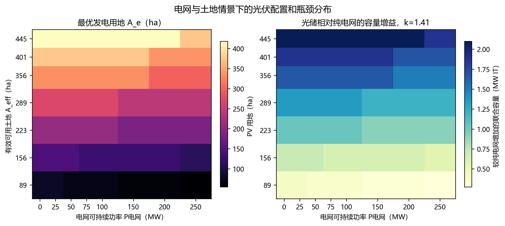
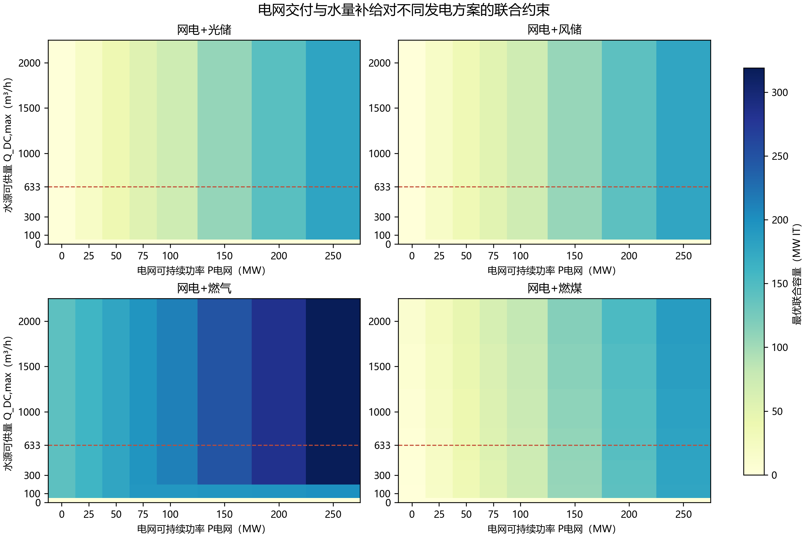
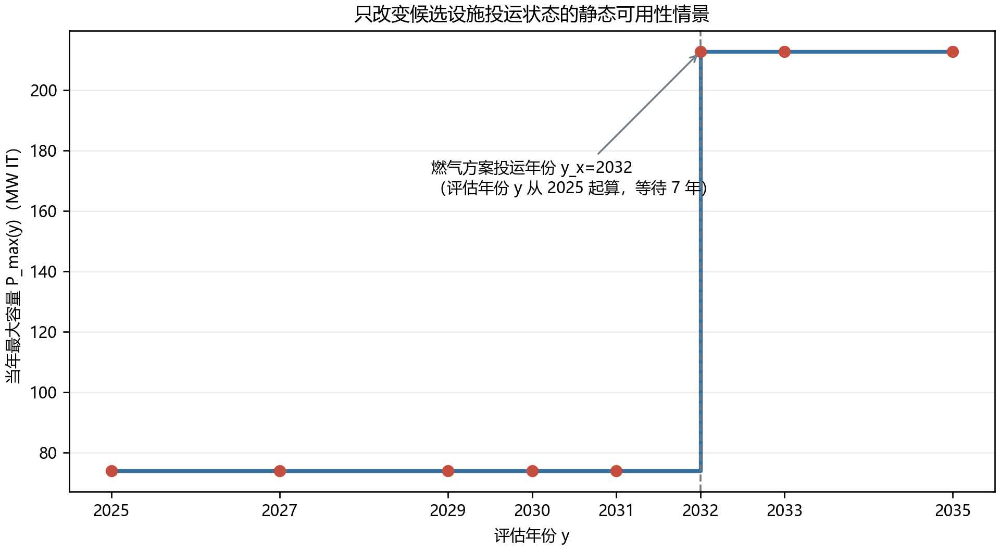

# Abilene 地理资源条件下的静态容量筛查报告

**报告对象**：Abilene, Texas 的指定地理资源包络；比较纯电网、电网+光伏储能、电网+风电储能、电网+燃气和电网+燃煤五类供电配置，不拟合、复现或验证任何现实数据中心的 IT 容量。

**基准情景结果**：设假想持续电网交付 100 MW，采用 2025-01-29 的 24 小时气象循环、全球/文献参考参数、区域规划水量情景和通用火电模块。当前候选中最优为电网+2 台 100 MW 净出力燃气模块，`P_E=212.766 MW IT`、`P_W=1258.149 MW IT`、`P_L=2922.445 MW IT`，联合容量 **212.766 MW IT**，电力触顶。这是燃料充分上界下的条件性设备情景，不是 Abilene 的实际项目容量。

## 两个图面板在表达什么

图中面板比较纯电网与电网+光储，并放大光储最优面积附近的电力/土地交叉。基准假定 `P_grid=100 MW`；电网可交付容量不是 Abilene 实测值，另以 0、25、50、100、250 MW 做敏感性。风储、燃气、燃煤结果见输出 03 和输出 11。

### 左面板：电网基准与光储增量

- 蓝线是纯电网与电网+光储的 `P_E`。虚线纯电网是 `100/1.41=70.922 MW IT`；光储线从这条基线向上增加，最高约 73.078 MW IT。该线呈斜坡，说明 PV 并未被当成替代电网，而是可靠自发电叠加到共同电网输入。
- 旧图的蓝线看起来水平，是因为那张图把横轴缩到最优面积附近约 1.55 ha，且纵轴仍从 0 画到 3.5 MW。该窄区间里 `P_E` 只增加约 `0.008 MW`，不到纵轴跨度的 0.3%，因此视觉上像常数。旧基准还令 `P_grid=0`，没有纯电网基线；新图已改为显示全 0–440 ha 的面积范围和有网混合方案。
- 橙线是 PV 分支的土地上限 `P_L=(A_eff-A_0-A_e)/a_site`。每多分给光伏 0.1 ha，就少 0.1 ha 留给 IT 园区；按 `a_site=0.143748 ha/MW IT`，土地上限约下降 `0.696 MW IT`。它比电力线变化陡得多，因此在 PV 最优点附近会接替成为瓶颈。
- 水上限约 1,266.15 MW IT，在基准情景下远高于电力/土地限制；图内标注其值但不把纵轴拉至该数值，否则其他曲线会压在零附近。水上限不活跃是区域水量全额分配假设造成的情景结果，不表示当地水资源实际上不受限。

左图展示**完整 PV 面积分配区间内的电网基准和光储增量**。

### 右面板：优化目标的候选曲线

右图只展开基准电网情景下的光储分支。蓝线为 `P_E`，橙线为 `P_L`，深灰线为 `P=min(P_E,P_W,P_L)`，虚线是纯电网容量。靠近交点前，电力是较小项，加入光伏可逐渐增加 IT 容量；越过交点后土地上限更低，联合容量下降。红点是当前 PV 候选中最优值。**全组合的最优方案在本基准情景下是燃气情景**，并不由右图的红点代表；燃气/燃煤/风储/光储的全体比较见输出 03 与 11。

每个给定 PV/电池规模先由 SciPy HiGHS 线性规划求 24 小时循环的恒定自发电功率，再由 Q1 场址模型计算三项上限；风储也用同一循环 LP。外层面积搜索在 20–380 ha 以 20 ha 步长扫描，400–440 ha 以 0.1 ha 加密。火电按模型的离散机组数输入候选。每个电网容量敏感性水平都重新评估整个候选集。

## 地理资源响应热力图

### 电网与土地

横轴是电网可持续供电功率 $P_{\mathrm{电网}}$（MW），纵轴是有效可用土地 $A_{\mathrm{eff}}$（ha）。有效面积网格由候选毛地面积乘可用比例生成，作为模型的地理输入；“比例”只是生成地理情景的辅助量，不是额外模型变量。$k$ 固定为全球平均 PUE 代理值 1.41。颜色表示优化 PV 面积分配后的联合容量 $P_{\max}$，黑色等值线标出容量水平。

### 光伏配置与容量增益

两轴沿用电网可持续供电功率 $P_{\mathrm{电网}}$ 和有效可用土地 $A_{\mathrm{eff}}$。左面板颜色表示最优方案的发电用地 $A_e$（ha）；右面板颜色表示该方案相对纯电网容量的增量（MW IT）。格内不逐项写数字，精确值见[格点结果表](outputs/12_geography_heatmap_data.csv)，每格均对 PV 面积方案取最大值。

### 水量、供电技术与建成等待期

四面板横轴是电网可持续供电功率 $P_{\mathrm{电网}}$（MW），纵轴是设计期可供水量 $Q_{\mathrm{DC,max}}$（m³/h）。红虚线标出 Region G 年度规划余量换算值 633.1 m³/h。四个面板分别是网电+光储、网电+风储、网电+燃气、网电+燃煤；颜色表示各技术分支优化后的联合容量 $P_{\max}$（MW IT）。该水量是情景值，不是当地取水许可或项目供水保证。

横轴是评估年份 $y$，候选方案按其投运年份 $y_x$ 是否满足 $y_x\le y$ 纳入当年方案集合。燃气候选按题面“约 7 年”的示例从 2025 年起算，于 2032 年进入可用集合。图中固定资源和技术参数，不是逐年气象、水文或扩建模拟；其他候选暂按 2025 年已经可用处理。

图轴和色层现在对应模型中的数学变量：图 13、14 使用 $P_{\mathrm{电网}}$ 与 $A_{\mathrm{eff}}$，图 14 的颜色显示决策量 $A_e$ 或容量增量；图 16 使用 $P_{\mathrm{电网}}$ 与 $Q_{\mathrm{DC,max}}$；图 18 使用评估年份 $y$ 按投运年份 $y_x$ 筛选方案。这些变量分别对应题目要求的电网、土地、水、可再生能源波动及发电设施等待期。$k$ 是设施功率换算为 IT 功率的工程效率参数，因此固定在主热力图、另做敏感性分析；950 MW、2,263 MW 和 5 GW 是题面比较对象，不作为模型输入。

需要限定两项地理含义：当前 `Q_source` 是区域规划 surplus 全额分配情景，不是流域水压力指标或补水率实测；图中没有独立的 Aqueduct 水压力阈值。当前有效土地比例也是筛查情景，不是经坡度、洪泛、生态保护区和地块连通性 GIS 掩膜得到的本地适宜性。它们是 Q1 真正需要的轴，但现阶段只能作为场景变量，不能冒充已观测地理事实。

## 地理与输入条件

| 输入 | 本次取值 | 来源与口径 | 可靠性判断 |
|---|---:|---|---|
| 气象点 | 32.442883°N, 99.732700°W；海拔 527 m | Open-Meteo 返回的 Abilene ERA5 网格点 | 有明确坐标；属于再分析网格，不是地面辐射仪实测 |
| 设计循环 | 2025-01-29，短波辐射日总量 802 Wh/m² | 先下载 2025 年 1 月逐小时序列，再按每日辐射总量排序取最低日；模型只输入该日 24 点 | 是单月、单年低辐射日，不是气候学极端日或可靠性重现期 |
| 候选地理面积 | 1,100 acre = 445.154 ha | Oracle 项目资料的园区毛面积；用于定义地理预算，不使用项目 IT MW 或站点供电 MW | 不是自行 GIS 勾绘的连续可建地；未扣洪泛、坡度、生态、道路和产权限制 |
| 初始固定用地 | 12.5 acre = 5.059 ha | 候选地理包络内的变电站用地，按全部位于包络内处理 | 情景边界假设 |
| 电网可持续输入 | 基准 100 MW；敏感性 0、25、50、100、250 MW | 未找到当地接入点可交付容量；100 MW 仅为通用情景轴上的基准点 | 不是 Abilene 电网/项目实际接入能力 |
| `k` | 1.41 | IEA 给出的 2024 全球平均 PUE，作为满载倍率代理 | 年度平均 PUE 不等于设计峰值 `k`；使用近似有偏差 |
| 光伏场址强度 | 8.9 acre/MWac = 3.602 ha/MWac | NREL 公用事业光伏**总场址面积**基准 | 比组件直接占地大；不等于特定倾角、地形或排布的 Abilene 实测值 |
| 风电场址强度 | 30 ha/MW | NREL spacing 面积 9–100 ha/MW 参考范围内的中间情景 | 用于风场占地示范，不是当地许可布局 |
| 风机曲线 | 10 m 风速外推至 100 m；切入/额定/切出 3/12/25 m/s | 1/7 风切变与通用立方功率曲线 | 简化曲线，不是某一型号的功率曲线 |
| WUE | 0.5 L/kWh IT | 闭式/液冷参考区间 0.1–0.5 的上端 | 文献参考值，不是全球样本平均或本地设计实测 |
| 水资源预算 | 4,496 acre-ft/year = 633.075 m³/h | Region G 2030 DB27 projected surplus 年量除以 8,760 h | 假设全部区域规划余量都能分给本案例；不是项目许可、合同或小时保证 |
| `a_site` | 0.143748 ha/MW IT | 由 100 kW/rack、6 m²/rack、IT hall 占楼面 50%，并结合候选场址的楼面/地块面积比计算 | 混合布局代理值，不是当地扩建实测或全球平均；已对 0.5×、1×、2×做敏感性 |
| 光伏与储能工程参数 | PR 0.85；NOCT 45°C；温度系数 -0.0035/°C；充/放电效率各 0.90；电池功率为 PV 的 25%，时长 4 h | 显式的设计情景参数 | 无本地设计书或全球平均声称；结果会随参数变化 |
| 火电模块 | 每台 100 MW 净功率；燃气 10 ha/台、燃煤 20 ha/台；1/2 台情景 | 通用比较单元；燃气干冷耗水 0.02 L/kWh，燃煤湿冷取水 132.5 L/kWh | 机组面积/效率为场景假设；按模型的燃料充足上界，不代表本地机组/燃料计划 |

完整输入和源链接分别见 [可执行输入](outputs/01_q1_inputs.yaml)、[来源表](outputs/06_source_registry.csv)、[单日气象原始响应](raw/open_meteo_abilene_2025-01-29.json)、[整月选日依据](outputs/08_design_day_selection.csv) 和 [电网水平敏感性](outputs/11_grid_access_sensitivity.csv)。

## 逐层计算

1. **地理资源到出力序列**：PV 按 ERA5 短波辐射、PR 和简化温度修正形成 AC 出力比例；风电按同日 10 m 风速外推到 100 m，再用通用功率曲线生成风场逐时出力。两者使用同一设计日。
2. **电网基准到 IT 上限**：基准情景 `P_grid=100 MW`，纯电网方案 `P_E=100/1.41=70.922 MW IT`。这只是场景输入，不是由 Abilene 实际线路反推的接入值。
3. **光储候选**：NREL 面积强度对应 `27.765 MWac/km²`。基准电网下 PV 分支最高约 73.078 MW IT，较纯电网增加约 2.156 MW；该增量来自 1 月低辐射设计日的光储可靠功率，不是全年平均发电量。
4. **风储候选**：相同网电与设计风日下，风储最高约 71.09 MW IT，略高于纯电网，但低于 PV 分支。单日 10 m 风速、幂律外推及通用曲线决定此比较，不能视作风资源长期排序结论。
5. **火电候选**：燃气 2×100 MW 模块在 100 MW 网电情景下 `P_E=(100+200)/1.41=212.766 MW IT`，模型水限约 1,258 MW IT、土地限约 2,922 MW IT，因此由电力限制。燃煤相同装机受 132.5 L/kWh 高取水参考值约束，水限约 74.11 MW IT，说明供水假设和冷却技术会显著改变火电排序。
6. **电网水平变化**：输出 11 对 0、25、50、100、250 MW 五个网电输入重新运行相同候选集合。基准选燃气并不意味着当地具备这套火电设备或燃料；它只是在模型已有的燃料充分假设下比较能源组合。
7. **三资源取最小**：每个方案都独立计算 `P_E/P_W/P_L`，先取最小再比较候选。全组合基准最优为燃气情景 212.766 MW IT，瓶颈是电力；水和土地约束在该输入下没有触顶。

## 合理之处

- 输入和输出边界分开：地点气象、毛面积和区域水计划作为地理输入；`k`、WUE、PV 占地强度与储能配置单独标为参考或工程假设。没有从已知 IT 容量反推任何参数。
- 用设计日逐时出力和周期储能平衡，而非用年平均容量因子直接冒充可靠功率。模型的 24 小时 LP 明确处理充电、放电、效率和期末 SOC。
- 用统一的 `min(P_E,P_W,P_L)` 计算每个候选，再在同一场址资源预算下最大化，体现了光伏用地增加电力、同时挤压 IT 用地的竞争关系。
- 结果瓶颈在机制上可解释：低辐射日使 PV+储能的恒定出力很低；规划水预算极宽松，因此水不绑定；PV 面积接近全部毛地，土地很快成为第二瓶颈。

## 不合理性、偏差方向与成因

**气象代表性不足。** 1 月最低日来自 2025 单月 ERA5 网格值，不能代表 Abilene 多年冬季风、光联合分布，也没有检验连续阴天/低风。重复同一日并要求日循环 SOC，可能比连续多日低资源下的电池结果乐观；另一方面，取单月最低日又可能比典型冬日过度保守。方向不确定。合理的下一层改进应取多年气候序列的指定分位设计日，必要时只构造多日静态压力窗口，而不是全年逐日运行。

**风光物理转换较粗。** PV 用水平面短波辐射近似阵列平面辐照，再乘常数 PR 和简化温度修正；风电从 10 m 风速按固定幂律外推到 100 m，再套通用曲线。两者都未逐项模拟设备型号、尾流、场址遮挡、阵列朝向、损耗和长期可用率。天气输入是 ERA5 再分析，不是现场观测。这些近似会改变风储/PV 储可靠增量，也可能改变两者排序。

**土地不是 GIS 适宜性分析。** 445.154 ha 是项目资料给出的毛面积，全部按可用处理；没有从土地覆盖、DEM 坡度、洪泛区、生态保护区、地块连通性和规划许可筛出可建地。PV 采用 NREL 总场址用地强度，但本地坡地和排布会改变装机密度。更关键的是，`a_site` 依赖机柜面积、IT hall 比例及项目楼面/地块比，并非可直接验证的全球均值；其敏感性测试只能说明所列倍数下的影响，不能证明其真实分布。

**水量是最强的乐观假设之一。** Region G 年度规划 surplus 被全部折成恒定小时流量并分配给一个假想案例；水源季节可用量、处理能力、输水能力、既有权利和新增配额均未校核。因此 1,266 MW IT 的 `P_W` 不能解释为当地真实可用水支撑的规模。当前结果由电力触顶，是因为输入水预算相对于这一小规模自建电源过大；这不等于 Abilene 水资源没有约束。

**工程基准不是场址设计值。** `k=1.41` 是全球年度平均 PUE 代理，不是满载峰值设计倍率；WUE=0.5 是参考区间上端；PR、电池效率、风机功率曲线、火电机组规模与用地都为明示情景值。k 的敏感性表中，1.20、1.41、1.54 对应燃气上界方案约 250、212.766、194.805 MW IT，说明单是 `k` 的取值就会直接改变电力容量。

**电网值是场景轴，不是当地测量。** 基准设 `P_grid=100 MW`，其他电网水平见输出 11。结果对电网输入近似线性敏感；没有本地接入点、变电站和上游网架计算，所以不能把 100 MW 情景称为可接入容量。火电候选按模型既定的燃料充分上界处理；模型没有独立的燃料输送能力变量，报告不应把它写成已核验的本地条件。

**供电组合仍非穷尽。** 本次纳入电网、光储、风储、燃气、燃煤，但没有水电、核电、柴油、储能与多电源共用母线等配置，也不计成本、N-1、故障概率和燃料年量。它回答的是当前给定候选集的最大值，不是地区全部可能方案的绝对最大规模。

## 从这次结果评价模型

### 已表现合理的结构

1. **联合瓶颈逻辑工作正常。** 基准全组合燃气候选上 `P_E < P_W < P_L`，联合值等于最小的 `P_E`；燃煤候选则由水约束压低。PV 子分支继续增加用地后，`P_L` 会跌破 `P_E`，联合值随即转为土地限制。这符合 `min(P_E,P_W,P_L)` 的定义。
2. **光储子模型守住周期能量平衡。** 它没有把 PV 装机 MW 当成可靠 MW，而是根据 24 个时段的可用功率、充放电功率、电池能量、效率和周期首尾 SOC 相等来求恒定供电增量。对“重复单日设计循环”这个任务口径，LP 结构是合适的。
3. **外层候选选择保留方案自洽性。** 每个 PV 面积同时带入对应的发电占地和 IT 剩余用地，先算该方案三项容量再取最大，避免分别挑选一个最大电力、另一个最大土地后拼接成不可能的配置。
4. **这一试验确实展示了模型要表达的机制。** 结果不是 PV 面积最大就无条件获胜；系统先受供电限制，随后土地会接替成为瓶颈。不同参数范围内最优面积随 `k` 和 `a_site` 移动，也说明土地不是孤立的事后扣减项。

### 结果暴露的模型改进点

| 观察到的结果 | 对模型/实现的评估 | 建议改进 |
|---|---|---|
| 光储候选的 `P_E` 随面积增加，纯电网 `P_E` 是水平基线 | 这是公式应有行为：`P_E=(P_grid+P_self)/k`；旧图蓝线在窄区间和宽 y 轴下视觉上近似水平，不是模型把光伏增量设为常数 | 图表同时给纯电网基线和完整面积区间；针对近交点单独放大，并标明纵轴范围 |
| 100 MW 网电情景下燃气方案给出 212.766 MW IT | 这是 `P_E=(100+2×100)/1.41` 的燃料充分、干冷低水耗模块上界；不是从地理数据导出的 Abilene 实际火电能力，也不是接入或燃料供应证明 | 保留为条件情景；报告命名和比较表必须注明“模块假设/燃料充分上界”，不能并入地理实测资源值 |
| 燃煤 2×100 MW 方案的电力上限很高，但联合容量只有约 74.11 MW IT | 水模型按 132.5 L/kWh 的高取水参考约束燃煤发电调用，出现水瓶颈，符合 `min` 结构；对水耗系数和可分配水量高度敏感 | 对湿冷/干冷和取水/耗水口径分别列情景，避免把高端系数当作单一全球平均 |
| 光储分支在约 430 ha 附近电力/土地交叉 | `min()` 的瓶颈切换逻辑正常；面积候选加密后可读出交叉附近的联合容量。整体最优实际来自火电情景，所以图示只是 PV 子分支 | 图注明确区分“PV 分支最优”和“全组合最优”；表格列出所有技术的最优候选 |
| 地块剩余面积以 ha 总量参与土地公式 | 标量土地公式能做总量筛查，但默认连续可切分、形状可布局；没有证明剩余地块能形成可建连续用地，也未给电池、道路、消防间距独立面积 | 加入 GIS 连通地块掩膜、设施最小模块/最小地块约束；把电池、逆变器、升压站纳入发电用地或独立面积项 |
| 1 月单日循环下 PV+储能可靠增量仅约 3.1 MW，水上限却约 1,266 MW | LP 求解是正确的，但输入窗口决定含义；周期 SOC 允许每天重复同一日，不涵盖多日连续低资源或电池应急预留。低辐射单日可能保守于典型日，仍可能乐观于连续低风光 | 仍保持静态口径，以多年资源分位数构造代表性压力窗口，或对 2–5 天连续低资源窗口单独建情景；电池增加预留 SOC 和可用率 |
| 水预算远大于模型需求，`P_W` 不活跃 | 水公式的单位链与 `min` 逻辑正常；但本次水输入是假设可取得全部区域规划余量，不能由结果得出“Abilene 水不受限” | 输入场址级可交付流量/合同情景；保留流域规划量只做上游资源边界，并设区域可分配比例敏感性，不将规划 surplus 直接视为项目供水 |
| `a_site` 变化 0.5×–2×时，基准燃气方案 `P_L` 仍明显大于 `P_E` | 土地强度在这个大毛地情景里不是当前最优燃气配置的活跃限制；不能据此得出土地参数一般不重要 | 对有效地面积、发电用地、最小连续园区面积和不同技术组合联合敏感性 |
| `k` 从 1.20 到 1.54 时燃气上界从 250 降至 194.805 MW IT | `P_E` 对 `k` 单调反比是正确的；全球年度 PUE 代替满载 `k` 会直接传递到容量值 | 用技术/气候分档区间，不能把全球平均 PUE 当成精确设计倍率 |

### 结论层级

- **模型实现层**：本案例支持 Q1 的“先求每套方案的 `P_E/P_W/P_L`，再取最小、再比较候选方案”结构，以及光储周期 LP 的基本可行性。优化候选网格误差较小，但应把离散精度报告出来。
- **模型形式层**：当前模型是有用的静态筛查模型，能清晰呈现资源竞争和瓶颈切换；它不是 GIS 布局模型、气象概率可靠性模型或水权模型。总量面积、代表日循环和线性强度使它保持简洁，也构成其主要近似边界。
- **数据/实证层**：这个案例没有独立实测 IT 规模作验证，也没有用目标容量反推 `k`、WUE 或土地强度。结果只能检验计算链和解释机制，不能据此宣称定量预测已经被现实数据验证。

## 综合结论

基准比较情景中，模型在候选集里选出电网+燃气模块的 **212.766 MW IT** 上界；这来自假设 `P_grid=100 MW`、两台各 100 MW 净出力燃气模块、`k=1.41`，电力项触顶。它不来自当地燃气站、实际电网接入或任何目标数据中心容量。光储分支约 73.078 MW IT、风储分支约 71.090 MW IT、纯电网约 70.922 MW IT；燃煤分支受当前高取水参考值限制在约 74.112 MW IT。电网敏感性表显示 `P_grid` 变化会明显改变所有组合的规模。

这一案例能评估模型的方案组合、`min(P_E,P_W,P_L)` 瓶颈逻辑、间歇电源储能 LP 和电网基准叠加方式；不能定量预测 Abilene 实际可持续容量。最大的不确定性在外部情景：未从本地网架计算 `P_grid`、气象只有单月设计日、毛面积未经 GIS 筛选、火电模块/占地是通用值、区域水余量被全部分配。报告保留这些条件，不把情景结果包装成地理实测结论。
