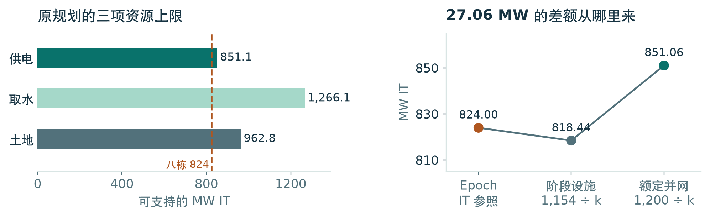
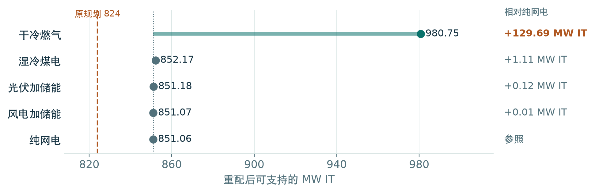
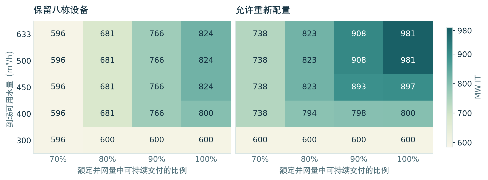

# Abilene 原八栋园区的规划复原与重新配置

原八栋的设计约为 **824 MW IT**。单看同一场址的电、水、土地，主情景允许 **851.06 MW IT**。允许重排运营用地、另建常态电源并增加 IT 设备时，仓库优化器得到 **980.75 MW IT**。若八栋保留且原用地锁定，只用已识别的一个地块扩建，则为 **882.47 MW IT**。[四页中文报告](report.pdf) · [原始输入与缺项表](input_register.csv) · [计算结果](results/)

## 原八栋与公开参照

DPR 总包方列出每栋四个数据厅，每厅 25 MW IT，另列每栋 3 MW IT。开发商 CEO 在 CERAWeek 访谈中给出的口径为每栋约 103 MW IT。八栋数据厅合计 800 MW，加上另列的 24 MW 后为 **824 MW IT**。项目方披露的 1.2 GW 是并网容量，原园区燃机按备用处理。[DPR 工程资料](https://www.dpr.com/projects/crusoe-abilene-data-center) · [Crusoe CEO 访谈，约 00:48–01:05](https://www.youtube.com/watch?v=cH7tiy7s17A&t=48s) · [并网与备用电源披露](https://www.crusoe.ai/resources/newsroom/crusoe-expands-ai-data-center-campus-in-abilene-to-1-2-gigawatts)

| 同一阶段的计算 | MW IT | 相对 Epoch 824 MW IT | 含义 |
| --- | ---: | ---: | --- |
| 按工程设备复原并经资源校核 | **824.00** | **0.00** | 资源足够时设备先触顶。设计与阶段估计共用八栋信息，零差值只说明口径相合。 |
| 只给 Q1 电、水、土地，不设八栋设备上限 | **851.06** | **+27.06（+3.28%）** | 电、水、土地分别允许 851.06、1,266.15、962.75 MW IT。 |
| 将 Epoch 同阶段设施功率 1,154 MW 除以 1.41 | 818.44 | −5.56 | 1,154/824 = 1.40049 是同源估计的比值。 |

项目并网额定量比阶段设施估计量大 46 MW，以同一倍率换算多出 32.62 MW IT。用 1.41 换算阶段设施量，又比 Epoch 的 IT 估计低 5.56 MW IT。两项相加解释 **27.06 MW** 差距。Epoch 将最后两栋的投运日标为建设进度推估，并未提供同期电表负荷。[Epoch 容量估计](https://epoch.ai/graphs/largest-ai-data-centers-by-power-capacity) · [仓库阶段时间线](../../../正稿/Q1-v2/IMMC2027-Q1/图片和附件/data_center_timelines.csv) · [资源上限输出](results/plan_limits.csv)



## 自由配置与保留八栋再扩建

保持和原规划对照组相同的网电、水量及满载倍率。IT 可在已识别的 **179.61 ha 运营宗地**内重新配置，还可使用一块 **23.36 ha** 的额外候选地。新增电源只能使用该块，余地可分给 IT，能否实际接入仍待布图。两站的 5.85 ha 在有效面积中单列，再作为固定地扣回。较宽松的 39.58 ha 地块使用另一种运维保留边界，未和整宗地重复相加。[原场址 GIS 面积账](../eight_building_land_review/README.md) · [完整用地核查请求](https://github.com/RL-RedLeaf/AIDC-test/issues/1#issuecomment-7075327576)

煤、气各最多两台，每台 100 MW，分别用地 20、10 ha。连续变量为风、光装机和逐时调度，电池功率按风光装机的 25%，时长 4 h，首尾荷电量相等。直接调用仓库 `Mix.solve` 与 `Mix.audit`，加上“新增发电用地不超过候选块”的约束，并按开放技术限制候选。九种煤气台数组合中四种满足面积约束，逐组求解线性规划。目标是最大化恒定 IT 功率，同容量择较小装机。2033 年用作新建常态电源可投运的反事实时点，供气、许可与工况恒定均为假设。原备用燃机未计入新增出力。[仓库混合电源求解器](../plot_fixed_installation.py) · [整数分支结果](results/integer_branches.csv)

| 开放的新增技术 | 最优安装 | MW IT | 相对只用网电 |
| --- | --- | ---: | ---: |
| 纯网电 | 无新增设备 | 851.06 | — |
| 风电加储能 | 风 0.78 MW | 851.07 | +0.01 |
| 光伏加储能 | 光 6.49 MWac，电池 1.62 MW / 6.49 MWh | 851.18 | +0.12 |
| 湿冷煤电 | 1 × 100 MW，取水先触顶 | 852.17 | +1.11 |
| 干冷燃气 | 2 × 100 MW，占 20 ha | **980.75** | **+129.69** |
| 允许煤、气、风、光混合 | 仍选两台干冷燃气，土地先触顶 | **980.75** | **+129.69** |

混合最优比原八栋多 **156.75 MW IT（19.02%）**。电力本可支持 992.91 MW IT，剩给机房与配套的 182.96 ha 先触顶。按满额网电运行时，需新增常态燃气出力约 182.86 MW，连同现场冷却取水约 494.03 m³/h。若要求每次按 103 MW IT 整栋投运，连续上限向下取整为 **927 MW IT**，第九栋的位置仍需实际布图。若候选地只许发电、不得转给 IT 配套，重配上限为 **962.75 MW IT**。[逐方案输出](results/portfolio.csv) · [敏感性结果](results/sensitivity.csv)



**若原八栋已经建好并锁定现有占地**，只能在 23.36 ha 中同时支付扩建 IT 用地和新增电源用地。由后六栋的宗地面积增量和已知阶段功率增量得到约 0.22844 ha/MW IT 的事后用地代理。模型选一台燃气机组，占 10 ha，剩余 13.36 ha 可支持约 58.47 MW 新 IT，总量 **882.47 MW IT**。这一分支使用已知 824 MW 作为扩建起点，只用于改造诊断。[保留八栋的扩建输出](results/anchored_extension.csv)

## 输入资料够用到哪一步

| 已能核对 | 情景代入 | 仍缺的数据 |
| --- | --- | --- |
| 1,200 MW 额定并网。开发商报告列年化设计 PUE 1.2–1.4。 | 默认额定量全部持续交付，主算例沿用仓库满载倍率 **k = 1.41**。另测 70%–100% 交付及 k = 1.2、1.3、1.4。 | 同工况持续净网电、限电条件与满载设施/IT 功率比。 |
| 一期租约列 94.963 英亩，约 38.4302 ha，前两栋约 206 MW IT。市存图八栋基底合计 36.04 ha。 | 一期平均用地 **aₛ = 38.4302 / 206 = 0.186554 ha/MW IT**，作为同口径边际用地的代理。原案例的 0.1421145 来自毛地布局折算，分子不同。 | 两期实际净增土地与同步额定 IT，完整 1,100 英亩红线、连续净地与使用许可。 |
| 市经理称，园区 2025 年约 100 万、2026 年截至 6 月访谈时约 300 万美制加仑/月，含施工、冲洗和充水。Oracle 当前与 Crusoe 均列每栋维护约 5 万美制加仑/年，早期 Oracle 简报为 12,625。 | **WUE = 0.50 L/kWh IT**。2030 年市级规划盈余 4,496 acre-ft/年若全额均摊，得 **633.07 m³/h**。 | 枯水期保障可配送流量、同期全站取水与 IT 电量。月度用水和维护补水各有统计范围，均不足以给出保障水量。 |

一期系数包含宗内配套与预留。它没有用八栋容量标定，且在原规划基准下土地未先触顶。对自由重配，它直接决定土地上限。把系数上调 20%，重配容量降至 861.96 MW IT。若把年化设计 PUE 的 1.2、1.3、1.4 暂作满载 k，原规划三次都由设备限在 824 MW IT，重配则分别为 1,034.36、1,000.03、980.75 MW IT。[市税务协议第 25 页](https://abilenetx.gov/DocumentCenter/View/39456/Lancium-LLC-Abilene-Second-Amended-and-Restated-Tax-Abatement-Agreement-PDF#page=25) · [一期融资资料](https://www.nmrk.com/insights/press-releases/newmark-advises-on-3-4-billion-joint-venture-on-one-million-square-foot-texas-data-center) · [开发商 PUE](https://media.ffycdn.net/us/crusoe/PL5TuZz5apXB9pVsd3H1.pdf) · [市经理访谈，40:51 起](https://american-audacity.buzzsprout.com/1821492/episodes/19398965-emily-crawford-abilene-city-manager) · [Oracle 当前披露](https://www.oracle.com/data-centers/abilene/) · [各项原始来源](input_register.csv)



在 k = 1.41、WUE = 0.50 时，824 MW IT 至少需要 **1,161.84 MW 持续网电**（额定量的 **96.82%**）和 **412 m³/h 到场水量**。若只能取得 400 m³/h，两类方案都降到 800 MW IT。若网电只保证 90%、其余取基准，固定八栋和重配分别为 765.96、907.82 MW IT。[敏感性原始表](results/sensitivity.csv)

固定设计日选出的风光储组合，用 **2024 年 8,784 个连续小时**重新求周期电池调度。设计日和独立天气年的恒定增益分别为 **0.117、0.154 MW IT**。前者取 2025 年 1 月最低总辐射日，后者为同一城市气象点的 ERA5 年度窗口。长期保障率仍需更多年份。[天气校核结果](results/weather_check.csv) · [独立年逐时天气](weather_2024.csv.gz) · [Open-Meteo 数据说明](https://open-meteo.com/en/docs/historical-weather-api)

## 复算

基于模型提交 `5374865a8234cd5608c243abc99dfe73bdd18493`。在完整仓库的此目录执行下列命令。计算使用 Python、NumPy、SciPy、PyYAML 及 Matplotlib。PDF 使用 XeLaTeX、ctex 和 Fandol。本次为 Python 3.11.15、NumPy 2.4.6、SciPy 1.17.1、Matplotlib 3.11.2。

```console
python run.py
python render.py
```

脚本读取上级目录的 GIS 面积表、设计天气、仓库求解器与阶段时间线。独立年份天气已随项目保存，可离线复算。原规划的资源判定调用 `assess_site`，设备上限是显式附加条件。输出 `p_e_mw_it`、`p_l_mw_it` 为在选定装机下的电、土上限，`max_water_feasible_schedule_m3_h` 为已校核调度的峰值取水。主情景按常态运行，未加入机组检修、燃料中断、工程成本或碳价。

[机器可读输入](inputs.json) · [规划对照](results/plan.csv) · [三项上限](results/plan_limits.csv) · [全部重配方案](results/portfolio.csv) · [计算摘要](results/summary.json) · [求解脚本](run.py) · [绘图与 PDF 构建](render.py)
