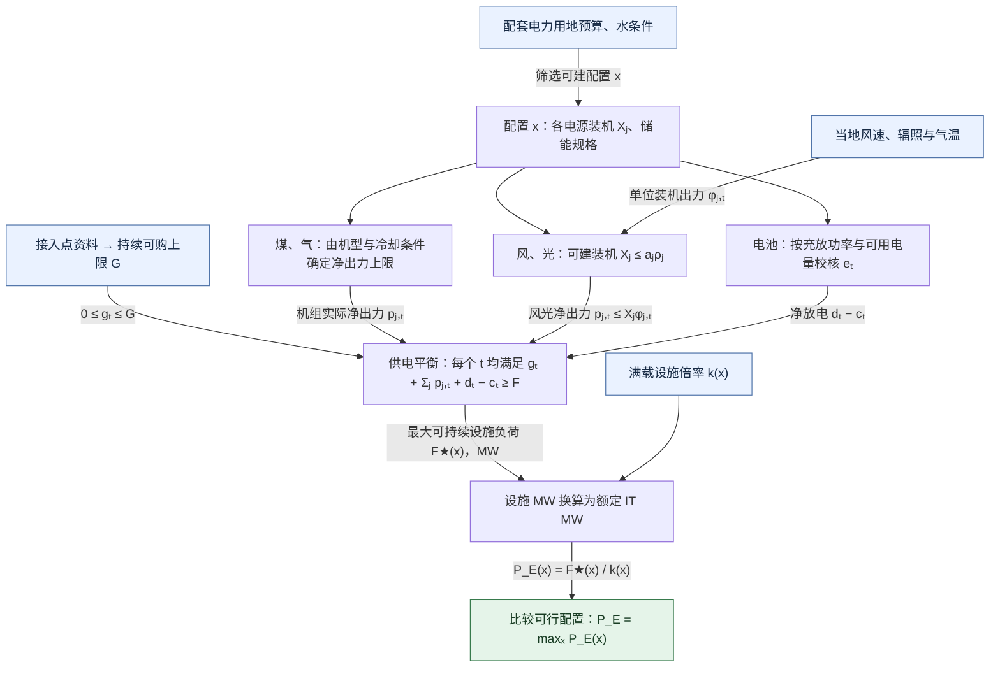

# 第一问 · 固定电网与园区自建电源下的电力承载上限

## 1　研究问题与模型结构

给定一个场址，公共电网能向新增园区交付的功率有限。园区还可以利用当地土地、水和燃料建设配套电源，并配置储能。我们用 $P_E$ 表示在这些条件下能够可靠支撑的最大额定 IT 负载，单位为 MW。IT 负载包括服务器、加速器、存储及网络设备。冷却与供配电损耗在设施侧另行核算。

本模型比较设施建成后的**终态配置**。公共电网保持给定规模，煤电、燃气、风电、光伏和储能是候选方案。配套工程的建设周期决定该配置最早何时能够实现。容量按若干代表性设计工况分别校核，基准采用电网正常运行条件，风光方案校核同一供电配置经历的日照、夜间及当地低出力过程。工况之间没有先后顺序。本文所称“可靠”指同一套设备在事先指定的工况和持续时长内都能履行服务要求。正常运行的实际负载可以波动；在承诺保障额定负载的设计工况中，须检验满载供电能力。

模型采用**外层估容量、内层验运行**的结构。外层给定场址、候选终态配置和服务要求，求一个额定 IT 容量上限 $P_E$（MW）。内层借鉴 Goiri 等的 GreenSwitch 多电源平衡和储能模型 [1, §5.2，式（6）–（13）]。需要检验连续供电时，以 $t$ 标记设计工况内部的运行时段，风光或电网可用功率可作为给定序列输入。在整个校核过程中，场址与设备配置固定。设计工况的选择、设施辅助功率核算及最大 IT 容量判据由本研究确定。

*图 1　电网正常运行、满载倍率取定值时的容量计算。箭头标出各节点传递的量。设备配置 $x$ 在运行校核全程固定。各方案采用相同的资源预算与服务要求。*

图中 $j$ 表示电源技术，$t$ 表示内部校核时段。$a_j$ 为分配给该技术的合格面积（km²），$\rho_j$ 为装机密度（MW/km²）。$g_t$ 为购电功率，$p_{j,t}$ 为各电源送达园区的净出力，$c_t,d_t$ 分别为充、放电功率，均以 MW 计；$e_t$ 为储能荷电量（MWh）。电池只以净放电进入园区平衡，重复周期按式（6a）校核并恢复期初荷电量。$F^\star(x)$ 表示整个校核周期能维持的最大恒定设施负荷。若满载倍率随时段变化，在每个时段用 $k_t(x)P$ 替换图中的 $F$，直接求最大可行 IT 容量 $P$。

## 2　固定电网能交付多少电力

以 $s$ 标记需要保障的一种设计工况。每个工况采用同一组能同时出现的电网负荷、天气和设备状态。设 $G_{s}$ 为电网在园区接入点可供该项目取用的净有功功率，$b_{s}$ 为实际购电功率，两者单位均为 MW。基准方案允许弃电，购电满足

$$
0\le b_{s}\le G_{s}. \tag{1}
$$

优先从项目接入评估或供电协议确定 $G_{s}$。运营商分别给出正常和事故取电额度时，两者对应不同情景。EirGrid 与 SONI 的规划报告给出了按接入节点及事故条件评估新增负荷的实例 [2, §8.5]。若资料只有变电站净开放余量（MVA），可乘同工况功率因数换为 MW，作为初筛上界。随后还要核查上游通道和项目接入条件。已经扣除既有负荷的净余量只扣一次。

## 3　场址允许建设哪些自建电源

令 $x$ 表示一套包括发电、储能、专线和变电设施的配置，$\mathcal X$ 表示在给定场址及资源预算下可选的配置集合。形成这个集合有两层判断：设备能否建在这里，以及这些设备在当地工况下能输出多少电。

**配套设施用地。** 土地模块给出配套电力设施可用地 $A_{\mathrm{elec}}^{\mathrm{budget}}$。合并方案 $x$ 新增发电、储能、变电和接线设施所占地块，得到 $A_{\mathrm{elec}}(x)$。电站围栏内已包括的升压站和电池区只计一次。风场间距面积、线路走廊与永久扰动面积应按土地模块采用的口径分别记录 [3]。方案须满足

$$
A_{\mathrm{elec}}(x)\le A_{\mathrm{elec}}^{\mathrm{budget}}. \tag{2}
$$

**风电与光伏。** 按 Parzen 等的方法，从满足地形、生态、退距及权属条件的地块估算装机潜力 [4, Fig. 6]。设 $a_{ij}$ 为地块 $i$ 实际分给技术 $j$ 的面积（km²），$\rho_{ij}$ 为该处装机密度（MW/km²）。选定装机 $X_j$ 后，按当地同期气象和设备特性计算每 MW 装机在指定工况内可保障的净出力比例 $\phi_{j,s}$ [5]。实际送达功率 $p_{j,s}$ 满足

$$
X_j\le \sum_i a_{ij}\rho_{ij},\qquad
0\le p_{j,s}\le X_j\phi_{j,s}. \tag{3}
$$

历史同步气象与负荷序列可用于提取工况，如把少风与夜间无光组合成当地有依据的低出力工况。同一工况采用可维持的出力值，估计的保障程度取决于所选工况及其覆盖范围。采用直流侧光伏装机时，出力换算应包含逆变器效率及交流容量限制。共享地块上的设备布局须能同时实现。

**煤电与燃气。** 先根据厂房、燃料设施和冷却系统所需空间确定候选机组，再从机组设计资料取得净出力与净热耗。NETL 的煤电与燃气联合循环基准提供了按机型进行性能核算的实例 [6]。对受淡水冷却约束的机组，可借鉴 Jones 等的方法，按水温、可取流量与允许温升估计可用容量 [7]。

设 $\bar P_{j,s}^{\rm net}$ 为候选机组在当地设计条件下可连续送到园区的净电功率（MW），已计入厂用电和适用的冷却降额，则

$
0\le p_{j,s}\le \bar P_{j,s}^{\rm net}. \tag{4}
$

燃气方案采用燃料可持续供应的设计假设，估算值标作该条件下的容量上界。若要说明这一上界的成立条件，可在算完后用目标燃气净出力除以机组净效率，反推所需的燃料热功率（MW 热）；若要换算成标准立方米/小时，再采用对应热值。若项目文件已有供气保障下的净出力，直接用该值。

## 4　多路电源在同一工况能交付多少功率

借鉴 GreenSwitch 对电网、可再生电源和电池供给 IT 负荷的分解 [1, §5.2，式（6）–（8）]，本文将供电边界扩展到园区设施总进线。令 $u_s$ 为储能在工况 $s$ 中可保障的放电功率（MW）。对给定配置 $x$，在给定购电额度和可同时实现的机组、储能出力范围内，取可同时交付的最大设施功率：

$$
F_s(x)=\max_{\text{工况 }s\text{ 内的可行供电组合}}
\left(b_s+\sum_j p_{j,s}+u_s\right). \tag{5}
$$

基准假设自建电源随厂配建足额的专用变配电及接线设施，园区内部配电按设计负荷配置，其新增用地计入式（2）。公共电网自身的接入限制由式（1）的购电上限体现。

**储能的静态处理。** 无储能对照取 $u_s=0$。光伏加储能作为正常运行候选方案，按下文式（6a）检验白天可充电量能否覆盖夜间缺口。若另有明确时长的单次事故，设 $h_s>0$ 为要求维持的小时数，$E_s^{\rm use}$ 为在该事件开始时有依据保证可动用的电池内部电量（MWh），已扣除其他服务须保留的部分。设 $P_{\rm dis}^{\max}$ 为额定放电功率，$\eta_{\rm dis}$ 为放电效率，则恒定放电必须同时满足功率上限和能量上限：

$$
0\le u_s\le\min\!\left(P_{\rm dis}^{\max},
                      \frac{\eta_{\rm dis} E_s^{\rm use}}{h_s}\right).
\tag{6}
$$

$h_s$ 是一次事件的设计参数。式（6）是本文对单次恒定缺口的简化。若事件开始时可动用的电量缺乏依据，取零作为保守基准。

**连续工况的内部校核。** 对缺口变化或需要回充的工况，采用 Goiri 等的荷电量递推 [1, §5.2，式（9），容量界限见原式（10）–（13）]。以下将原文的充电来源合并，并将充、放电效率分别记为 $\eta_c,\eta_d$。令 $e_t$ 为时段初的内部电量（MWh），$p_t^+,p_t^-$ 为交流侧充、放电功率（MW），$\Delta t$ 为时段长度（小时）。省略固定的工况下标 $s$ 后，等价的能量收支结构写为 光储方案在代表性运行周期取期末荷电量等于期初，逐时满足充、放电功率额定值和可动用能量上限；地点数据允许时，再校核连续低日照过程。若设施倍率随时段变化，直接检验每个时段能否满足相同 IT 负载及其对应的辅助用电。

$$
e_{t+1}=e_t+\eta_c p_t^+\Delta t-\frac{p_t^-\Delta t}{\eta_d}.
\tag{6a}
$$

给定有依据的期初电量，各时段分别校核充放功率、荷电上下限和应急预留，并限定同一电池的充放方向。重复周期还要求期末恢复期初电量。在这种校核中，以多时段功率平衡替代式（5）的单工况求和：每一时段的购电与自发电之和加 $p_t^- - p_t^+$ 均须覆盖同一待检验设施负荷，充电同时占用供电能力。能通过整个过程的最大恒定设施负荷作为 $F_s(x)$ 返回式（7）。式（6）与式（6a）按工况选用，电池贡献只计一次。连续短缺对后续可用电量的影响也见 Sioshansi 等 [8]。

## 5　由设施侧功率求电力承载上限

设待检验的额定 IT 容量为 $P$。在必须保障额定负载的工况，冷却、供配电损耗等所需辅助功率为 $P_{\mathrm{aux},s}(P;x)$。ITU-T L.1300 建议分别计量设施整体与 ICT 设备的能源使用 [9, §12.1]。据此在同一设施边界内要求

$$
P+P_{\mathrm{aux},s}(P;x)\le F_s(x). \tag{7}
$$

若满载附近辅助功率与 IT 功率近似成比例，式（7）左侧可写成 $k_{s}(x)P$，其中 $k_{s}(x)$ 为该工况下设施总功率与 IT 功率之比，应取自同步测量或设计负荷表。高温既可能降低燃机出力，又可能提高机房制冷用电，因此应在同一工况内配对供电与倍率。年度 PUE 用于估计年电量，设计工况倍率用于检验额定容量。

对给定配置 $x$，以 $\mathcal S$ 表示必须保障额定负载的工况集合。工况内各路供电已通过式（5）联合校核。采用设计倍率近似时，

$$
P_E(x)=\min_{s\in\mathcal S}\frac{F_s(x)}{k_s(x)},\qquad
P_E=\max_{x\in\mathcal X}P_E(x). \tag{8}
$$

每套建成配置通过同一组工况检验，最低的可支撑 IT 容量决定该配置的保障上限。比较所有候选配置，取其中最高者。若辅助负荷明显非线性，直接按式（7）求各工况的可行上限。若只枚举有限方案，结果即为这些方案中的最大值。

**输出与模型衔接。** 对每套方案保存 $P_E(x)$、首先触及的约束和对应工况，并向水、土地模块返回装机、工况出力、发生地点及新增占地。年度发电量及其对应取耗水量须结合另行给定的运行小时或年负荷率核算。后续应对同一方案计算 $\min\{P_E(x),P_W(x),P_L(x)\}$，再比较方案。单独实现电力分项最大值的配置，在水或土地受限时可能不再占优。

**计算实现。** 固定候选配置后，逐个工况求可交付功率。单次恒定缺口可用式（6）初筛；涉及连续充放电的过程用式（6a）与各时段的功率平衡联合校核。外层再按式（7）或（8）确定 IT 容量。线性规划或 PyPSA 均可实现上述约束 [10]。

## 参考文献

[1] Goiri I, Katsak W, Le K, Nguyen T D, Bianchini R. Parasol and GreenSwitch: Managing datacenters powered by renewable energy. *Proceedings of the 18th International Conference on Architectural Support for Programming Languages and Operating Systems (ASPLOS)*, 2013. [DOI: 10.1145/2451116.2451123](https://doi.org/10.1145/2451116.2451123).

[2] EirGrid, SONI. *All-Island Ten Year Transmission Forecast Statement 2019*. 2019, §8.5. [运营商报告](https://cms.soni.ltd.uk/sites/default/files/media/documents/All-Island-Ten-Year-Transmission-Forecast-Statement-2019.pdf).

[3] Lovering J, Swain M, Blomqvist L, Hernandez R R. Land-use intensity of electricity production and tomorrow’s energy landscape. *PLOS ONE*, 2022, 17(7), e0270155. [DOI: 10.1371/journal.pone.0270155](https://doi.org/10.1371/journal.pone.0270155).

[4] Parzen M, Abdel-Khalek H, Fedotova E, et al. PyPSA-Earth. A new global open energy system optimization model demonstrated in Africa. *Applied Energy*, 2023, 341, 121096. [DOI: 10.1016/j.apenergy.2023.121096](https://doi.org/10.1016/j.apenergy.2023.121096).

[5] Hofmann F, Hampp J, Neumann F, Brown T, Hörsch J. atlite: A lightweight Python package for calculating renewable power potentials and time series. *Journal of Open Source Software*, 2021, 6(62), 3294. [DOI: 10.21105/joss.03294](https://doi.org/10.21105/joss.03294).

[6] National Energy Technology Laboratory. *Cost and Performance Baseline for Fossil Energy Plants, Volume 1: Bituminous Coal and Natural Gas to Electricity*. DOE/NETL-2025/5313, 2025. [美国能源部报告](https://www.osti.gov/servlets/purl/2589925).

[7] Jones E R, et al. A multi-model assessment of global freshwater temperature and thermoelectric power supply under climate change. *Environmental Research: Water*, 2025, 1, 025002. [DOI: 10.1088/3033-4942/addffa](https://doi.org/10.1088/3033-4942/addffa).

[8] Sioshansi R, Madaeni S H, Denholm P. A dynamic programming approach to estimate the capacity value of energy storage. *IEEE Transactions on Power Systems*, 2014, 29(1), 395–403. [DOI: 10.1109/TPWRS.2013.2279839](https://doi.org/10.1109/TPWRS.2013.2279839).

[9] International Telecommunication Union. *Best practices for green data centres*. Recommendation ITU-T L.1300, 2014. [ITU 标准目录](https://www.itu.int/rec/T-REC-L.1300-201406-I/en).

[10] Brown T, Hörsch J, Schlachtberger D. PyPSA: Python for power system analysis. *Journal of Open Research Software*, 2018, 6(1), 4. [DOI: 10.5334/jors.188](https://doi.org/10.5334/jors.188).
