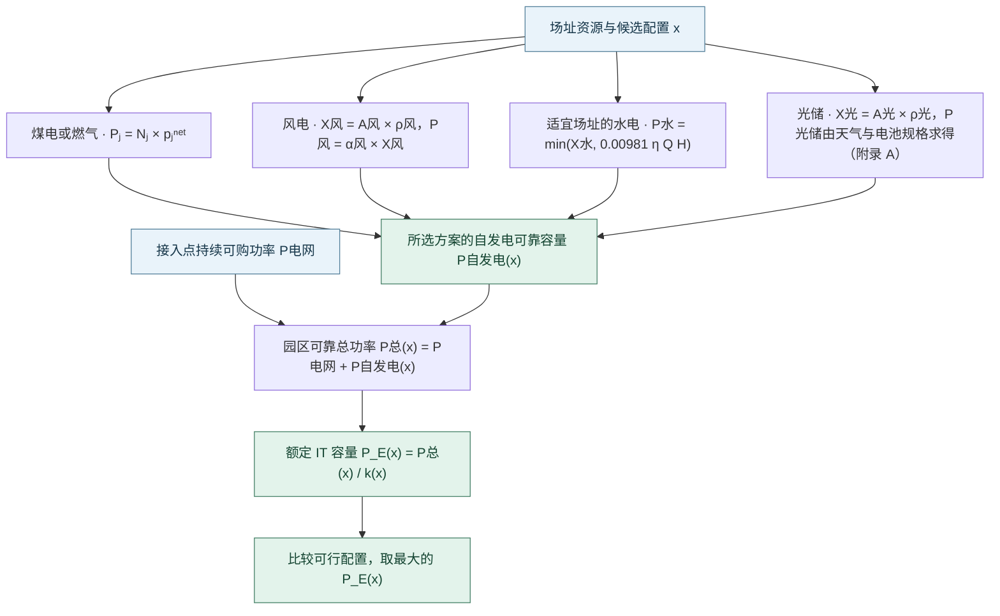

# 第一问　电力能支撑多大的 AI 数据中心？（模型介绍 v2）

## 1　从园区可获得的电力出发

光伏电站可以在晴天中午为园区供电，服务器却需要在日落后继续运行。因此，要估计一个场址能容纳多少 IT 设备，首先要确定园区在考察期内始终能维持多大的负荷。我们将这一功率定义为园区的**可靠供电容量**。设 $x$ 为一套已建成的供电方案。在公共电网正常运行时，园区的可靠供电容量由两部分组成（单位均为 MW）。

$$
\boxed{P_{\mathrm{总}}(x)=P_{\mathrm{电网}}+P_{\mathrm{自发电}}(x).}
\tag{1}
$$

$P_{\mathrm{电网}}$ 是电网在接入点可持续交付给园区的功率。$P_{\mathrm{自发电}}(x)$ 是在电网已承担这部分负荷的条件下，自建电源还能持续供给的净功率。两项都按园区进线处计量。式（1）由此把问题归结为两步。先确定场址能得到多少可靠供电，再扣除冷却和配电所需的功率，求出额定 IT 容量。

对同一场址，各方案共用一张规模固定的公共电网。电网项优先采用供电方核定的项目可交付容量。若只查到变电站可开放的视在功率（MVA），则按功率因数折算为 MW，作为场址初筛上界 [1]。自建电厂按设计功率配备专用接线和变电设施，相关用地计入方案。题面提到的燃机交付期决定方案最早何时可用。本节计算各项设施建成后的容量。

*图 1　从场址供电到额定 IT 容量。沿一条自建电源支路可得到相应方案的容量。风、光共用电池时，按附录 A 合并计算。*

## 2　当地条件能支持多少自发电？

我们在同一份配套电力用地预算内比较煤电、燃气、风电和光伏。在具有可开发水能的场址，另设水电方案。用地按实际占用的地块统计。例如，光伏电站围栏内若已包含升压站和电池区，这两个区域只计一次。对每种电源，我们依次回答两个问题。当地装得下多少设备，这些设备又能持续供给多少功率？

### 火电：能布置多少台，每台能供多少电

对燃煤或燃气电厂，土地与配套设施决定可以布置的机组数量，当地运行条件决定每台机组能送出多少电。设 $N_j$ 为可同时投入正常运行的同型号机组数，$p_j^{\rm net}$ 为单台机组持续送达园区的净功率。该技术的可靠容量为

$$
P_j=N_jp_j^{\rm net},\qquad j\in\{\text{煤电},\text{燃气}\}.
\tag{2}
$$

单机净功率取自项目或机型的设计资料，已扣除电厂自身用电 [2]。若当地河流在枯水期难以满足湿冷机组的冷却需求，就按该期流量与水温修正单机净功率 [3]。对燃气方案，我们报告供气充足条件下的容量上界。将式（2）的净功率除以机组净效率，即可反算实现这一上界所需的燃料热功率。

### 风电：从可用土地到可靠容量

同一片土地能装下多少风机，可以从面积估计。按 Parzen 等的地理潜力方法 [4]，设 $A_{\mathrm{风}}$ 为分配给风电的合格面积（km²），$\rho_{\mathrm{风}}$ 为当地布置条件下的装机密度（MW/km²）。两者的乘积给出可建装机 $X_{\mathrm{风}}$。其中能在考察期内持续供电的比例记为 $\alpha_{\mathrm{风}}$，则

$$
X_{\mathrm{风}}=A_{\mathrm{风}}\rho_{\mathrm{风}},
\qquad
P_{\mathrm{风}}=\alpha_{\mathrm{风}}X_{\mathrm{风}}.
\tag{3}
$$

为确定 $\alpha_{\mathrm{风}}$，用当地同期风速和所选机型的功率曲线估计风场净功率 [5]。若风电单独承担一份恒定负荷，能保证的功率取决于考察期内风最弱时风场还能供多少电。此时，$\alpha_{\mathrm{风}}$ 取该期最低净功率与装机之比。如果风场一度停机，风电对这份恒定负荷的独立保障容量为零，其他时段的发电仍可减少购电量。

### 水电：可用流量与落差共同决定功率

在适宜开发水电的场址，水轮机可利用的水量和落差共同决定发电能力。设 $Q$ 为预留生态下泄并满足其他用水要求后，可持续通过机组的流量（m³/s），$H$ 为同一条件下的净落差（m），$\eta_{\mathrm{水}}$ 为综合转换效率。水流能提供的电功率还受装机容量 $X_{\mathrm{水}}$ 限制，因此取两者中的较小值 [6]。

$$
P_{\mathrm{水}}=\min\!\left\{X_{\mathrm{水}},\;
0.00981\,\eta_{\mathrm{水}}QH\right\}.
\tag{4}
$$

系数 0.00981 来自淡水密度、重力加速度及 W 到 MW 的单位换算。若要保障枯水期的运行，就用枯水期可利用的流量及对应落差。式（4）只用于园区专用水电。公共电网中水电机组的供电已计入式（1）的电网项。

### 光伏与储能：白天的富余电能否撑过夜间

设 $A_{\mathrm{光}}$ 与 $\rho_{\mathrm{光}}$ 分别为光伏可用面积与装机密度，则充分布置后的光伏装机为 $X_{\mathrm{光}}=A_{\mathrm{光}}\rho_{\mathrm{光}}$ [4]。计算送达功率时统一换算到交流侧。光伏可以在白天减少购电；若考察期包含夜间且没有储能，光伏独自持续补充的恒定功率为零。

储能改变了这一结论，但能增加多少全天容量，取决于白天能存下多少电，以及这些电能否撑过夜间。Goiri 等在 Parasol 实验机房中，用 GreenSwitch 协调光伏供电与电池充放电 [7]。我们借用其功率与能量平衡关系，求一套光储配置能够持续承担的最大恒定负荷。

$$
P_{\mathrm{光储}}=
f_{\mathrm{光储}}\!\left(X_{\mathrm{光}},\,\mathcal W,\,
C_{\max},\,D_{\max},\,E_{\mathrm{可用}},\,\eta_c,\,\eta_d\right).
\tag{5}
$$

这里 $\mathcal W$ 包含考察期内当地的日照与气温，$C_{\max}$ 和 $D_{\max}$ 分别为电池的最大充、放电功率（MW）。$E_{\mathrm{可用}}$ 是扣除应急预留后可动用的电量（MWh），$\eta_c$ 和 $\eta_d$ 分别为充、放电效率。附录 A 按时段检验供电，并要求期末电量恢复到期初。这样，一个白天充得满、却无法撑过整夜的方案，其容量会受夜间供电限制。若风电与光伏共用电池，则将两者同期的可用功率一起代入附录 A。

## 3　换算成最大 IT 容量

将各方案的自发电可靠容量代回式（1），便得到园区总进线可以持续支撑的功率。对纯电网基准，取 $P_{\mathrm{自发电}}=0$。在园区内部，进线功率既要供给服务器、存储和网络设备，也要维持冷却和配电。按照设施侧与 IT 侧分项计量的口径 [8]，设 $k(x)$ 为设计满载时的设施用电倍率，则方案 $x$ 所能支撑的额定 IT 容量为

$$
k(x)=\frac{\text{设计满载时的设施总功率}}{\text{同一工况的 IT 功率}},
\qquad
\boxed{P_E(x)=\frac{P_{\mathrm{电网}}+P_{\mathrm{自发电}}(x)}{k(x)}.}
\tag{6}
$$

式（6）按每套方案采用固定的满载设计倍率。若只有同类设施公布的年度 PUE，可用它近似 $k(x)$，并注明取值的设施类型和统计周期。年度 PUE 衡量全年设施总电量与 IT 电量之比，采用这一近似的前提是满载时的辅助用电占比接近全年平均水平。

在相同场址预算和服务要求下，最大的 $P_E(x)$ 给出候选方案中的电力承载上限。联合评估时，还要看这套方案的用水和用地。例如，燃气方案即使能提供更多电力，也可能先用尽当地分给冷却系统的水量。因此，我们先对每套方案分别取 $\min\{P_E(x),P_W(x),P_L(x)\}$，再比较这些结果。这样得到的规模对应一套可以共同满足三项约束的配置。

## 附录 A　光储可靠容量的计算

Goiri 等在 GreenSwitch 中按时段分配电网、光伏和电池功率，并追踪电池剩余电量 [7, §5.2，原式（6）–（13）]。本文沿用功率与能量平衡，将目标改为求整个考察期都能供给的最大附加负荷 $L$。公共电网的持续供电已由式（1）计入，附录只核算自建电源增加的部分。

将考察期划为 $T$ 个长度为 $\Delta t$ 小时的时段。设备配置始终固定，$t$ 只标记运行时段。设 $r_t$ 为可用光伏净功率（MW），由装机和同期气象转换得到 [5]；$c_t,d_t$ 分别为充、放电功率（MW），$e_t$ 为时段初的可动用电量（MWh）。每个时段须满足

$$
r_t+d_t\ge L+c_t,\qquad
e_{t+1}=e_t+\eta_c c_t\Delta t-\frac{d_t\Delta t}{\eta_d}.
\tag{A1}
$$

不等式允许弃电。充电使用当时的供电余量，电池还需满足

$$
0\le c_t\le C_{\max},\quad 0\le d_t\le D_{\max},\quad
0\le e_t\le E_{\mathrm{可用}},\quad e_{T+1}=e_1 .
\tag{A2}
$$

式（A2）的电量上下限覆盖全部状态，包括期末。每个时段只采用一种充放方向。周期首尾电量相同是本研究的边界条件，确保一个周期的供电能够靠该周期内的发电补回。于是

$$
f_{\mathrm{光储}}=\max\{L\ge0:\ \text{存在满足式（A1）、（A2）的全周期运行安排}\}.
\tag{A3}
$$

考察期决定结果可以外推到哪里。若只校核一个晴天，所得上限只说明该昼夜循环能够维持。要估计场址在连续低日照期间的可保障容量，记录也应覆盖相应天气过程。若温度同时影响发电与机房冷却，可在式（A1）左端加入固定的 $P_{\mathrm{电网}}$，将右端的 $L$ 换成当时的设施负荷 $k_tP$，求所有时段均可维持的最大 IT 容量 $P$。

## 参考文献

[1] EirGrid, SONI. *All-Island Ten Year Transmission Forecast Statement 2019*. 2019, §8.5. [机构报告](https://cms.soni.ltd.uk/sites/default/files/media/documents/All-Island-Ten-Year-Transmission-Forecast-Statement-2019.pdf).

[2] National Energy Technology Laboratory. *Cost and Performance Baseline for Fossil Energy Plants, Volume 1: Bituminous Coal and Natural Gas to Electricity*. DOE/NETL-2025/5313, 2025. [美国能源部报告](https://www.osti.gov/servlets/purl/2589925).

[3] Jones E R, et al. A multi-model assessment of global freshwater temperature and thermoelectric power supply under climate change. *Environmental Research: Water*, 2025, 1, 025002. [DOI](https://doi.org/10.1088/3033-4942/addffa).

[4] Parzen M, Abdel-Khalek H, Fedotova E, et al. PyPSA-Earth. A new global open energy system optimization model demonstrated in Africa. *Applied Energy*, 2023, 341, 121096. [DOI](https://doi.org/10.1016/j.apenergy.2023.121096).

[5] Hofmann F, Hampp J, Neumann F, Brown T, Hörsch J. atlite: A lightweight Python package for calculating renewable power potentials and time series. *Journal of Open Source Software*, 2021, 6(62), 3294. [DOI](https://doi.org/10.21105/joss.03294).

[6] U.S. Department of Energy. *Microhydropower Handbook*, Appendix A1, Development of the Power Equation. 1983. [美国能源部手册](https://www.energy.gov/sites/default/files/2019/01/f59/Microhydropower_Handbook_2.pdf).

[7] Goiri I, Katsak W, Le K, Nguyen T D, Bianchini R. Parasol and GreenSwitch: Managing datacenters powered by renewable energy. *Proceedings of the 18th International Conference on Architectural Support for Programming Languages and Operating Systems (ASPLOS)*, 2013. [DOI](https://doi.org/10.1145/2451116.2451123).

[8] International Telecommunication Union. *Best practices for green data centres*. Recommendation ITU-T L.1300, 2014, §12.1. [ITU 标准目录](https://www.itu.int/rec/T-REC-L.1300-201406-I/en).
