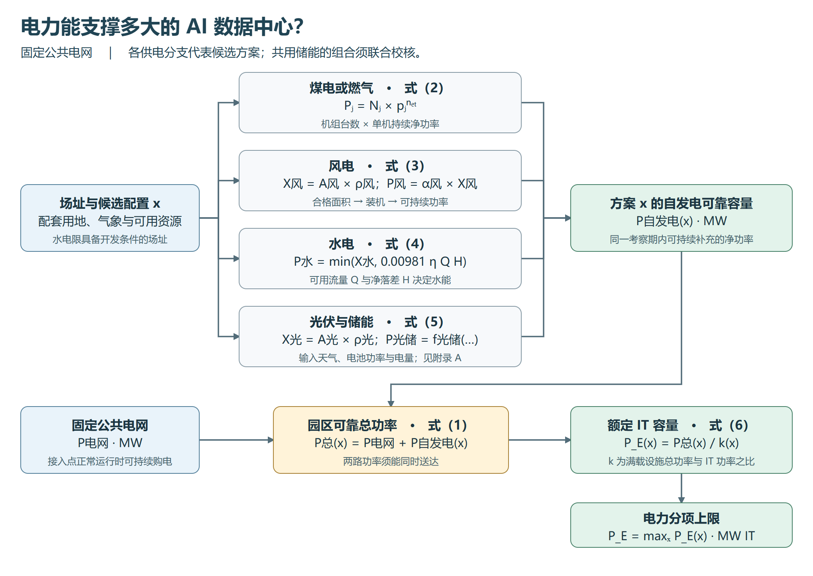
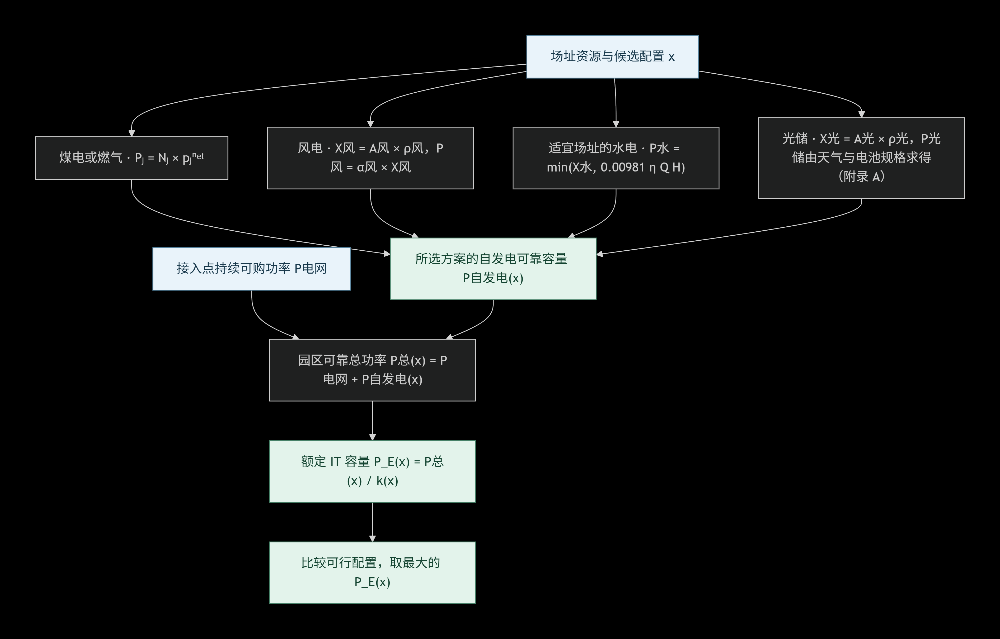

# IMMC2027\-Q1


## 核心定义01

**AI 数据中心（AIDC）**：AI 数据中心（AIDC）是专为人工智能模型训练、推理及大规模数据处理设计的数据中心，集成 GPU 等加速算力、高密度供电、高速网络、大容量存储及液冷等散热系统，以支撑 AI 应用的规模化运行。其规模通常以算力性能和 IT 电力容量衡量。

**集中式 AIDC**：本研究沿用题目对 AIDC 的定义，将“集中式 AIDC”界定为主要 IT 设备集中部署于单一场址或地理相邻园区，并由相应的供配电和冷却基础设施支持运行的设施整体。其中，IT 设备包括服务器、GPU 等加速设备、存储及网络设备；供配电损耗、冷却等辅助需求另行核算。

> Epoch 将 AI 数据中心定义为位置相近、共享硬件所有者或设施运营商、运行 AI 专用硬件的一栋或多栋建筑。
> 
> 

- **标准运营模式**：本研究以建成后正常运行的集中式 AIDC 为对象，在给定的**设备配置**、**任务负载**和**服务可用性**要求下，由**供配电系统**向 IT 设备及辅助设施供能，由**冷却系统**排出运行产生的热量。实际负载可以随时段变化，不假设全年满载。**供电来源及冷却方式作为可替换的技术方案，其资源需求分别核算**；备用与冗余能力用于满足既定服务要求，不与正常生产容量重复计算。

> - ITU\-T《绿色数据中心最佳实践》提出，应分别计量设施整体与 ICT 设备的能源使用，整体口径包括供电处理、配电和冷却。欧盟《2024/1364 号条例》将额定 IT 负载定义为：供配电与环境控制基础设施在满足所要求的服务可用性时，能够支撑的最大 IT 负载。这些文件支持本研究的系统划分和容量口径，具体运行参数仍由本研究明确设定。
> 
> 

**规模度量**：依据第一问，本研究以 IT 电力容量 $P_{\mathrm{IT}}$（MW）衡量规模，即在规定运行条件和服务可用性要求下，设施能够支撑的 IT 负载容量。该量区别于设备标称功率的简单加总、设施总功率及年耗电量，也不直接等同于算力性能。

来源：[Epoch AI](https://epoch.ai/data/ai-data-centers)、[ITU\-T L\.1300](https://www.itu.int/rec/T-REC-L.1300/en)、[欧盟《2024/1364 号条例》第二条](https://eur-lex.europa.eu/eli/reg_del/2024/1364/oj/eng)。


把 **IT 功率 **$P$ 变成资源压力存在三种途径，

p=min\(pe,pw,p\)


# 总假设

**1\.固定场址与建成配置:** 本文考察某一给定场址在考察期内的建成状态，不模拟逐年扩建、设备退役或电网规划的动态过程，其中允许出现正常的日夜、季节性波动等，但不考虑长期大范围变更。候选设施视为已经建成并处于设计运行状态。建设工期只用来判断某一方案在哪一年具备投运条件，不改变其建成后的容量上限。


**2\.正常运营:** 本模型认为所有设施始终处于正常运营条件下，不考虑事故备用或可靠性评估。设计工况内出现的枯水、高温和风光低出力属于正常波动，仍纳入容量校核；超出设计范围的极端灾害不在基准结果内，必要时作为敏感性情景另行讨论。可能使场址本身不适合建设的地质灾害、洪泛区和生态敏感区，在选址阶段即予排除，而不作为运行期事故处理。本文的基准结果不包含 N\-1 或概率可靠性要求；若采用这类标准，需要另设情景并在附录中说明。


**3\. 同口径比较：** 本文的所有候选方案都在同一场址、同一考察期、同样的可用土地与水资源上限和同一服务要求下评估。园区在考察期内须能支撑额定 IT 负载，实际负载可随时间变化；电力、水和土地三个上限按同一设计工况计算。各子模型中的关键效率和出力参数取设计值，配套的变电、配电和取输水设施按设计容量配置，不作为额外瓶颈。

# 电



## 0    模型假设

### 电力承载上限模型的基本假设

1. 场址与设施配置固定： 本文评估最大可持续规模；此时公共电网规模保持固定，自建电源、储能和配套设施均已投运。建设工期等仅决定该方案最早可实现的时间，不影响最终上限。

2. 公共电网正常供电： 考察期内，公共电网能够在园区接入点持续提供给定的有功功率，不发生导致断电或供电不足的特殊故障。

3. 配套设施能够输送设计功率： 自建电源配备与其净供电能力相匹配的变电设施，园区内部配电系统不会过载。因此，电网购电与自发电均按园区进线处的净功率计量。

4. 各方案采用相同的资源预算和服务要求： 各候选方案在同一场址、同一考察期和相同的可用土地与水资源预算下进行比较。容量校核要求园区在考察期内均能支撑额定 IT 负载，实际运行负荷可随任务需求变化。共用地块只计一次，备用设备仅用于维持既定服务要求。

5. 满载时的设施用电倍率近似固定： 对给定的设备与冷却方案，假设满载附近的设施总功率与 IT 功率之比 $k$ 近似不变，即正文式（6）中的 $k(x)$ 取固定值。缺少满载设计数据时，采用同类设施的年度 PUE 近似 $k$，并假设其全年平均辅助用电占比能够代表满载条件。

### 各类自建电源的补充假设

6. 火电机组按当地条件持续运行： 纳入计算的机组可同时正常运行，单机净功率已扣除厂用电，并反映当地设计条件。燃气方案假设燃料供应充足，其结果为该条件下的容量上界。对受冷却水限制的机组，采用相应水量和水温下能够维持的净功率。

7. 风电、光伏与水电采用当地资源条件： 对给定机型和布置方式，风电与光伏的可建装机容量与合格用地面积成正比。其供电能力按当地同期气象记录估算，结果适用于记录覆盖的天气条件。水电方案采用扣除生态下泄和其他用水需求后的可用流量，以及同一条件下的净落差。

8. 储能可在考察期内重复运行： 电池充放电受额定功率、可用电量和效率限制，可用电量已扣除应急预留。对于重复运行的周期，假设期末电量恢复至期初水平，以保证夜间供电所用电量能够在周期内补回。

## 1　从园区可获得的电力出发


光伏电站可在晴天中午为园区供电，但服务器需在日落后继续运行。因此，估计一个场址可容纳多少 IT 设备，首先要确定园区在考察期内能够持续维持多大的负荷。本文将这一功率定义为园区的**可靠供电容量**。设 $x$ 为一套已建成的供电方案。在公共电网正常运行时，园区的可靠供电容量由两部分组成（单位均为 MW）：


$$
\boxed{P_{\mathrm{总}}(x)=P_{\mathrm{电网}}+P_{\mathrm{自发电}}(x)}
\tag{1}
$$


其中，$P_{\mathrm{电网}}$ 为电网在接入点可持续交付给园区的功率；$P_{\mathrm{自发电}}(x)$ 为在电网已承担相应负荷的条件下，自建电源仍能持续供给的净功率。两项均按园区进线处计量。式（1）将问题归结为两步：先确定场址可获得的可靠供电容量，再扣除冷却与配电所需的功率，求出额定 IT 容量。


对同一场址，各方案共用规模固定的公共电网。电网项优先采用供电方核定的项目可交付容量；若仅能获得变电站可开放的视在功率（MVA），则按功率因数折算为 MW，作为场址初筛上界 \[1\]。自建电厂按设计功率配备专用接线与变电设施，相关用地计入方案。题面所述燃机交付期决定方案最早何时可用；本节仅计算各项设施建成后的容量。





*图 1　从场址供电到额定 IT 容量。沿一条自建电源支路可得到相应方案的容量。风、光共用电池时，按附录 A 合并计算。*


## 2　当地条件可支持的自发电容量


我们在同一份配套电力用地预算内比较煤电、燃气、风电和光伏；在具有可开发水能的场址，另设水电方案。用地按实际占用的地块统计。例如，光伏电站围栏内若已包含升压站和电池区，这两个区域只计一次。对每种电源，依次回答两个问题：当地可布置多少设备，这些设备又能持续供给多少功率？


### 火电：可布置机组数量与单机净出力


对燃煤或燃气电厂，土地与配套设施决定可布置的机组数量，当地运行条件决定每台机组可送出的功率。设 $N_j$ 为可同时投入正常运行的同型号机组数，$p_j^{\rm net}$ 为单台机组持续送达园区的净功率，则该技术的可靠容量为


$$
P_j=N_jp_j^{\rm net},\qquad j\in\{\text{煤电},\text{燃气}\}.
\tag{2}
$$


单机净功率取自项目或机型的设计资料，已扣除电厂自身用电 \[2\]。若当地河流在枯水期难以满足湿冷机组的冷却需求，则按该期流量与水温修正单机净功率 \[3\]。对燃气方案，本文报告供气充足条件下的容量上界；将式（2）的净功率除以机组净效率，即可反算实现该上界所需的燃料热功率。


### 风电：从可用土地到可靠容量


同一片土地可布置多少风机，可由可用面积估算。按 Parzen 等的地理潜力方法 \[4\]，设 $A_{\mathrm{风}}$ 为分配给风电的合格面积（km²），$\rho_{\mathrm{风}}$ 为当地布置条件下的装机密度（MW/km²），二者乘积给出可建装机 $X_{\mathrm{风}}$。其中能在考察期内持续供电的比例记为 $\alpha_{\mathrm{风}}$，则


$$
X_{\mathrm{风}}=A_{\mathrm{风}}\rho_{\mathrm{风}},
\qquad
P_{\mathrm{风}}=\alpha_{\mathrm{风}}X_{\mathrm{风}}.
\tag{3}
$$


为确定 $\alpha_{\mathrm{风}}$，利用当地同期风速和所选机型的功率曲线估计风场净功率 \[5\]。若风电单独承担一份恒定负荷，可保障功率取决于考察期内风最弱时风场仍可供给的功率；此时，$\alpha_{\mathrm{风}}$ 取该时段最低净功率与装机容量之比。若风场一度停机，则风电对该恒定负荷的独立保障容量为零；其他时段的发电仍可用于减少购电量。


### 水电：可用流量与落差共同决定功率


在适宜开发水电的场址，水轮机可利用的水量与落差共同决定发电能力。设 $Q$ 为扣除生态下泄并满足其他用水要求后，可持续通过机组的流量（m³/s）；$H$ 为同一条件下的净落差（m）；$\eta_{\mathrm{水}}$ 为综合转换效率。水流可提供的电功率还受装机容量 $X_{\mathrm{水}}$ 限制，因此取二者中的较小值 \[6\]：


$$
P_{\mathrm{水}}=\min\!\left\{X_{\mathrm{水}},\;
0.00981\,\eta_{\mathrm{水}}QH\right\}.
\tag{4}
$$


系数 0\.00981 来自淡水密度、重力加速度及 W 到 MW 的单位换算。若要保障枯水期运行，应采用枯水期可利用流量及对应落差。式（4）仅用于园区专用水电；公共电网中水电机组的供电已计入式（1）的电网项。


### 光伏与储能：白天富余电量能否支撑夜间负荷


设 $A_{\mathrm{光}}$ 与 $\rho_{\mathrm{光}}$ 分别为光伏可用面积与装机密度，则充分布置后的光伏装机为 $X_{\mathrm{光}}=A_{\mathrm{光}}\rho_{\mathrm{光}}$ \[4\]。计算送达功率时统一换算至交流侧。光伏可在白天减少购电；若考察期包含夜间且未配置储能，则光伏可独自持续补充的恒定功率为零。


储能可改变这一结论，但其可增加的全天容量取决于白天可存储的电量以及该电量能否支撑夜间负荷。Goiri 等在 Parasol 实验机房中采用 GreenSwitch 协调光伏供电与电池充放电 \[7\]。本文借用其功率与能量平衡关系，求一套光储配置能够持续承担的最大恒定负荷：


$$
P_{\mathrm{光储}}=
f_{\mathrm{光储}}\!\left(X_{\mathrm{光}},\,\mathcal W,\,
C_{\max},\,D_{\max},\,E_{\mathrm{可用}},\,\eta_c,\,\eta_d\right).
\tag{5}
$$


其中，$\mathcal W$ 包含考察期内当地日照与气温；$C_{\max}$ 和 $D_{\max}$ 分别为电池最大充、放电功率（MW）；$E_{\mathrm{可用}}$ 为扣除应急预留后可动用的电量（MWh）；$\eta_c$ 和 $\eta_d$ 分别为充、放电效率。附录 A 按时段检验供电，并要求期末电量恢复至期初水平。由此，一个白天可充满但无法支撑整夜的方案，其容量将受夜间供电限制。若风电与光伏共用电池，则将二者同期的可用功率一并代入附录 A。


## 3　换算为最大 IT 容量


将各方案的自发电可靠容量代回式（1），得到园区总进线可持续支撑的功率。对纯电网基准，取 $P_{\mathrm{自发电}}=0$。在园区内部，进线功率既供给服务器、存储和网络设备，也维持冷却与配电。按照设施侧与 IT 侧分项计量的口径 \[8\]，设 $k(x)$ 为设计满载时的设施用电倍率，则方案 $x$ 可支撑的额定 IT 容量为


$$
k(x)=\frac{\text{设计满载时的设施总功率}}{\text{同一工况的 IT 功率}},
\qquad
\boxed{P_E(x)=\frac{P_{\mathrm{电网}}+P_{\mathrm{自发电}}(x)}{k(x)}.}
\tag{6}
$$


式（6）对每套方案采用固定的满载设计倍率。若仅有同类设施公布的年度 PUE，可用其近似 $k(x)$，并注明取值的设施类型和统计周期。年度 PUE 衡量全年设施总电量与 IT 电量之比；采用该近似的前提是满载时辅助用电占比接近全年平均水平。


在相同场址、资源预算和服务要求下，最大的 $P_E(x)$ 给出候选方案中的电力承载上限。联合评估时，还需考察该方案的用水与用地。例如，燃气方案即使可提供更多电力，也可能首先耗尽当地分配给冷却系统的水量。因此，先排除固定用水已超过预算等不可行方案，再对每套可行方案取 $\min\{P_E(x),P_W(x),P_L(x)\}$，最后比较这些结果。水量校核通过但不产生有限 MW 上限时，取最小值不纳入 $P_W(x)$。由此得到的规模对应一套可共同满足三类约束的配置。


## 附录 A　光储可靠容量的计算


Goiri 等在 GreenSwitch 中按时段分配电网、光伏和电池功率，并追踪电池剩余电量 \[7, §5\.2，原式（6）–（13）\]。本文沿用其功率与能量平衡，将目标改为求整个考察期均可供给的最大附加负荷 $L$。公共电网的持续供电已由式（1）计入，附录仅核算自建电源增加的部分。


将考察期划分为 $T$ 个长度为 $\Delta t$ 小时的时段。设备配置始终固定，$t$ 仅标记运行时段。设 $r_t$ 为可用光伏净功率（MW），由装机与同期气象条件转换得到 \[5\]；$c_t,d_t$ 分别为充、放电功率（MW）；$e_t$ 为时段初的可动用电量（MWh）。每个时段须满足


$$
r_t+d_t\ge L+c_t,\qquad
e_{t+1}=e_t+\eta_c c_t\Delta t-\frac{d_t\Delta t}{\eta_d}
\tag{A1}
$$


该式允许弃电。充电使用当时的供电余量，电池还需满足


$$
0\le c_t\le C_{\max},\quad 0\le d_t\le D_{\max},\quad
0\le e_t\le E_{\mathrm{可用}},\quad e_{T+1}=e_1
\tag{A2}
$$


式（A2）的电量上下限覆盖全部状态，包括期末。每个时段仅采用一种充放方向。周期首尾电量相同是本模型的边界条件，确保一个周期的供电可由该周期内的发电补回。于是


$$
f_{\mathrm{光储}}=\max\{L\ge0:\ \text{存在满足式（A1）、（A2）的全周期运行安排}\}
\tag{A3}
$$


考察期决定结果的可外推范围。若仅校核一个晴天，所得上限只说明该昼夜循环能够维持。要估计场址在连续低日照期间的可保障容量，记录也应覆盖相应天气过程。若温度同时影响发电与机房冷却，可在式（A1）左端加入固定的 $P_{\mathrm{电网}}$，将右端的 $L$ 换成当时的设施负荷 $k_tP$，求所有时段均可维持的最大 IT 容量 $P$。


## 参考文献


\[1\] EirGrid, SONI\. \*All\-Island Ten Year Transmission Forecast Statement 2019\*\. 2019, §8\.5\. [机构报告](https://cms.soni.ltd.uk/sites/default/files/media/documents/All-Island-Ten-Year-Transmission-Forecast-Statement-2019.pdf)\.


\[2\] National Energy Technology Laboratory\. \*Cost and Performance Baseline for Fossil Energy Plants, Volume 1: Bituminous Coal and Natural Gas to Electricity\*\. DOE/NETL\-2025/5313, 2025\. [美国能源部报告](https://www.osti.gov/servlets/purl/2589925)\.


\[3\] Jones E R, et al\. A multi\-model assessment of global freshwater temperature and thermoelectric power supply under climate change\. \*Environmental Research: Water\*, 2025, 1, 025002\. [DOI](https://doi.org/10.1088/3033-4942/addffa)\.


\[4\] Parzen M, Abdel\-Khalek H, Fedotova E, et al\. PyPSA\-Earth\. A new global open energy system optimization model demonstrated in Africa\. \*Applied Energy\*, 2023, 341, 121096\. [DOI](https://doi.org/10.1016/j.apenergy.2023.121096)\.


\[5\] Hofmann F, Hampp J, Neumann F, Brown T, Hörsch J\. atlite: A lightweight Python package for calculating renewable power potentials and time series\. \*Journal of Open Source Software\*, 2021, 6\(62\), 3294\. [DOI](https://doi.org/10.21105/joss.03294)\.


\[6\] U\.S\. Department of Energy\. \*Microhydropower Handbook\*, Appendix A1, Development of the Power Equation\. 1983\. [美国能源部手册](https://www.energy.gov/sites/default/files/2019/01/f59/Microhydropower_Handbook_2.pdf)\.


\[7\] Goiri I, Katsak W, Le K, Nguyen T D, Bianchini R\. Parasol and GreenSwitch: Managing datacenters powered by renewable energy\. \*Proceedings of the 18th International Conference on Architectural Support for Programming Languages and Operating Systems \(ASPLOS\)\*, 2013\. [DOI](https://doi.org/10.1145/2451116.2451123)\.


\[8\] International Telecommunication Union\. \*Best practices for green data centres\*\. Recommendation ITU\-T L\.1300, 2014, §12\.1\. [ITU 标准目录](https://www.itu.int/rec/T-REC-L.1300-201406-I/en)\.


# 水

## 总体关系

我们先估计水源能支持多少新增取水，再考虑水压力和政策是否进一步限制该数值，最后检验给定配置的固定用水、随 IT 负载变化的现场用水和自发电用水。Aqueduct 用“取水量与可用可再生水资源之比”描述水压力；其物理意义是**取水需求占水资源的比例**：比例越高，其他用户竞争越强，枯水时持续供水越容易受到影响。\[1\] 政策上限则回答另一问题：**即使水源有余水，项目最多被允许取得多少**。整体关系为


$$
Q_{\text{DC,max}}
= \min\left\{
Q_{\text{DC,水源}},\;
Q_{\text{DC,压力上限}},\;
Q_{\text{DC,政策上限}}
\right\},\qquad
Q_{\text{固定}}+w_{\text{可变}}P+Q_{\text{发电耗水}}(P)
\leq Q_{\text{DC,max}}.
$$


式中，$P$ 是该时段的 IT 功率；$Q_{DC,max}$ 是用于校核的新增可用水流量；$Q_{\text{固定}}$ 是**给定建成配置**在该时段不随 IT 负载变化的现场用水；$w_{\text{可变}}$ 是现场随 IT 用电增加的用水强度；$Q_{\mathrm{发电耗水}}(P)$ 按实际调用的自发电出力计算；其余三项分别为水源或供水系统、水压力阈值、项目许可或合同给出的上限。各用水项与上限必须采用相同的取水或耗水口径及同一时段；功率用 MW、强度用 L/kWh 时，$w_{\text{可变}}P$ 的数值单位为 m³/h。只有数据确实可得、口径一致且构成**独立上限**时，才把相应约束放入最小值；政策上限缺失时，不得把结果称作已获许可的供水量。水压力阈值未设定时，不纳入该项。

若没有固定项且自发电用水可视为已知常数，原来的 $P_W=(Q_{DC,max}-Q_{\mathrm{发电耗水}})/\mathrm{WUE}$ 是上述不等式在 $w_{\text{可变}}=\mathrm{WUE}>0$ 时的特例。若 $Q_{\text{固定}}>0$，先从预算中扣除它；自发电出力随 $P$ 变化时，应直接求满足不等式的最大 $P$。若 $w_{\text{可变}}=0$ 且无需用水发电，固定项不超过预算时水资源不产生有限的 MW 上限，超过预算时该配置不可行，而非容量为 0。$Q_{\text{固定}}$ 只在所选建成配置内固定；比较不同楼栋数时应逐配置重算。通常 WUE 定义为现场**总用水量**除以同期 IT 用电量，已包含固定项；此处的 $w_{\text{可变}}$ 是分解后的边际强度，不能再将包含固定项的实测 WUE 与 $Q_{\text{固定}}$ 相加，否则会重复计水。\[4\]

## 水源能提供的新增取水量

如果掌握取水河段的基准流量、生态保留流量和其他用户取水量，可以先估计**水源侧**能支持的数据中心新增取水：


$$
Q_{\text{DC,水源}}
= \max\left\{0,\;
Q_{\text{河流}}-Q_{\text{生态}}-Q_{\text{其他取水}}
\right\}
$$


式中，$Q_{DC,水源}$ 是数据中心的水源侧新增取水上界；$Q_{河流}$ 是取水河段在**扣除所计其他取水之前**的同一时段基准流量；$Q_{生态}$ 是该河段必须保留的生态流量；$Q_{其他取水}$ 是同一水源及同一时段内，生活、工业、农业等已有用户的取水量。各项均使用相同流量单位。保留 $max(0, ...)$ 是因为新增取水不能为负。\[2\]\[3\]\[8\]

这是简化的**水量分配情景**，不是官方核准量。$Q_{河流}$ 必须与 $Q_{其他取水}$ 的范围和口径匹配。如果河流数据来自已经受上游取水影响的实测测站，那些上游取水已体现在实测流量中，不能在式中再减一次。尚未实际使用的承诺水量不能直接混进“实际取水”情景；若使用“水权全部行使”情景，应统一改用授权口径。回流水和水库调度影响明显时，简单减法只能用作粗略情景，应优先查相应的分配模型。\[6\]\[9\]

## 缺少水源数据时怎么办

第 2 节的减法式需要河流流量、生态保留和其他取水数据，但现实中常缺其中一项。下面的 A、B、C 是**补数据或直接取得剩余水量的途径**，不是三个必须各算一次并取最小值的约束。直接得到的剩余水量可以替代减法估计，却不能凭一个结果反推出缺少的分项；若拿不到同口径的取水数据，也不强行计算本地 $S$。

### 路径 A：官方或流域数据

优先找取水河段的流量、生态保留目标及分行业取水数据，补齐第 2 节各项；若流域部门直接发布了对应地点、时段的**剩余可分配水量**或可靠可供水量，且已考虑生态要求、已有取水和承诺额度，也可直接作为 $Q_{DC,水源}$ 的依据，不再重复相减。\[2\]\[3\]\[8\]\[9\]

若只能取得河流流量与生态保留流量，可暂时计算：


$$
Q_{\text{水文余量}}=Q_{\text{选定时段流量}}-Q_{\text{生态}}
$$


式中，$Q_{水文余量}$ 是尚未核实其他取水的水文余量；$Q_{选定时段流量}$ 是相应河段、时段的流量；$Q_{生态}$ 是同一河段和时段应保留的生态流量。

这一结果是**尚未核实其他用水的水文余量上界**，不能当作已可供项目取用的水量。下游需求与已承诺水量仍需核实；实测流量已反映的上游取水不得重复扣除。生态流量优先采用当地官方目标，缺失时才参照论文方法设定情景。\[2\]\[3\]

### 路径 B：WAM/WRAP 一类分配模型

若 $Q_{其他取水}$ 或已占用水权难以逐项收集，可以查覆盖当地流域的 WAM/WRAP 一类模型。它们把水权、径流、回流和水库调度放入同一情景，给出剩余可供水量；无需反过来从模型的一个剩余值计算各行业取水。\[6\] 得州 WAM 的 Full Authorization 情景按最大授权取水，Current Conditions 情景采用当前用水并考虑回流，两者不能混用。\[9\]

若模型发布对应控制点、时期和情景的剩余水量，可直接用其替代水源侧的减法估计，但须核对是否已包含生态要求、既有用水、承诺供应和下游需求。\[6\]\[9\]

### 路径 C：供水单位可交付量

如果数据中心不直接从河流取水，而是接入市政或工业供水系统，就不必为该项目强行逐项估计河流的 `Q_其他取水`。可改查供水单位对**该项目**确认的新增可交付量，用它作为项目侧的水量依据。还须核对枯水期保障、供水合同、限供规则以及取水和输水设施的余量；河流平均流量不能直接代表供水系统的可靠能力。\[7\]

供水能力不等于流域新增水量。若既有承诺或干旱限供条件未核实，该值只能作为供水情景。

## 水压力限制

对选定河段，在 $Q_{河流} > Q_{生态}$ 且各项属于同一时段时，定义本地取水压力并设置阈值：


$$
S=\frac{Q_{\text{其他取水}}+Q_{\text{DC}}}{Q_{\text{河流}}-Q_{\text{生态}}}\leq S_{\max}
$$


式中，$S$ 是本研究定义的河段取水压力；$Q_{DC}$ 是数据中心的新增取水流量；$S_{max}$ 是本研究设定的允许压力阈值。三个其余流量与第 2 节含义一致；此处计算的 $S$ 不是 Aqueduct 已公布的区域评分。\[1\]

将上式对 $Q_{DC}$ 求解，可得压力所允许的新增取水上限：


$$
Q_{\text{DC,压力上限}}
= \max\left\{0,\; S_{\max}\left(Q_{\text{河流}}-Q_{\text{生态}}\right)-Q_{\text{其他取水}}\right\}
$$


式中，$Q_{DC,压力上限}$ 是在自设阈值下可供项目新增取水的流量，其余量已在上文定义。若此值小于 $Q_{DC,水源}$，则按第 1 节主式收紧取水量；若 $Q_{河流} <= Q_{生态}$ 或现有取水已超过设定压力，取零。阈值须由研究者给出情景依据；若路径 B 或 C 不能提供同口径的河段流量与既有取水量，就只使用已核实的水源数据，不反推或凭空计算 $S$。\[1\]\[6\]\[9\]

## 5\.发电耗水

自发电情景下需考虑发电耗水。\[10\]


$$
Q_{\mathrm{发电耗水}} =P_{\mathrm{煤}}c_{\mathrm{煤}} +P_{\mathrm{气}}c_{\mathrm{气}} +P_{\mathrm{风}}c_{\mathrm{风}} +P_{\mathrm{光}}c_{\mathrm{光}}
$$


式中，$P_i$ 是电量限制模型中相应电源的**实际供电功率**（kW），$c_i$ 是该发电方式的运行期耗水系数（L/kWh）；所得 $Q_{\mathrm{发电耗水}}$ 为 L/h。

## 6\.高温修正

若将全年划为夏、冬两个代表时段，由现场 WUE 的定义，**全年 WUE 的原式按同期 IT 用电量加权**：\[4\]


$$
\mathrm{WUE}_{\text{全年}}=\frac{E_{\text{夏}}\mathrm{WUE}_{\text{夏}}+E_{\text{冬}}\mathrm{WUE}_{\text{冬}}}{E_{\text{夏}}+E_{\text{冬}}}
$$


式中，$E_夏$ 和 $E_冬$ 分别为两时段的 IT 用电量；$WUE_夏$ 和 $WUE_冬$ 是相应时段、相同取水口径下的现场 WUE。这里的 $E$ 若尚未求出，原式仅说明全年 WUE 如何定义，不能把未知用电量当作已知输入。

若讨论的是全年保持相同 IT 功率的情景，两时段的 IT 用电量均等于该功率乘以各自运行时长，未知功率可在原式中约去。因此，估算**全年平均用水强度**时可按时长加权：


$$
\mathrm{WUE}_{\text{全年}}=\frac{t_{\text{夏}}\mathrm{WUE}_{\text{夏}}+t_{\text{冬}}\mathrm{WUE}_{\text{冬}}}{t_{\text{夏}}+t_{\text{冬}}}
$$


式中，$t_夏$ 和 $t_冬$ 分别为夏季和冬季的运行小时数。

上述两式针对**现场总量 WUE**。若已单列固定用水，分季计算时对 $w_{\text{可变},t}$ 按时长加权，并把各季固定用水另行计入同期流量及总量预算；不能把含固定项的总量 WUE 再加到固定用水上。

## 从可用水流量 Q 到 IT 功率

现场取水 WUE 将同期取水量与 IT 用电量联系起来。\[4\] 若固定用水和自发电用水均为零，且 $w_{\text{可变}}=\mathrm{WUE}>0$，原有的简化换算仍成立。此时若 $Q_{DC,max}$ 的单位为 L/h、WUE 为 L/kWh，算出的平均 IT 功率单位为 kW；若取水量按 m³/day 记录，则换算为


$$
P_{\text{IT,平均}}=\frac{1000 \cdot Q_{\text{DC,max}}}{24\cdot \mathrm{WUE}}\quad(\text{kW})
$$


式中，$Q_{DC,max}$ 以 m³/day 计，$WUE$ 以 L/kWh 计；$1000$ 将 m³ 换算为 L，$24$ 将日流量换算为小时流量，故 $P_{IT,平均}$ 的单位为 kW。

这个结果是上述特例的**该时段平均 IT 功率上限**，不是芯片算力。有固定或发电用水时应回到总体不等式；有年度维护补水资料但没有设计时段补水率时，只能检查年度总量，不能把年用水除以 8760 当成设计小时保障值。枯水期的流量只能支持枯水期结论，全年平均流量也不能保证枯水期维持相同功率。用水强度应与所选冷却方式和当地气候相匹配；若采用取水强度，就不能把净耗水量代入分子。\[4\]\[5\]

## 取输水假设

当可供流量仅来自河流余量或模型控制点时，暂时假设可设置取水口，取水、处理和输水设施有足够能力，且沿途没有输水损失。因此结果是**水源侧的乐观上界**，不是到厂保障水量。若直接采用供水单位确认的到厂交付量，则沿用该数据的工程口径，不再套用这一假设。

## 参考来源

\[1\] WRI Aqueduct 4\.0 方法说明：Kuzma, S\., et al\. \(2023\)\. *Aqueduct 4\.0: Updated Decision\-Relevant Global Water Risk Indicators*\. [DOI](https://doi.org/10.46830/writn.23.00061)。

\[2\] Hoekstra, A\. Y\., et al\. \(2012\)\. “Global monthly water scarcity: Blue water footprints versus blue water availability\.” *PLOS ONE*, 7\(2\), e32688\. [DOI](https://doi.org/10.1371/journal.pone.0032688)。

\[3\] Pastor, A\. V\., et al\. \(2014\)\. “Accounting for environmental flow requirements in global water assessments\.” *Hydrology and Earth System Sciences*, 18, 5041–5059\. [DOI](https://doi.org/10.5194/hess-18-5041-2014)。

\[4\] Mytton, D\. \(2021\)\. “Data centre water consumption\.” *npj Clean Water*, 4, 11\. [DOI](https://doi.org/10.1038/s41545-021-00101-w)。

\[5\] Sickinger, D\. E\., et al\. \(2018\)\. *Thermosyphon Cooler Hybrid System for Water Savings in an Energy\-Efficient HPC Data Center: Results from 24 Months and the Impact on Water Usage Effectiveness*\. NREL\. [DOI](https://doi.org/10.2172/1471661)。

\[6\] Wurbs, R\. A\. \(2005\)\. “Texas Water Availability Modeling System\.” *Journal of Water Resources Planning and Management*, 131\(4\), 270–279\. [DOI](https://doi.org/10.1061/%28ASCE%290733-9496%282005%29131%3A4%28270%29)。

\[7\] Okeola, O\. G\., \& Balogun, S\. O\. \(2015\)\. “Estimating a municipal water supply reliability\.” *Cogent Engineering*, 2\(1\), 1012988\. [DOI](https://doi.org/10.1080/23311916.2015.1012988)。

\[8\] Dieter, C\. A\., et al\. \(2018\)\. *Estimated use of water in the United States in 2015*\. U\.S\. Geological Survey Circular 1441\. [DOI](https://doi.org/10.3133/cir1441)。

\[9\] Texas Commission on Environmental Quality\. [Water Availability Models \(WAM/WRAP\) 官方说明](https://www.tceq.texas.gov/permitting/water_rights/wr_technical-resources/wam.html)。

\[10\] SIDDIK M A B, SHEHABI A, MARSTON L\. The environmental footprint of data centers in the United States\[J\]\. *Environmental Research Letters*, 2021, 16\(6\): 064017\. DOI: [10\.1088/1748\-9326/abfba1](https://doi.org/10.1088/1748-9326/abfba1)\. 


\[1\] MACKNICK J, NEWMARK R, HEATH G, et al\. Operational water consumption and withdrawal factors for electricity generating technologies: a review of existing literature\[J\]\. Environmental Research Letters, 2012, 7\(4\): 045802\. DOI: 10\.1088/1748\-9326/7/4/045802\. 用于选取煤、天然气、风电、光伏的运行期系数；须区分耗水与取水，以及火电冷却方式。

[可用水量与WUE到IT功率\_文献译读与引用\.md](图片和附件/可用水量与WUE到IT功率_文献译读与引用.md)

# 土

土地模型固定为一个**静态选址模型**：假设数据中心及其配套设施已经建成，问在某片具体地区，土地条件最多允许建设多少 MW 的 **IT 设备功率**。

> 假设 静态建成状态：我们认为土地条件牵制下，“最大可持续规模”是给定土地条件，即给定物理土地空间的方位与可用性条件下，某片地区最多可承载的 IT 额定功率。这一数值取决于土地性质，在我们讨论的尺度下不随时间改变，默认为静态。
> 
> 


## 从输入到输出

```Plain Text
候选地区的地图与规划资料
        ↓
排除依规划不可建设、地形不适宜及预设生态禁建区域
        ↓
识别能容纳一个集中式园区的连续候选地块 s
        ↓
确定每块地的有效可用面积 A_eff,s
        ↓
选定园区设计方案：建筑密度、冷却、变电设施、道路等
        ↓
建立 IT 容量 P → 园区需地 A_req,s(P)
        ↓
对每块候选地求可容纳的最大 IT 功率 P_land,s
        ↓
若地区允许选择场址，取各候选地中的最大可行值
```

最后输出的是 $P_{\mathrm{land,max}}$，单位 **MW IT**

## 输入变量

## 候选场址选定

> 假设2 固定研究边界：主结果只计园区本体及明确归属项目的配套电力设施，不考虑远处电厂占地。“园区边界内总用地”，包含机房、园区内部变配电、冷却设施、道路、安全间距及预留的必要配套空间。
> 
> 

> 假设3 “可持续”——通过城市规划确定行政划地，避开（当下与未来规划的）居住区，工业区，自然保育区等；避开有潜在自然灾害区域，如洪泛区；不考虑后续意外情况，如地震，陨石等
> 
> 

将地块划分为小块，

对地图中的地块，根据法律规划、地形灾害及事先声明的生态保护规则，判断是否允许建设。由此得到每块连续候选场址的 $A_{\mathrm{eff},s}$。


## 建立“功率 → 需地”关系（有额外内容）

> 假设4 给定场址和技术方案，园区在扩建过程中保持相近的机柜功率密度、建筑布局、冷却方式及供配电配置。机房和配套设施的面积随新增 IT 额定功率按稳定比例增加；园区入口、管理设施等共用部分的面积视为固定。因此，在研究的容量范围内，每增加 1 MW IT 功率，新增园区用地大致相同，园区需地可用 IT 额定功率的一次函数近似。
> 
> 禁建、适宜性和生态避让标准不随计算结果临时更改。
> 
> 

**基础模型：**

$$
A_{\mathrm{req},s}(P)=A_{0,s}+A_{e,s}+a_sP,\qquad P>0
$$

含义是：启动一个园区先占用一部分固定土地，随后需地随功率以线性增加。

这里 $a_{\text{site}}$ 的单位是“公顷/MW IT”，是**边际扩张的用地强度**；$A_0$ 则容纳初始道路、管理区等固定用地。$A_e$表示园区内规划的自建发电站用地，若只使用电网用电则置$0$

> 发电用地 \(A_e\) 如何限制火电机组台数、风电和光伏面积，见
> [补充_发电用地与A_e耦合.md](补充_发电用地与A_e耦合.md)。

$a_s$由现实园区规划中IT设施总面积除以IT 电力容量算出，在考虑达到最大电力容量时采用现有$a_s$最大的建筑方案计算。

（插入老马，meta等的as数据）

### 扔进附录：线性式成立需要什么前提？

（glt:考虑实际园区给定土地后IT容量的计算：可能会牵扯到园区内实际布局规划，包括IT设施的面积占比，IT设施自身的用地强度（这甚至牵扯到园区买了老黄哪款芯片，以多大的密度安排机架，等等），以及其所需配套设备的面积，诸如此类，在此展开建模太复杂。不妨考虑，园区扩建时大致采用均匀一致的设施布局，增加同等功率IT设施）

给定场址和技术方案，假设园区在扩建过程中保持相近的机柜功率密度、建筑布局、冷却方式及供配电配置。机房和配套设施的面积随新增 IT 额定功率按稳定比例增加；园区入口、管理设施等共用部分的面积视为固定。因此，在所研究的功率区间内，园区需地可用 IT 额定功率的一次函数近似。

对应的数学语言是：

$$
\frac{\Delta A_{\mathrm{req}}}{\Delta P}\approx a_{\mathrm{site}}, \qquad A_{\mathrm{req}}(P)=A_0+A_e+a_{\mathrm{site}}P, \quad P\in[P_{\min},P_{\max}]
$$

其中，$A_0$ 为共用设施的固定用地，$a_{\mathrm{site}}$ 为增量用地强度，单位为 $\mathrm{ha/MW_{IT}}$。如果用连续函数表示，就是在该区间内假设 $dA_{\mathrm{req}}/dP\approx a_{\mathrm{site}}$。

也可以用“标准扩建模块”解释这一式子：若每个模块新增 $\Delta P$ MW IT 容量、占地 $\Delta A$ ha，则 $a_{\mathrm{site}}=\Delta A/\Delta P$。模块只能整块建设时，精确面积会呈阶梯状；一次函数是用于估算规模上限的连续近似。

需要特别澄清一点：**固定芯片型号不是必要条件，稳定的“每 MW IT 所需布局”才是必要条件。**芯片变化若使单位面积可布置的 IT 功率显著提高，$a_{\mathrm{site}}$ 就会改变，应另设技术情景。大模型吞吐量等“每 MW 能完成多少计算”属于算力产出问题，不能直接代替这里以 MW IT 衡量的容量。

据此，给定有效可用土地 $A_{\mathrm{eff}}$，线性情景下的土地容量上限为

$$
P_{\mathrm{land,max}} =\frac{A_{\mathrm{eff}}-A_0-A_e}{a_{\mathrm{site}}}, \qquad A_{\mathrm{eff}}>A_0+A_e
$$

论文中把这个结果称为**固定技术方案、指定扩张区间内的近似上限**即可；若扩建跨越新增变电站、改变建筑层数等明显的设计节点，再分段更换系数，而不必展开芯片和机架级的布局模型。

主要有四个：

1. **设施设计基本不变**：机柜功率密度、建筑层数、冷却方式、供电冗余标准在扩张期间相近。

2. **能够按相似模块扩建**：新增机房、冷却和配电容量大致随 IT MW 增长，不会突然需要一座很大的新变电站或另一条专用道路。

3. **场地条件近似均一**：后续地块的坡度、形状、地基及生态避让要求与先期地块差不多。

### 可能需要补充

（现有某几个数据中心扩张前后面积与IT 电力容量）

## 输出土地上限

对一个候选场址：

$$
P_{\mathrm{land},s}=\max\left\{P>0:A_{\mathrm{req},s}(P)\leq A_{\mathrm{eff},s}\text{ 且布局在该地块内可行}\right\}
$$

在基础线性模型下，若 $A_{\mathrm{eff},s}>A_{0,s}+A_{e,s}$：

$$
P_{\mathrm{land},s} =\frac{A_{\mathrm{eff},s}-A_{e,s}-A_{0,s}}{a_s}
$$

若 $A_{\mathrm{eff},s} \leq A_{0,s}+A_{e,s}$，该场址不能按设定方案建设。对于阶梯模型，可逐段检验容量，或用程序搜索满足面积及布局条件的最大 $P$。

如果题目指定的地区内有多个**备选**场址，而研究对象仍是“一个集中式算力中心”，则：

$$
P_{\mathrm{land,max}}=\max_{s\in S}P_{\mathrm{land},s}
$$

## GPT碎碎念

$a_s$ 最值得做的敏感性分析来自**建筑/机柜密度、建筑层数、冷却设施布局、变电与道路配置**。而 $A_{\mathrm{eff},s}$ 的敏感性来自**土地规划与生态筛选规则**。分别改变这两组输入，就能看出结论究竟取决于“园区设计”还是“当地地理条件”。

## 资料引用

[data\_center\_timelines\.csv](图片和附件/data_center_timelines.csv)

[data\_centers\.csv](图片和附件/data_centers.csv)

epoch上的数据中心数据


