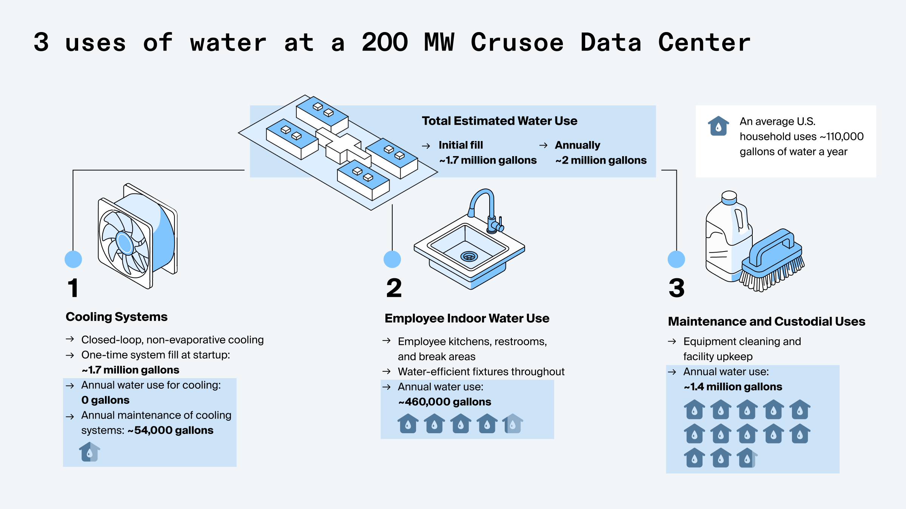

# 从地理可用水量到 IT 功率：证据链与中文译读

**范围**：本页只为“水文条件能提供多少水，再用现场取水 WUE 讨论 IT 功率上限”找依据；不是某个地点的取水许可或完整求解。下文“译读”为对原文要点的中文意译，不是逐字引文。书目、原始网址及已取得的 PDF 见文末；正文角标与书目编号对应。

## 证据链

1. **水文上有多少水**：取水口在有关月份的可靠流量，不能仅以年平均代替；生态流量应保留。Hoekstra 等用月度自然径流扣除假定环境流量，讨论“可用蓝水”与既有耗水的关系。其核算对象是**耗水足迹**，不是某项目的最大**取水**许可；作者使用的环境预留比例也不能不加核验地搬到选定河段。[1]
2. **多少水能送到中心**：还需分清取水口位置、下游已承诺的供水、取输水设施能力。水文站的实际流量一般已经包含上游取水造成的影响；不能重复扣除。Aqueduct 的区域水压力可提示竞争风险，但其风险得分不是可新增取水量，不能直接乘以单站河流流量。[1][2] 若这些本地资料缺失，只能报告条件性/情景性上限，不宜称为已核实的项目可用水量。
3. **同口径 WUE 到 IT 功率**：Mytton 定义的现场 WUE 用现场用水量除以同期 IT 用电量。采用**现场取水 WUE**时，给定同一时期中心能稳定取得的水量，可以反推该时期支持的 IT 用电量；再结合运行时长和负载假设讨论持续 IT 功率。不能把发电间接用水、耗水 WUE、额定功率与实际 IT 用电量混用。[3]
4. **WUE 必须匹配冷却条件**：NREL 的高性能计算中心案例报告，采用混合冷却后第一年现场 WUE 为 0.70 L/kWh；报告给出的“若仍仅采用既有余热回收和冷却塔”反事实 WUE 为 1.27 L/kWh。前者是该中心运行结果，后者是报告中的比较情景，不是两个通用系数。[4]

**最简换算（由 WUE 定义推得，并非论文给出某地上限）**：若同一时期中心可取水量为 `V` m³，现场取水 WUE 为 `w` L/kWh，持续 `t` 小时且 IT 设备平均负载率为 `u`，则额定 IT 功率上限为 `V / (w × t × u)` MW；这里 m³→L 与 kW→MW 的两个 1000 正好抵消。若只求该时段**平均实际 IT 功率**，令 `u = 1`。`w = 0` 时不能用该反推式；还应单独检查电力、冷却和设备约束。[3]

**计算边界提醒**：文献支持“可用水量、现场取水 WUE、IT 用电”之间的单位关系，但没有哪篇文献能从某地 Aqueduct 风险级别和一条河的总流量，直接给出具体项目已获保障的取水量。若用枯水期日供水检查全年持续运行，应匹配同季节/同冷却工况的用水强度及当日负载；年度平均 WUE 不能无说明地当作最热日 WUE。[1][2][3][4]

## 等效 WUE 的估计与使用边界

**主模型的位置。** 对给定场址、设计工况和候选冷却方案 $x$，先由水源、既有需求、水压力及许可/合同得到同口径的 $Q_{\mathrm{DC,max}}$，再以该方案的现场总用水强度 $\mathrm{WUE}_x$ 将 IT 功率 $P$ 映射为现场用水。若自建电源与现场用水使用同一水预算，另计其实际供电产生的用水：

$$
\mathrm{WUE}_x P+Q_{\mathrm{发电}}(P,x)\le Q_{\mathrm{DC,max}}.
$$

功率用 MW、WUE 用 L/kWh 时，$\mathrm{WUE}_xP$ 的数值单位是 m³/h。方案之间可以有不同 WUE，但比较时水预算、统计时段、取水或耗水口径和服务要求必须一致。WUE 衡量现场总用水与同期 IT 用电的比例；发电间接用水若已计入供水预算，应另按实际发电量及其发生的水源核算，不能无说明地混进现场 WUE。[3][4]

**如何折算额外现场用水。** 当某项用水虽未直接报告为 WUE，但有独立的工程量可将它表示成 $P$ 的近似线性函数时，可把该项在指定容量区间和时段折进等效 WUE。例如设计方案保持相近时，若每 MW IT 对应 $a_c$ 公顷冷却设施，该设施在设计工况每公顷取水 $q_c$ m³/h，则对应的强度在数值上为 $a_cq_c$ L/kWh IT；这是由单位换算得到的**条件性估计**，并非文献给出的通用系数。也可由给定的设备和循环系统设计直接求每 MW 的补水率。只要各项采用同一现场边界，等效 WUE 就是这些每 MW 用水强度之和。这里的面积、设备布置、补水率和容量区间应先于计算确定，并保留来源及情景假设。该近似描述的是**同类建成方案之间的规模变化**，不意味着单个已建园区在 IT 负载下降时所有维护用水也同比下降。

**不能折算时怎样报告。** 已建园区的清洗、系统更换、维护补水等可能按设备数量或日程发生。若只知道一套固定配置的年度总用水 $V$，形式上的 $V/E_{\mathrm{IT}}$ 只是该配置、该年的观测平均 WUE，不自动成为其他规模或设计小时的常数；零负载时仍发生的用水尤其不能由 $wP$ 严格表示。若此类用水在结论中可能重要，应单列年度总量检查或把无法得出有限 $P_W$ 的原因作为模型局限；不能为了维持主公式而强行给出一个设计时段系数。若 $w=0$，除法换算式不适用；只有在核实该边界内现场用水确实为零、且其他用水约束也已检查后，才能说水不限制该方案的 IT MW。

**防止循环检验。** 不能将待比较项目的已公布 IT 容量当作分母，把该项目的已公布用水量换成一个 WUE，再代回同一模型声称预测了该项目规模。应优先用独立的冷却设计、设备参数或具有相同边界和工况的其他设施数据确定参数；随后才与目标项目的 IT 容量比较。即便有可信的年度 WUE，仍需另证它能否代表枯水期、高温期等用于容量校核的设计工况。[3][4]

**Abilene 示例。** [Oracle 项目资料](https://arrington.house.gov/uploadedfiles/final_oracle_oai_data_center_fact_sheet_092225b.pdf)预计每栋楼每年约 12,625 美制加仑用于闭式冷却系统的维护与水质管理，八栋楼合计约 382 m³/年；这不是该园区的现场总取水量。这个数字可以作为已选定八栋楼配置的年度补水检查；单靠它没有同期 IT 用电量、实际补水时段或同类扩建的物理比例，就不能得出设计工况 WUE，更不能除以 Epoch 对该园区的 IT 容量估计后带回去验证上限。“按栋”仅是此项目的披露口径，不是主模型必须采用的结构。市政年度规划余量也不能直接视作该园区设计小时的可交付水量。因此，在进一步取得同工况、同边界的资料前，该案例的水容量应注明未独立确定。

### 附录图：闭式冷却设施的现场用水构成

*图 S1　Crusoe 公布的 200 MW 数据中心示意，并非 Abilene 八栋楼的实测水量。图中一次性初次充填约 170 万美制加仑；年度冷却运行用水记为 0，冷却系统维护约 5.4 万、员工室内约 46 万、设备清洁和设施维护约 140 万，年度总量约 200 万加仑。这里的“冷却运行用水为 0”不意味着现场总用水 WUE 为 0。原图与说明：[Crusoe, Water stewardship at our data centers](https://www.crusoe.ai/resources/blog/water-stewardship-at-our-data-centers)；图中所有数值均是运营商的示意估计。*

此图适合解释现场用水边界，不用于计算 Abilene 的 $P_W$：[Crusoe 的另一份影响报告说明](https://www.crusoe.ai/resources/blog/crusoes-2025-impact-report)把一座 200 MW 设施的年度总用水写作约 91 万加仑，与本图的约 200 万加仑不同；现有原文未交代两者是否为同一设计版本或相同边界。[Crusoe 的 Abilene 项目介绍](https://www.crusoe.ai/resources/blog/an-inside-look-at-the-abilene-ai-data-center)还预计每栋楼每年约 5 万加仑冷却系统维护补水，与上文 Oracle 的 12,625 加仑/栋·年不同。不能把这些数字混合或平均，再除以已公布的 IT MW 形成“验证用”WUE。

## 原文关键内容的中文译读

**[1] Hoekstra 等，2012，PLOS ONE（同行评审）**：作者认为只比较年平均供需会遮蔽月度缺水；估算可用蓝水时，应为维持河流生态功能留出流量。文中专门指出，许多工业与家庭取水会回流，因此取水量与实际耗掉的水不一样。**用于本题**：论证按枯水时段而非仅按全年平均检查物理余量；不要把论文中的“剩余可耗水”直接当成数据中心“可抽取水”。原文的全球尺度环境流量假设不等于当地法定或工程取水规则。[1]

**[2] Kuzma 等，2023，WRI Aqueduct 4.0（机构技术说明）**：该方法对不同流域的供给、需求与水压力作风险评估，还报告时间和情景差异。**用于本题**：选择需要重点核查的缺水地点；它不能替代河段可新增取水评估，也不提供数据中心独占的剩余额度。[2]

**[3] Mytton，2021，npj Clean Water（同行评审）**：数据中心的现场水使用和供电造成的间接用水须区分；现场 WUE 把同期现场水量与 IT 设备的耗电量联系起来，还需分清取水与耗水。**用于本题**：明确从中心可用**取水量**到 IT 用电的参数口径；没有规定哪个地点必然具有某个 WUE，也不能直接把 IT MW 称为芯片运算吞吐量。[3]

**[4] Sickinger 等，2018，NREL / OSTI（官方技术报告）**：作者介绍了将热虹吸冷却系统与已有冷却塔结合的实际运行，在第一年记录的现场 WUE 为 0.70 L/kWh；若仅沿用原方案，报告估计为 1.27 L/kWh。**用于本题**：证实冷却配置不同会改变适用的 WUE；案例值不可直接作为其他气候和设备条件下的普适参数。[4]

**IEEE 补充候选，暂不作全文依据**：Crossref 已核对 Singh、Singh、Kaur (2026) 的 IEEE CHANDICON 论文 *Estimating Water Consumption of Data Center Expansion in India Using a Capacity–Energy–WUE Modeling Framework*，DOI [10.1109/CHANDICON70877.2026.11767483](https://doi.org/10.1109/chandicon70877.2026.11767483)。出版社当前未提供可直接获取的全文，因此仅记录题名与书目信息，**不据题名推断论文公式、参数或结论，也不伪称已下载/已翻译原文**。Google Scholar 是检索入口而不是原始出版来源；正式引文仍以期刊、IEEE、机构原件为准。

## 可直接套用的角标与书目

正文示例：“对于取水口的水文评估，应区分枯水时段并保留生态所需流量；已有的耗水量与河道取水量不是同一个口径。[1] 数据中心可使用现场取水 WUE 将现场水量与同期 IT 用电量关联。[3] 不同冷却方案需使用匹配的 WUE。[4]”

[1] Hoekstra, A. Y., Mekonnen, M. M., Chapagain, A. K., Mathews, R. E., & Richter, B. D. (2012). Global monthly water scarcity: Blue water footprints versus blue water availability. *PLOS ONE*, 7(2), e32688. [DOI / 期刊原文](https://doi.org/10.1371/journal.pone.0032688) · [本地 PDF](15_Hoekstra_全球月度水稀缺与可用水.pdf)。

[2] Kuzma, S., et al. (2023). *Aqueduct 4.0: Updated Decision-Relevant Global Water Risk Indicators*. World Resources Institute. [DOI / 原件](https://doi.org/10.46830/writn.23.00061) · [本地 PDF](05_WRI_Aqueduct4方法.pdf)。

[3] Mytton, D. (2021). Data centre water consumption. *npj Clean Water*, 4, 11. [DOI / 期刊原文](https://doi.org/10.1038/s41545-021-00101-w) · [本地 PDF](02_Mytton_数据中心用水.pdf) · [已有详细中文译读](../02_中文译读/04_Mytton_数据中心耗水_摘要与正文中译.md)。

[4] Sickinger, D. E., Van Geet, O. D., Belmont, S. A., Carter, T., & Martinez, D. (2018). *Thermosyphon Cooler Hybrid System for Water Savings in an Energy-Efficient HPC Data Center: Results from 24 Months and the Impact on Water Usage Effectiveness*. NREL technical report. [DOI / 官方原件](https://doi.org/10.2172/1471661) · [本地 PDF](16_NREL_高性能计算中心冷却节水与WUE.pdf)。

对应 BibTeX 见 [可用水量与WUE到IT功率_参考文献.bib](可用水量与WUE到IT功率_参考文献.bib)。
