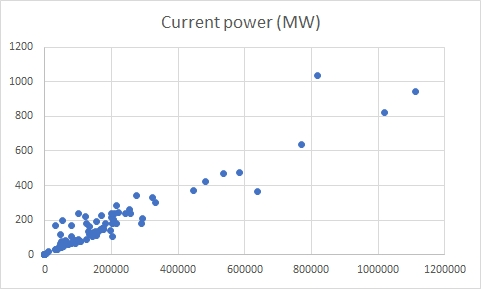

# IMMC2027\-Q2

# 环境足迹

**根据联合国大学水、环境与健康研究所的探讨与报告（****https://unu\.edu/sites/default/files/2026\-10/UNU\-INWEH\-Report\-The\_Env\_Cost\_of\_AI\-2026\.pdf****），**AI 的环境成本不仅取决于电力使用，更在于对土地和水资源的占用**。**电力使用带来的环境成本则主要源于发电过程产生的温室气体排放，部分能源生产过程的用水以及发电设施占地（本文讨论中合并到信息设施土地占用下）

基于这一报告，在题目讨论框架下，我们认为AI数据中心产生的**环境足迹要素主要**包含**碳足迹，水足迹，以及土地足迹**。我们比较总算力需求给定情况下不同方案**运行时**环境足迹的多少，

$C_{out}$代表给定算力需求下**单位时间内**产生的碳足迹，单位是kg CO2e/d

$W_{out}$为给定算力需求下**单位时间内**产生的水足迹，单位kg/d

$A_{out}$为给定算力需求下产生的土地足迹，单位ha

对于给定算力需求$O_{ut}$，由数据可知，对于现有算力设施，能量消耗与算力需求大致呈线性关系（这张图不能进论文）

${P_{\text{IT}}=\frac{O_{ut}}{\eta}} $

其中 $O_{ut}$ 是持续提供的算力，$\eta$ 是单位 IT 功率对应的算力。以下统一令 $P_{\mathrm{IT}}$ 的单位为 **kW**。

信息来源：https://epoch\.ai/data/ai\-data\-centers

> 我们假设的时间尺度下，η是定值，黄仁勋重新当上英伟达CEO前不太会变
> 
> 

对于每一种资源限制，按照$P_{IT}$强度反推出对应的足迹或对当地资源的压力。

## **集中式数据设施**

### 碳足迹

**1　核算边界与近似假设**

本文以运行用电相关的二氧化碳排放量表征数据设施的碳足迹。考虑到运行阶段温室气体排放以 CO₂ 为主，为降低模型复杂度，采用 CO₂ 排放因子，不单独核算 CH₄、N₂O 等其他温室气体，也不计入燃料开采与运输、设备制造等环节的排放。因此，本文的“碳足迹”仅指上述边界内的运行用电相关 CO₂ 排放。

统计期划分为若干运行时段。保留时段是为了描述用电及供电来源的变化，并累计排放。设施用电包含 IT 设备、冷却及配电等，站外广域网用电单独核算。

**2　参数与变量**

|符号|含义|单位／来源|
|---|---|---|
|j；t；m|节点编号；时段编号；自建电源类型|方案及统计期设定|
|Δt|每个时段的长度|h，例如 1 h|
|Dⱼ,ₜ|节点在时段内的平均实际 IT 功率，含站内网络|MW；用电模型|
|kⱼ,ₜ|设施总功率与同工况 IT 功率之比|无量纲；实测或 PUE 近似|
|P设施,j,t|节点设施总用电功率|MW；kⱼ,ₜDⱼ,ₜ|
|P电网,j,t|电网实际供给节点的功率|MW；供电分配结果|
|P自发电,j,m,t|第 m 类自建电源实际供给节点的净功率|MW；供电分配结果|
|P广域网,t|核算范围内站外网络的用电功率|MW；网络耗电模型|
|f电网,j,t|节点所在地区的电网 CO₂ 排放因子|t CO₂/MWh；官方资料|
|f自发电,j,m,t|对应自建电源单位净供电量的 CO₂ 排放因子|t CO₂/MWh；项目或电源资料|
|f广域网,t|站外网络用电的综合 CO₂ 排放因子|t CO₂/MWh；按设备用电量加权|
|C总|整个统计期的运行用电相关 CO₂ 排放|t CO₂；模型输出|

所有功率均指实际运行功率或时段平均功率。电量 E 为功率乘以时段长度所得的中间计算量，单位 MWh。

**3　计算步骤**

**第一步：确定园区设施用电功率**

对于碳足迹，分布式模型沿用集中式模型的设施用电核算方法。新增网络传输等损耗，非线性增长，需根据设施规模估算，此处计入系数k计算。

$\boxed{
P_{\mathrm{设施},t}=k_tD_t.
}
\tag{1}$

设施倍率 $k_t$ 将 IT 功率换算为包含冷却、供配电等辅助用电的设施总功率。可近似等于PUE。

**第二步：区分电网供电与自发电**

在无储能的情景下，各时段满足：

$\boxed{
P_{\mathrm{电网},t}
+\sum_mP_{\mathrm{自发电},m,t}
=P_{\mathrm{设施},t}.
}
\tag{2}$

电网与自发电的份额由前述供电分配模型确定，并满足电网额度及电源出力限制。式（2）本身只规定供需平衡，不唯一决定各电源的份额。

**第三步：将功率换算为电量**

$\boxed{
E_{\mathrm{电网},t}=P_{\mathrm{电网},t}\Delta t,
\qquad
E_{\mathrm{自发电},m,t}=P_{\mathrm{自发电},m,t}\Delta t.
}
\tag{3}$

功率单位 MW 乘以时长单位 h，得到电量单位 MWh。

**第四步：计算并累加各时段排放**

$\boxed{
C_{\mathrm{}}
=\sum_t\left[
P_{\mathrm{电网},t}f_{\mathrm{电网},t}
+\sum_mP_{\mathrm{自发电},m,t}f_{\mathrm{自发电},m,t}
\right]\Delta t.
}
\tag{4}$

各来源电量分别乘以对应排放因子，再将所有时段的排放相加，得到 $C_{\mathrm{集中}}$，单位为 t CO₂。

**4　官方因子取值及简化公式**

采用中国全国平均电网数据进行近似时，取：

$\boxed{
f_{\mathrm{电网},t}=0.5306\ \mathrm{t\ CO_2/MWh}.
}
\tag{5}$

当自发电全部采用化石能源混合平均情景时，取：

$\boxed{
f_{\mathrm{自发电},t}\approx0.8273\ \mathrm{t\ CO_2/MWh}.
}
\tag{6}$

采用中国全国平均数据进行近似时，电网因子取 2023 年全国电力平均二氧化碳排放因子；自发电采用 2023 年全国化石能源电力二氧化碳排放因子。数据发布于 2025 年 12 月 31 日。在缺少最新数据的情况下将上述历史数据作为近似，并在各运行时段保持不变。

风电、光伏在本文发电运行边界内，CO₂ 排放近似取零。

**参考文献**

［1］生态环境部，国家统计局．关于发布2023年电力二氧化碳排放因子的公告：公告2025年第47号［EB/OL］．2025\-12\-31．

https://www\.mee\.gov\.cn/xxgk2018/xxgk/xxgk01/202512/t20251231\_1139517\.html

附件：https://www\.mee\.gov\.cn/xxgk2018/xxgk/xxgk01/202512/W020251231726284332528\.pdf

［2］生态环境部．生态环境部应对气候变化司有关负责人就《关于发布2023年电力二氧化碳排放因子的公告》答记者问［EB/OL］．2026\-01\-05．

https://www\.mee\.gov\.cn/ywdt/zbft/202601/t20260105\_1139911\.shtml

### 水足迹

${ Q_{\mathrm{现场}} =\mathrm{WUE}\,P_{\mathrm{IT}} =\mathrm{WUE}\frac{C}{\eta} }$

其中$Q_{\mathrm{现场}}$ 为数据中心正常运营所需的现场耗水流量，包括冷却及辅助设施耗水，不含供电过程的间接耗水。

另外考虑自发电情形产生的耗水：

$Q_{\mathrm{发电耗水}} =P_{\mathrm{煤}}c_{\mathrm{煤}} +P_{\mathrm{气}}c_{\mathrm{气}} +P_{\mathrm{风}}c_{\mathrm{风}} +P_{\mathrm{光}}c_{\mathrm{光}}$

功率采用 **kW**、耗水系数采用 **L/kWh** 时，$Q_{\mathrm{发电耗水}}$ 的单位为 **L/h**。

则数据中心总耗水流量为正常运营流量与发电耗水流量之和：

$Q_{\mathrm{DC}}=Q_{\mathrm{现场}}+Q_{\mathrm{发电耗水}}$

**土地足迹**

在给定功率计划下，可计算得总需地

$A_{\mathrm{req}}=A_{0}+A_{e}+a_sP_{IT},\qquad P_{IT}>0$

分布式数据设施

将总算力需求分散到各个小园区，有

$\sum O_{i}=O_{ut}$

随后对于每个小园区，与上同理计算出C，W，和L

> 假设：单体小园区即单个小规模集中式数据中心，各自拥有独立地理条件与建设运营方案，包括分配到的IT功率，发电功率配比，发电方式，建筑布局等。在计算时这些条件作为输入。
> 
> 考虑到小园区自身设施配置限制与园区间联络成本，其具有特点：
> 
> 年度PUE高于大型园区，通常在1\.5以上，表征其需要花费更多电力在设施运维与通讯联络上
> 
> a\_s大于大型园区，表征其IT设施密度较低
> 
> 

最后将每个园区C,W,L求和得到总足迹：

$C_{out} = \sum C_i$

$W_{out} = \sum W_i$

$A_{out} = \sum A_i$

# 资源压力

对于给定的地理条件，由第一问假设，该地区资源存在一个确定的供给上限，当数据中心消耗资源逼近上限时会对当地资源产生巨大压力。

（美国中期选举的例子）

为表征这种资源压力，我们依次计算数据中心使用资源在当地总剩余可调配资源中的占比。

## **集中式数据设施**

### 水资源压力

$R_{\text{W}}=\frac{Q_{\text{DC}}}{Q_{\text{河流}}-Q_{\text{生态}}-Q_{\text{其他取水}}}$

其中$Q_{\text{河流}}-Q_{\text{生态}}-Q_{\text{其他取水}}$即第一问求得的数据中心的新增取水上界

### 电资源压力

**确定当地电网剩余可供功率**

$\boxed{
P_{\mathrm{余量}}
=P_{\mathrm{总}}-P_{\mathrm{其他负荷}}.
}
\tag{1}$

**确定项目实际购电功率**

园区在设计工况下的实际购电功率记为 P项目购电，直接采用前述供电分配模型的结果。

**计算集中式电力资源余量**

$\boxed{
R_{\mathrm{E}}
=1-\frac{P_{\mathrm{电网}}}{P_{\mathrm{余量}}}.
}
\tag{2}$

### 土地资源压力

由上文算得需地，结合选定地图中的地块，按照上文选择标准得到候选场址的 $A_{\mathrm{eff}}$，即可调配的土地资源面积。随后计算可得土地资源压力，即用地在调配的土地资源的占比：

$R_A=\frac{A_{\mathrm{req}}}{A_\mathrm{eff}}$

## 分布式数据设施

继承上文对分布式数据设施假设，我们同理将其按单个集中式中心处理，特别地：

> 假设各分算力中心资源占用无交叉
> 
> 

计算每个算力中心对**当地**资源的资源消耗以及当地可用资源，得到各自的各项资源占用率$R$。为衡量总体压力表现，我们**以最紧张节点作为压力指标：**

$R_W=\max R_i^W$，

$R_E=\max R_i^E$，

$R_A=\max R_i^A$，

# 综合评价

## **环境足迹**

对于**环境足迹**维度，我们取定该算力规模下的基准环境足迹$C_0,W_0,L_0$ （可直接取集中式方案足迹作为基准），以将这三个足迹指标转化为可比较的无量纲指标。

赋予三者权重$w_C,w_W,w_A$并加和。

考虑到资源使用量的绝对量级：10吨相对于1吨碳排放，100吨相对于10吨碳排放，这两次比较从绝对量级的角度而言，后者差异显著更大，但从横向比较的角度而言这种差异是一致的。我们希望比较方案间相对的增长，为了避免绝对量级对评价造成的影响，我们选择再加一层对数抹除绝对量级。

最终得到综合环境足迹指数$F$：

$F=\ln (w_C\frac{C}{C_0}+w_W\frac{W}{W_0}+w_A\frac{A}{A_0}), \qquad w_C+w_W+w_A=1$

若以集中式方案作为基准方案，有

$F_{cen}=0$

## **资源压力**

对于**资源压力**维度，我们希望构建惩罚项，使得资源在迫近当地资源上限时有显著的边际效应。

因此，我们先构建压力函数：

$\phi(R)=\frac{R}{1-R}$

它具有性质：

$\phi(0)=0, \qquad \lim_{R\to1^-}\phi(R)=+\infty,$

并且其边际效应为：

$\frac{\mathrm d\phi}{\mathrm dR} = \frac{1}{(1-R)^2}.$

因此，资源占比较小时增长影响有限，但接近极限时会受到强烈惩罚。

例如：

$\phi(0.5)=1,\qquad \phi(0.9)=9,\qquad \phi(0.99)=99.$

这正好表达“当地资源接近耗尽时，新增消耗的环境代价快速上升”。

如果任何一项资源达到或超过当地可用上限，直接规定：

$R_k\ge 1 \quad\Longrightarrow\quad \phi=+\infty,$

也就是方案不可行。

为综合三项压力表现，我们赋予三者权重$m_W,m_E,m_A$，得压力表现加权平均值$S$:

$S=m_W\phi(R_W)+m_E\phi(R_E)+m_A\phi(R_A), \qquad m_W+m_E+m_A=1$

## **最终评价**

我们的终极目标是比较集中与分布式方案在**降低环境足迹和资源压力**这两方面的综合优劣。二者往往不可得兼：分布式算力中心能分摊对当地资源的压力，但同时也可能需要更多资源来代偿设施不集中带来的效率折损问题。

因此，我们最后的评价兼并二者。为比较同等算力任务下集中式与分布式方案在**环境足迹与资源压力**这两个评价向度下的综合表现，构造综合得分：

$Ω = F + \lambda S $

$Ω$反映该方案的环境足迹与资源压力的综合评价：$Ω$越大，说明该方案环境足迹更严重或对当地资源挤压更严重。$\lambda$表示S项的权重，实际应按F可能的大小差异估计调整。

分别代入两个方案，

$Ω_{cen}<Ω_{dis}$说明集中式方案更具优势，反之说明分布式方案更具优势。

# 结果讨论

## 分布式算力网络的普惠性

### 水资源压力

对于每个节点，分别计算其**所在当地**水资源压力$R_i^{\text{W}}$，取资源压力最大者，即热点，作为总**压力指标**

$R_W=\max R_i^W$

### 电资源压力

**第一步：确定各节点所在地的电网余量**

以 j 表示节点编号。由于每个节点分别接入独立供电区域，直接计算其所在地的剩余可供功率：

$\boxed{
P_{\mathrm{余量},j}
=P_{\mathrm{总},j}-P_{\mathrm{其他负荷},j}.
}
\tag{3}$

其中，P可供,j 为节点 j 所在供电区域满足可靠性及输配电限制后的可供功率，P其他负荷,j 为该区域除本项目以外的已有及已承诺负荷。

**第二步：确定各节点实际购电功率**

节点 j 在设计工况下的实际购电功率记为 P电网,j，沿用前述电力模型的供电分配结果。各节点的电网供电额度独立。

**第三步：计算各节点的电力资源余量**

$\boxed{
R_{\mathrm{E},j}
=1-\frac{P_{\mathrm{电网},j}}{P_{\mathrm{余量},j}}.
}
\tag{4}$

**第四步：取最小余量作为全网评价指标**

$\boxed{
R_{\mathrm{E}}
=R_{\min}
=\min_j R_{\mathrm{E},j}.
}
\tag{5}$

以最紧张节点所在地的资源余量作为分布式方案的压力指标。

### 土地资源压力

