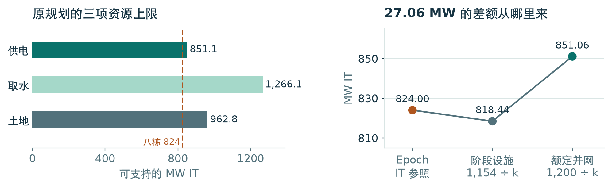
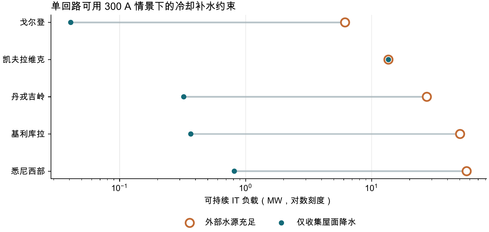
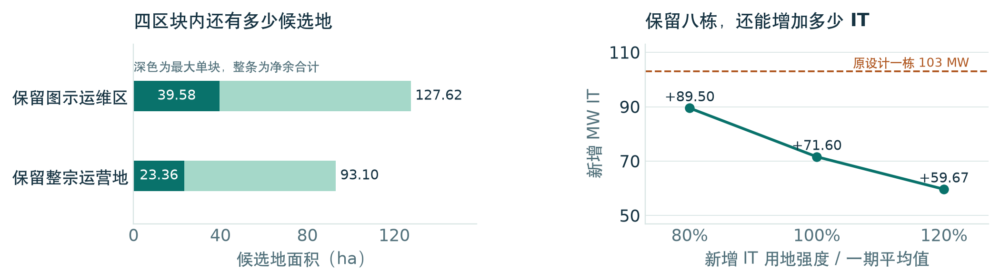

# 第一问补充稿 · 六个场址的规模上限与验证

> 本稿可独立阅读。第 4 节是论文正文备选稿，附录 D 保留可复算的依据。文末列出摘要用句及每幅图在原稿中的建议位置。全文以 MW IT 表示服务器等 IT 设备的用电容量，以 MW 表示设施侧或发电侧功率。

## 4　给定场址能支撑多大的集中式数据中心？

### 4.1　用 Abilene 原八栋校核电、水、土地三项上限

得克萨斯州 Abilene 园区披露了 1,200 MW 的并网容量。这些电力除了驱动服务器，还要供冷却和配电设备使用。究竟有多少能用于 IT？我们选取 2026 年原八栋的建设范围，先只给模型电、水和土地，再用逐栋工程设计检验答案。对于场址 $s$，令 $X_s(y)$ 表示到年份 $y$ 能投运的方案，每个方案 $x$ 同时指定用地、冷却、电源及可行调度。给定场址的资源上限为

$$
P^*(s,y)=\max_{x\in X_s(y)}\min\{P_E(s,x),P_W(s,x),P_L(s,x)\}.
$$

三个上限须由同一方案取得。例如，分给电站的一块地不能再用来布置机房，发电取水也要从冷却可用水量中扣除。若保留已有设备，能承载的 IT 容量还须与设备设计容量取较小值。

原八栋以网电正常运行，燃机留作备用。设 1,200 MW 均可持续交付，以 $k=1.41$ 近似满载时设施功率与 IT 功率之比，则电力可支持 **851.06 MW IT**。供水采用偏宽的条件，把 2030 年市级规划盈余全额分给园区并在年内均摊，可得 633.07 m³/h。若现场取水强度为 0.50 L/kWh IT，水可支持 **1,266.15 MW IT**。一期两栋的租赁面积为 38.43 ha，设计为 206 MW IT。以此平均强度估算，179.61 ha 运营宗地可支持 **962.75 MW IT**。因此，在这组条件下最先用尽的是电力。枯季实际可交付水量和满载倍率均待同期记录核实。[并网披露](https://www.crusoe.ai/resources/newsroom/crusoe-expands-ai-data-center-campus-in-abilene-to-1-2-gigawatts) · [原始输入及来源](../../data/geographic_case_abilene_20261122/plan_vs_optimizer/input_register.csv) · [三项上限](../../data/geographic_case_abilene_20261122/plan_vs_optimizer/results/plan_limits.csv)

工程资料给出了另一种算法。每栋有四个 25 MW IT 数据厅，另有 3 MW IT，八栋合计 $8(4\times25+3)=824$ MW IT。Epoch 对同一建设阶段的估计也是 824 MW IT，设施侧估计为 1,154 MW。图 Q1-1 右侧解释了模型多出的 **27.06 MW IT（3.28%）**。将额定并网的 1,200 MW 换成该阶段的 1,154 MW，按同一倍率折算便减少 32.62 MW IT，得到 818.44 MW IT，较 824 低 5.56 MW IT。工程复原与阶段估计共享八栋的设计信息，二者相合只能检验口径。要验证实际满载，还需同一时段的设施和 IT 分表记录。[DPR 工程说明](https://www.dpr.com/projects/crusoe-abilene-data-center) · [建设阶段与对照来源](../../data/geographic_case_abilene_20261122/plan_vs_optimizer/README.md)

**图 Q1-1　Abilene 八栋设计容量与资源上限。** 左图的竖线为 824 MW IT。右图三点采用同一建设范围，后两点分别将阶段设施功率和额定并网容量除以 $k$。

反过来问，要用满八栋，供给至少要达到什么水平？在上述参数下，园区需持续取得 $824\times1.41=1{,}161.84$ MW 网电和 $824\times0.50=412$ m³/h 的水。网电若只能保证额定容量的 90%，其余条件不变，可运行容量降至 **765.96 MW IT**。只把供水改为 400 m³/h，则上限变为 **800 MW IT**，瓶颈也由电转为水。这给出了可用接入协议和枯季供水记录直接检验的两个门槛。[单因素复算](../../data/geographic_case_abilene_20261122/plan_vs_optimizer/results/sensitivity.csv)

### 4.2　把新增电源放进同一块地

假如允许园区重新布置，新建电源能把 851.06 MW IT 推高多少？我们保持并网、供水及冷却参数不变，允许在 179.61 ha 运营宗地内重排机房，并开放一块 23.36 ha 的连续候选地。新增电源只能建在该地块，余地可用于 IT 配套。题面以 Hyperion 的燃机交付为例给出约七年等待期，我们据此设定一个 **2033 年可投运**的对照情景。原八栋的备用机组在两种规划中均只承担备用。煤、气分别按 100 MW 整台选取，风、光与电池联合逐时调度。目标是使各小时都能维持的 IT 功率最大。[题面第 2 页](../../IMMC2027%20Problems_Greater%20China%20Autumn/IMMC2027%20Problem%20A-How%20big%20an%20AI%20data%20center%20to%20be_.pdf#page=2) · [求解设置与分支](../../data/geographic_case_abilene_20261122/plan_vs_optimizer/results/integer_branches.csv)

**表 Q1-1　同一并网和供水条件下，四种新增电源如何改变 Abilene 的容量。** 峰时取水为可行调度下机房与新增发电合计的现场取水，发电占地为该方案实际划给新增电源的面积。

| 新增电源及最优装机 | 发电占地（ha） | 峰时取水（m³/h） | 上限（MW IT） | 比纯网电增加（MW IT） | 首先触及的约束 |
|---|---:|---:|---:|---:|---|
| 纯网电基准 | 0 | 425.53 | 851.06 | — | 电力 |
| 湿冷煤电，1 × 100 MW | 20.00 | 633.07 | 852.17 | 1.11 | 水 |
| 干冷燃气，2 × 100 MW | 20.00 | 494.03 | **980.75** | **129.69** | 土地 |
| 风电 0.78 MW 加储能 | 23.36 | 425.54 | 851.07 | 0.01 | 电力 |
| 地面光伏 6.49 MWac 加储能 | 23.36 | 425.59 | 851.18 | 0.12 | 电力 |

湿冷煤电按每发 1 kWh 取水 132.5 L 的高取水工况估算。现场冷却与机组共用一份水额，100 MW 机组只能持续调用约 1.56 MW。干冷燃气按 0.02 L/kWh 发电量计，两台机组虽可将电力上限抬至 992.91 MW IT，却先占去 20 ha，余地仅够 **980.75 MW IT**。即使允许四种电源混合，在给定候选中仍选两台燃机。这个上限以燃料充足、获准投运及宗地可重排为条件，目标函数只衡量容量。[电源与取水系数](../../data/geographic_case_abilene_20261122/plan_vs_optimizer/input_register.csv) · [各方案调度结果](../../data/geographic_case_abilene_20261122/plan_vs_optimizer/results/portfolio.csv)

风电按机组间距取 30 ha/MW，地面光伏阵列约需 3.60 ha/MWac。同一块 23.36 ha 的地因此分别只能容纳约 0.78 MW 和 6.49 MWac。能逐小时供给的功率还会受到夜间、低风时段和电池储能时长的限制。固定表中的光储装机后，更换为留出的 2024 年连续 8,784 小时，可靠增益从设计日的 0.117 变为 **0.154 MW IT**。两段天气中，6.49 MWac 的装机都只带来不足 0.2 MW IT 的全天增量。[跨年天气检验](../../data/geographic_case_abilene_20261122/plan_vs_optimizer/results/weather_check.csv)

若业主要求保留八栋原状，新增机房和电源就只能分享那块 23.36 ha 的地。布置一台燃机要占 10 ha，剩余约 13.36 ha。按一期用地强度可增 **71.60 MW IT**，连同八栋为 **895.60 MW IT**。即使将新增单位用地降至一期平均的 80%，新增容量也只有 89.50 MW IT，仍小于一整栋的 103 MW IT。保留建筑与允许重排对应两种不同的扩建决策，详见图 D-1。[保留八栋的扩建复算](../../data/geographic_case_abilene_20261122/plan_vs_optimizer/results/anchored_extension.csv)

### 4.3　与题面的三个参照规模相比

Abilene 原八栋的资源上限约为 **0.85 GW IT**，允许重排并建设常态燃机时约为 **0.98 GW IT**。所以，在有吉瓦级并网条件的这个场址，所得上限的数量级是 **$10^3$ MW IT**。若将题面的 950 MW、2,263 MW 和 5 GW 均理解为 IT 功率，原布局分别低约 **99、1,412 和 4,149 MW IT**。重新配置可超过 950 MW 约 31 MW，另两个参照仍高于模型结果。例如，在 $k=1.41$ 下，5 GW IT 需要 7.05 GW 设施侧功率，已远超本址 1.2 GW 并网和候选自建机组能提供的规模。

计量边界会改变高低判断。题面称 Hyperion 的 5 GW 为规划电力需求，未逐一给出三个参照的 IT 换算口径。若三者均按设施功率计，仅为说明换算影响而统一除以 1.41，则对应约 **674、1,605、3,546 MW IT**。此时 Abilene 的 851.06 MW IT 高于第一档，仍低于后两档。题面另有明确标为 IT 的同量纲参照，New Carlisle 当前估计 1,037 MW IT，比 Abilene 的资源上限高约 186 MW IT。各项目的接入规模、建设阶段和满载倍率不同，同址阶段检验采用图 Q1-1。[题目背景及参照口径，第 1–2 页](../../IMMC2027%20Problems_Greater%20China%20Autumn/IMMC2027%20Problem%20A-How%20big%20an%20AI%20data%20center%20to%20be_.pdf#page=1)

### 4.4　在另外五个场址复用判据

换一处场址时，我们保留三项取小的判据，重新确定当地能交付的电、水和土地。五地资料所能约束的量并不相同。Golden 有配电改造记录，冰岛有新增机房地块，悉尼有总用电批复。我们先用这些资料估算各自能够约束的那一项，再对照公开规划，反求目标成立所需的资源。新加坡公开了建筑终态需求，但缺项目获配的持续网电，表 Q1-2 因而保留这一空缺。[五地工程资料与来源](../../data/q1_plan_comparison/README.md) · [逐项计算结果](../../data/q1_plan_comparison/comparison.csv)

**表 Q1-2　用五个场址的工程资料检验公开规模。** 两个容量列的单位均为 MW IT。第二列标明资料能支持哪一项上限，最后一列给出达到公开目标的必要条件。

| 场址 | 工程资料支持的估计（MW IT） | 同址公开参照（MW IT） | 达到公开参照需要什么 |
|---|---|---|---|
| 美国 Golden，ESIF | 5.66，按改造后的 6 MW 含辅机计算。若 6 MW 指 IT 侧，则为 6.00 | 10，终态设计，晚于本次配电改造 | 设施侧 10.6 MW，按热虹吸冷却取水强度需 7.0 m³/h |
| 冰岛 Keflavík，VDC04 | 100，按 2.4 ha 地块推得的机房布局上限 | 120，环境文件列三期各 40 | 分得 144 MW 设施供电，按干冷假设补水 2.4 m³/h，并增加可排柜面积或柜功率 |
| 新加坡 Tanjong Kling | 独立容量待核，项目保障供电份额未披露 | 约 126.05，同址建筑 150 MW 终态需求按 $k=1.19$ 折算 | 设施侧 150 MW，按两种取水强度需约 252–303 m³/h |
| 智利 Quilicura，Data Luna | 66.85，仅为一段线路留存一回并全部供给项目时的电力情景 | 约 60.19，电网研究对 2025 年的 65 MW 需求按 $k=1.08$ 折算 | 若仅靠该回路供 65 MW，其他占用最多约 7.2 MW，枯季供水仍需单独核对 |
| 澳大利亚 Huntingwood，SYD3 | 347.83，由审批所列 400 MW 总用电按 $k=1.15$ 折算 | 至少 320，运营商九期规划下限 | 仅按 320 计需 368 MW 设施功率，按两种取水强度需 224–384 m³/h |

冰岛扩建模块说明，补足电力有时还不够。2.4 ha 地块在设定布局下提供 6,000 m² 机房，每柜占 6 m²、功率 100 kW，最多容纳 100 MW IT。要实现环境文件所列的 120 MW IT，除分得 144 MW 设施电力外，还需将机房增至 **7,200 m²**，或把平均柜功率提高到 **120 kW**。前者可用供电协议核实，后两项可用楼层图和机柜清单核实。悉尼则说明，审批用电规模可以检验规划是否相容。320 MW IT 的规划下限折合 368 MW 设施功率，低于获批的 400 MW，但审批材料仍未给出故障后园区可持续取得的电力。[冰岛官方环境文件](https://uua.is/urleits/uua2606003-uppbygging-gagnavers/) · [悉尼州规划审批](https://www.planningportal.nsw.gov.au/major-projects/projects/51-huntingwood-drive-data-centre) · [SYD3 运营商分期公告](https://airtrunk.com/airtrunk-expands-western-sydney-region-with-new-syd3-hyperscale-data-centre-asia-pacifics-largest/)

智利提供了独立的用水核查。若采用 0.50 L/kWh IT 的低取水设计，60.19 MW IT 只需约 30.1 m³/h。Alphabet 披露 Quilicura 在 2025 年全址取水 2.782 亿美制加仑，折合全年平均 **120.2 m³/h**，约为上述设计需水量的四倍。两者统计范围与工况有别，这个差距提示我们须取得同期 IT 电量后，才能估计既有园区的 WUE。表 Q1-2 将智利的枯季供水保留为待核量。[Alphabet 2025 年分场址取水表](https://storage.googleapis.com/gweb-mobius-cdn/sustainability/uploads/6b09a7cbecbf228f4d30ad089301578eb599425e.pdf) · [智利电网研究，第 15 页](https://www.coordinador.cl/wp-content/uploads/2021/08/Minuta_Solicitud_Nueva_Subestacion_COLINA_24_08_2021.pdf#page=15)

水源变化本身会造成多大差别？为只改变供水条件，图 Q1-2 另设对照实验，给每址同一档 300 A 净电流、保留各自电压和机房布局，再逐址切换正常外供水与屋面雨水。这一假设只用于压力测试。若只能收集并储存屋面降水，Golden、Tanjong Kling、Quilicura 和 Huntingwood 的容量分别降至 **0.041、0.323、0.367 和 0.813 MW IT**。冰岛既有园区采用闭式干冷辅助补水假设，雨水已能支撑供电上限 13.58 MW IT。WRI 将 Golden、Quilicura 所在子流域列为极高水压力，Huntingwood 为高，另两处为低。新加坡所在子流域虽属低压力，图中 27.39 MW IT 情景仍需要在屋面雨水之外持续补足约 **65.0 m³/h**。园区可获配的再生水及管网流量由此成为决定性资料。[逐站雨水与外供水结果](../../data/q1_geography_rebuild/results.csv) · [WRI Aqueduct 4.0 方法](https://www.wri.org/research/aqueduct-40-updated-decision-relevant-global-water-risk-indicators)

**图 Q1-2　五地从屋面雨水转为外部水源充足时，容量增加多少。** 同一行两点共用 300 A 净电流，横轴每跨一档为十倍。冰岛这一行取 **33 kV 既有园区**，两点重合。表 Q1-2 则取 **132 kV 的 VDC04 扩建模块**，两组容量分别对应各自的建设范围。

因而，同样给出一个“规划 MW”还不足以判定能否长期运行。Abilene 八栋能否用满可用 1,161.84 MW 网电与 412 m³/h 水量来检验，冰岛 120 MW IT 的目标还可用 7,200 m² 机房面积来检验。对新加坡这样的高层场址，多层楼面增加了可排柜面积，旱季可获配的水和持续供电份额仍决定最终容量。六地能给出有条件的数量级和可以查验的门槛，给出场址联合上限还须有同阶段的三项输入。[新加坡建筑与冷却设计](https://engineering.fb.com/2019/01/14/data-center-engineering/singapore-data-center/)

## 附录 D　输入边界与复算

### D.1　区分已知数、情景参数和待测量

| 对象 | 可核对的记录 | 本文如何代入 | 最影响结论的缺项 |
|---|---|---|---|
| Abilene 电力、设备 | 1,200 MW 额定并网，8 栋 × 103 MW IT 设计 | 基准按额定量全额交付，$k=1.41$ 由年度指标近似 | 同阶段保障网电、满载设施及 IT 分表 |
| Abilene 水源 | 市规划列 2030 年盈余 4,496 acre-ft/年 | 全额均摊为 633.07 m³/h，现场 WUE 取 0.50 L/kWh IT | 枯季项目份额、高温日取水与 IT 用电、维持生态流量后的可分配余量 |
| Abilene 用地 | 1,100 英亩毛地，前两栋租约 94.963 英亩，GIS 可复核四区块 | $a_s=38.4302/206=0.18655$ ha/MW IT，采用一期平均代理扩建边际用地 | 同一边界下的分期增量面积、全园红线、生态与用地许可 |
| 另外五地 | 配电改造、建筑规模、审批总用电、分期设计、逐时气象 | 表 Q1-2 各用场址工程资料。图 Q1-2 的控变量实验另设净电流 300 A、100 kW/柜，各址 $k$ 和 WUE 另取 | 项目获配的保障电力、枯季供水合同、可排柜楼面及满载工况 |

上述水量统一用 m³/h。若按正文第 2 节以 m³/day 记流量，先除以 24。WUE 用 L/kWh IT 时，$Q_{\rm site}=\mathrm{WUE}\,P_{\rm IT}$ 可直接得到 m³/h。湿冷煤电与干冷燃气的系数以发电量为分母，表 Q1-1 使用现场**取水**这一共同口径。风光运行取水在本算例取零，电池使用配套设备空间，清洗水与独立电池用地可在获得设计资料后另计。[Abilene 输入登记](../../data/geographic_case_abilene_20261122/plan_vs_optimizer/input_register.csv) · [五地参数依据](../../data/q1_geography_rebuild/README.md)

若关心流域里实际少了多少水，则应从取水中扣除回流。作为量级参照，Macknick 等汇总的运行期**耗水**中位数折合为直流冷却常规煤电约 0.95、干冷联合循环燃气约 0.008、风电约 0、公用事业规模光伏约 0.004 L/kWh 发电量。表 Q1-1 中煤电受 633.07 m³/h 的取水能力限制。若改评净耗水约束，应另用当地可消耗水量与同口径系数重新求解。[Macknick 等，表 1–3](https://openei.org/datasets/files/969/pub/1748-9326_7_4_045802.pdf)

### D.2　固定用地与 429.5 ha 地面光伏的检验

运营宗地内的道路、备用设施和调蓄池已随地块计入。两座变电站在模型的运营宗地外单列，共约 5.85 ha。若采用含站的有效用地，先计入站地再以 $A_0$ 扣除一次，留给机房及宗内配套的是 $179.61+5.85-5.85=179.61$ ha。12.5 英亩是新站的工程披露面积，新站与 1,100 英亩公告红线的交叠比例仍待核。图 D-1 在能核界的 330.19 ha 四个规划区块内计算，保留整宗运营地并避让道路、备用设施、池体及规划缓冲等区域后，净余 93.10 ha，最大连续单块为 **23.36 ha**。保留范围改为图示运维区，两数分别为 127.62 和 39.58 ha。新增地块能否获批，还取决于坡度、生态限制及实际布局。[QGIS 宗地复核与口径](../../data/geographic_case_abilene_20261122/eight_building_land_review/parcel_check/README.md)

早期光储算例已包含 100 MW 持续网电，给地面光伏分了 429.5 ha。用完整公告毛地也能检验这项分配。八栋机房建筑基底合计 36.04 ha，仅扣这些建筑，余地至多 $445.15-36.04=409.11$ ha，比光伏所需面积至少少 **20.39 ha**。由此即可排除原八栋与这片阵列在公告场址内共存，无须先判定新站在红线内的比例。并网条件能改变光伏需求，建筑的占地仍须逐项满足。[早期光储算例](../../data/geographic_case_abilene_20261122/10_geographic_case_report.md) · [建筑基底与土地账](../../data/geographic_case_abilene_20261122/eight_building_land_review/README.md)

**图 D-1　净余面积、最大连续地块与保留八栋的扩建量。** 左图深色部分为最大单块。右图横轴为新增单位用地相对一期平均值的比例，纵轴只计八栋以外的增量。三个情景均小于一栋 103 MW IT 的设计容量。

### D.3　五地计算怎样复现

表 Q1-2 的现场证据各自进入对应约束。例如悉尼算式为 $400/1.15=347.83$ MW IT，智利算式为 $76\times0.95/1.08=66.85$ MW IT，其中 76 MVA 仅为特定线路段的单回路额定值。新加坡工程供应方列整栋需求最高 150 MW，建筑地址、11 层和约 17 万 m² 与业主设计相符。可用其校对目标，独立保障电力仍留空。[五地工程计算及原表](../../data/q1_plan_comparison/comparison.csv) · [新加坡工程方披露](https://www.peri.sg/projects/data-center-at-sunview-drive-singapore.html)

图 Q1-2 的控变量实验另按 $G=\sqrt{3}\,UI\cos\varphi$ 计算购电，$U$ 用 kV、$I$ 用 kA 时 $G$ 为 MW。假设留存回路额定 600 A，基准按一半分给其他负荷，功率因数取 0.95。加上 2025 年 8,760 小时屋顶光储调度所得的恒定增供，再除以场址的 $k$。机房可排柜面积为 $F$ m² 时，布局上限为 $0.1\lfloor F/6\rfloor$ MW IT。雨水情景对 2016–2025 年 87,672 小时逐时补给求解，假设屋面径流收集率 80%、每平方米屋面配 50 L 蓄水容积，水池与电池均要求期末恢复期初状态。因此，连旱时段会降低可靠补水量，即使全年总降水较多。[逐时求解方法与输入](../../data/q1_geography_rebuild/README.md)

仓库另保留了一组假设到 2030 年建成的完整方案，依次得 Golden **5.66**（电）、Keflavík **100.00**（电）、Tanjong Kling **110.45**（水）、Quilicura **60.20**（电）、Huntingwood **320.00**（地），单位均为 MW IT。悉尼的 320 来自用同一规划的 8.3 ha 和 320 MW 标定单位用地，回算一致只检验计算过程。冰岛的 100 则来自假定园区首期 120 MW 可持续全额供电，再除以 1.20。表 Q1-2 中的 100 来自 **VDC04 单个扩建模块的机房面积**，其保障供电份额仍未知。相同数值在这两处回答了不同的问题。[原五地工程情景](../../data/q1_five_sites/comparison.csv) · [原工程假设](../../data/q1_five_sites/README.md) · [最新五地工程对照](../../data/q1_plan_comparison/README.md)

## 合稿位置与插图说明

以下为编辑备注。正文、附录或摘要均可单独选用。

| 原稿位置 | 可选用的内容及图件 |
|---|---|
| 第一问“可持续规模上限”三项取小公式之后 | 可移入 4.1 首段的联合判据。若移入，4.1 从“原八栋以网电正常运行”开始，并保留首段的建设阶段说明。 |
| 第一问 2.1“以河流为主要水源”的假设之后 | 建议补一句“河流取水按生态流量和已有取水量约束。屋面雨水按可持续收集量计，其他水源按同一设计时段可送达的流量计，有许可或合同上限时再取较小值。” |
| 第一问 3.3“最大场址”最后一式之后、第二问之前 | 第 4 节整体可放在此处。[图 Q1-1](图片和附件/Q1-1_原八栋容量校核.png) 放在 4.1 的 27.06 MW 差值分解之后，表 Q1-1 放在 4.2 的重配条件之后，表 Q1-2 放在 4.4 的五地工程资料说明之后，[图 Q1-2](图片和附件/Q1-2_五地供水与容量.png) 紧随屋面雨水检验。 |
| 附录 C.3“发电预留地与配套设施的边界”之后 | 可选用附录 D，将[图 D-1](图片和附件/D-1_候选地与扩建容量.png) 放在 D.2 的面积反证之后。图表暂用 Q1 或 D 前缀，合稿时随全文编号。 |

**摘要可选句。** 在 Abilene 原八栋的建设范围内，按额定网电全额交付及给定供水条件，我们估计资源可支持 851 MW IT，与 824 MW IT 的同阶段设计相差 3.3%。保留原楼扩建与允许重排宗地的新建电源情景分别可达约 896 和 981 MW IT。将模型应用于另外五址，冰岛扩建模块的 120 MW IT 规划要求至少 7,200 m² 有效机房（按每柜 100 kW），悉尼 320 MW IT 规划下限则需 368 MW 设施供电。两项门槛均可由同阶段工程资料检验。

本稿借鉴 Collingwood 在主案例中“先给方案结果，再由目标反求所需资源”的写法，并沿用其把压力测试放在迁移到其他场址之前的组织方式。对应位置为样例第 16–18 页的情景表与目标反算、第 19–21 页的压力检验及第 23–24、58–59 页的异地应用。这里选用同阶段工程记录、留出天气年和独立取水披露检验各自能检验的结论。[Collingwood 情景与反算](../../2026-IMMC-赛题与教学视频/2026-IMMC-Outstanding-2026025-Collingwood-Canada.pdf#page=17) · [压力检验](../../2026-IMMC-赛题与教学视频/2026-IMMC-Outstanding-2026025-Collingwood-Canada.pdf#page=20) · [异地复算附录](../../2026-IMMC-赛题与教学视频/2026-IMMC-Outstanding-2026025-Collingwood-Canada.pdf#page=58)
