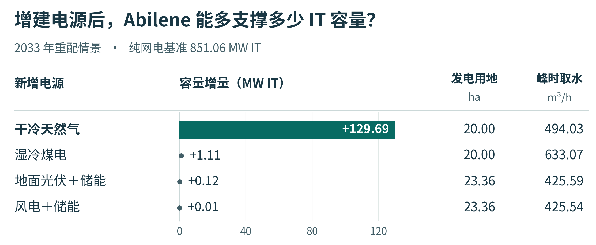

## 4　场址规模上限与发电方式

### 4.1　Abilene 原八栋的资源上限与工程设计

在得克萨斯州 Abilene，项目方披露的 1,200 MW 是园区并网容量。要估计其中多少能长期供给 IT 设备，我们按 2026 年原八栋的建设范围分别核算电、水与土地，再用逐栋设备设计校核资源上限。[^ai]

原八栋以网电正常运行，燃机留作备用。设 1,200 MW 均可持续交付，以 $k=1.41$ 近似满载时设施功率与 IT 功率之比，则电力可支持 **851.06 MW IT**。供水采用偏宽的条件，把 2030 年市级规划盈余全额分给园区并在年内均摊，可得 633.07 m³/h。若现场取水强度为 0.50 L/kWh IT，水可支持 **1,266.15 MW IT**。一期两栋的租赁面积为 38.43 ha，设计为 206 MW IT。以此平均强度估算，179.61 ha 运营宗地可支持 **962.75 MW IT**。因此，在这组条件下最先用尽的是电力。枯季实际可交付水量和满载倍率均待同期记录核实。[并网披露](https://www.crusoe.ai/resources/newsroom/crusoe-expands-ai-data-center-campus-in-abilene-to-1-2-gigawatts) · [原始输入及来源](../../data/geographic_case_abilene_20261122/plan_vs_optimizer/input_register.csv) · [三项上限](../../data/geographic_case_abilene_20261122/plan_vs_optimizer/results/plan_limits.csv)

每栋含四个 25 MW IT 数据厅，另有 3 MW IT，八栋设计容量合计 $8(4\times25+3)=824$ MW IT。资源上限比设计容量高 **27.06 MW IT（3.28%）**。若用 Epoch 对同阶段设施功率的估计 1,154 MW 代替额定并网值，按相同倍率折算为 818.44 MW IT，比设计容量低 5.56 MW IT。可见，仅把额定接入换成分期设施估计，就足以改变这次比较的高低方向。实际满载水平还需同期电表核实。[DPR 工程说明](https://www.dpr.com/projects/crusoe-abilene-data-center) · [八栋规划复原报告](../../data/geographic_case_abilene_20261122/plan_vs_optimizer/README.md)

### 4.2　煤电、天然气、风电和光伏如何改变上限

为单独比较发电方式，保持网电 1,200 MW、园区取水额度 633.07 m³/h、现场取水强度 0.50 L/kWh IT 和满载倍率 $k=1.41$。允许重新布置原有 179.61 ha 运营宗地，另有一块 23.36 ha 的连续地块可建电源，余地可用于机房及其配套。原八栋的备用燃机只承担备用。参照题面所述燃机约七年的交付等待期，设新增电源在 2033 年可投运。煤、气按 100 MW 整台布置，风电与光伏配四小时储能，按设计日逐小时求可维持的恒定 IT 功率。[发电与储能参数](../../data/geographic_case_abilene_20261122/plan_vs_optimizer/input_register.csv) · [宗地核查](../../data/geographic_case_abilene_20261122/eight_building_land_review/parcel_check/README.md)

**图 4-1　四种电源相对纯网电的容量增量。** 峰时取水为机房与自建电厂的取水量之和。

煤电与燃气方案各占 20 ha，首先耗尽的资源却不同。按湿冷煤电高取水工况 132.5 L/kWh 发电量，一台 100 MW 机组只有约 1.56 MW 能持续调用，IT 上限为 **852.17 MW**。模型允许机组连续调低出力，实际机组还受最低稳定出力限制。干冷燃气按 0.02 L/kWh 发电量取水，两台 100 MW 机组将电力上限抬至 992.91 MW IT，留给机房的土地先把容量限定在 **980.75 MW IT**。这一结果以燃料持续供应、获准投运和宗地可重排为条件。保留八栋原布局时，按一期平均用地强度扩建可达 **895.60 MW IT**。[各方案调度结果](../../data/geographic_case_abilene_20261122/plan_vs_optimizer/results/portfolio.csv) · [保留八栋的扩建结果](../../data/geographic_case_abilene_20261122/plan_vs_optimizer/results/anchored_extension.csv)

风机间距按 30 ha/MW、地面光伏按约 3.60 ha/MWac 计，同一块 23.36 ha 的地分别只能容纳 0.78 MW 风电或 6.49 MWac 光伏。两者的发电运行取水近似为零，受低风和低日照时段限制，风储与光储的 IT 上限分别为 **851.07、851.18 MW**。固定光储设备，用 2024 年连续 8,784 小时复核，可持续的 IT 增量为 **0.15 MW**，与设计日的 0.12 MW 同属一个量级。[逐时天气检验](../../data/geographic_case_abilene_20261122/plan_vs_optimizer/results/weather_check.csv)

场址供水约束采用**取水量**。若考察流域损失的水，应从取水中扣除回流。文献给出的运行期净耗水中位数分别约为直流冷却常规煤电 0.95、干冷联合循环燃气 0.008、风电 0、地面光伏 0.004 L/kWh 发电量。要按净耗水重估容量，还需同一枯水期可分配给项目的净耗水额度。[Macknick 等，表 1–3](../../ref/15_Macknick2012_Electricity_Water_Factors.pdf#page=6)

### 4.3　与 950 MW、2,263 MW 和 5 GW 的比较

Abilene 原八栋的资源上限为 **0.85 GW IT**，允许重排用地并增建干冷燃机时为 **0.98 GW IT**，均属 $10^3$ MW IT 量级。表 4-1 先按题面数值表示 IT 功率作比较。只有在允许重排的情景中，场址上限才超过 950 MW IT。[题目第 6 页](../../IMMC2027%20Problems_Greater%20China%20Autumn/IMMC2027%20Problem%20A-How%20big%20an%20AI%20data%20center%20to%20be_.pdf#page=6) · [场址复算结果](../../data/geographic_case_abilene_20261122/plan_vs_optimizer/results/summary.json)

**表 4-1　按 IT 功率比较，Abilene 上限与题面规模相差多少。** 差值取整至 MW IT。

| 题面参照 | 原八栋资源上限（851.06 MW IT） | 重配上限（980.75 MW IT） |
|---|---:|---:|
| 950 MW | 低 99 | **高 31** |
| 2,263 MW | 低 1,412 | 低 1,282 |
| 5 GW | 低 4,149 | 低 4,019 |

题面将 Hyperion 的 5 GW 称为规划电力需求，三档参照的计量位置并未逐一注明。若按设施总功率理解，并借用 Abilene 的 $k=1.41$ 换算，三档依次约为 **674、1,605、3,546 MW IT**。此时原八栋的资源上限高于第一档，仍低于后两档。题面也给出一个明确按 IT 计量的运营项目，New Carlisle 的 **1,037 MW IT** 比 Abilene 原八栋资源上限高约 **186 MW IT**。若 Abilene 要达到 5 GW IT，仅供电就需要 7.05 GW 设施功率，已超过本址 1.2 GW 并网与候选自建电源的合计容量。[题目背景与 New Carlisle 图注，第 5 页](../../IMMC2027%20Problems_Greater%20China%20Autumn/IMMC2027%20Problem%20A-How%20big%20an%20AI%20data%20center%20to%20be_.pdf#page=5)

### 4.4　五个场址的规模对照与瓶颈

五地按 2030 年建成情景评估，在纯网电与屋顶光储之间取可持续容量较高者，光伏出力采用 2025 年逐时天气。表 4-2 同时列出各址能用工程资料核对的数值及其建设阶段。[五地基准报告](../../data/q1_five_sites/README.md) · [分阶段工程对照](../../data/q1_plan_comparison/README.md)

**表 4-2　五地的基准容量、瓶颈与工程参照。** 基准容量单位为 MW IT。

| 场址 | 基准容量 | 瓶颈 | 同址工程参照 |
|---|---:|---|---|
| [美国 Golden](../../data/q1_us_golden/plan_comparison.csv) | 5.66 | 电力 | 改造配电 6 MW，实验室终态设计 10 MW IT |
| [冰岛 Keflavík](../../data/q1_is_keflavik/plan_comparison.csv) | 100.00 | 电力 | 基准按全园计。新增模块布局可容 100 MW IT，规划 120 MW IT |
| [新加坡 Tanjong Kling](../../data/q1_sg_tanjongkling/plan_comparison.csv) | 110.45 | 水 | 整栋最高需求 150 MW，折合 126.05 MW IT |
| [智利 Quilicura](../../data/q1_cl_quilicura/plan_comparison.csv) | 60.20 | 电力 | 单段线路全额分配时为 66.85 MW IT，需求预测折合 60.19 MW IT |
| [澳大利亚 Huntingwood](../../data/q1_au_huntingwood/plan_comparison.csv) | 320.00 | 土地 | 获批总用电折合 347.83 MW IT，九期目标至少 320 MW IT |

五地基准容量为 **5.66–320.00 MW IT**。同样加一套电源，各地结果可以相差很远。五处可分给发电的土地都容纳不下本研究设定的 20 ha 煤电模块。冰岛全园在燃料充足、可布置一台 10 ha 燃机的假设下，可从纯网电的 **100.00** 提高到 **136.36 MW IT**，此时取水先达到上限。智利若也为燃机划出 10 ha，机房用地将把该配置压至 **26.92 MW IT**，低于纯网电的 **60.19 MW IT**。当地扩展候选中，采用约 5.21 ha 地面光储可达 **60.23 MW IT**。[五地扩展候选汇总](../../data/q1_five_sites/expanded_comparison.csv) · [冰岛报告](../../data/q1_is_keflavik/扩展候选.md) · [智利报告](../../data/q1_cl_quilicura/扩展候选.md)

新加坡的 110.45 MW IT 取决于等效管径 250 mm 的供水假设。该情景可送达 265.07 m³/h，而以 2.4 L/kWh IT 的取水强度支撑 126.05 MW IT，需约 **303 m³/h**。缺少项目枯季配额时，这一差值给出了需要核实的供水量。悉尼的 320 MW IT 用到了按规划下限标定的用地强度。另一份审批记录允许设施总用电 400 MW，实现 320 MW IT 需要 368 MW。从用电审批看，目标有 32 MW 的余量，场址容量仍受土地限制。[新加坡基准报告](../../data/q1_sg_tanjongkling/README.md) · [悉尼基准报告](../../data/q1_au_huntingwood/README.md)

[^ai]: OpenAI Codex，2026 年 11 月 22 日。本节使用该工具将团队已有的六场址补充稿及场址分析报告编整为论文正文，并按已有结果编制图表、核对数字和单位。
