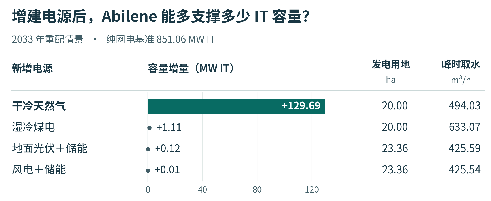
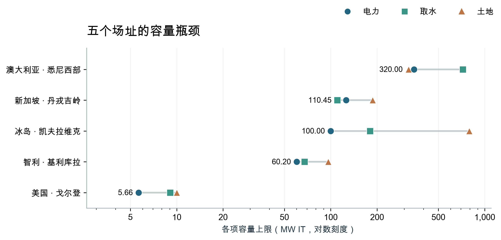

## 4　实证校验、规模对标与发电方式的影响

前文从能源、水资源与土地三类约束出发，建立了单个集中式 AIDC 的最大可持续规模判据 $P(x)=\min\{P_E(x),\,P_W(x),\,P_L(x)\}$ 与分年优选框架 $P_{\max}(y)=\max_{x\in\mathcal X_y}P(x)$。本节将该模型代入具体场址，依次回答三个核心问题：其一，与现实工程规模及题面参照相比，模型测算的资源上限究竟偏高还是偏低，差额源于物理资源、功率口径还是建设阶段；其二，在同一块地、同一份电网接入与供水额度下，增建煤电、天然气、风电或光伏时，哪项约束最先触顶、最终能多支撑多少 MW IT；其三，当模型迁移至不同地理与水资源条件的场址时，上述瓶颈排序与电源增容规律是否依然成立。[^ai]

### 4.1　主案例校核：Abilene 原八栋的资源上限与口径检验

为避免仅凭假设参数空转，我们先选取资料完整度最高的得克萨斯州 Abilene 园区（Stargate Abilene 原八栋建设范围）作为主校核场址，先在不设建筑设备上限的条件下代入当地电、水、土地资源求取理论承载上限，再与同阶段、同边界的逐栋工程设计容量对照。[并网披露](https://www.crusoe.ai/resources/newsroom/crusoe-expands-ai-data-center-campus-in-abilene-to-1-2-gigawatts) · [输入登记表](../../data/geographic_case_abilene_20261122/plan_vs_optimizer/input_register.csv)

原八栋在基准状态下以公共电网正常运行，现场燃机仅作应急备用。代入三项独立资源边界后，可算得该范围的三项单项上限：[三项上限输出](../../data/geographic_case_abilene_20261122/plan_vs_optimizer/results/plan_limits.csv)

- **能源约束上限 $P_E=851.06\text{ MW IT}$**：园区公开并网容量为 $P_{\mathrm{电网}}=1{,}200\text{ MW}$（假设额定量在正常运营期可持续全额交付）。沿用全园设计满载倍率 $k=1.41$（即每 $1\text{ MW IT}$ 需 $1.41\text{ MW}$ 设施总功率），由式（2）得 $P_E=1{,}200/1.41=851.06\text{ MW IT}$。
- **水资源约束上限 $P_W=1{,}266.15\text{ MW IT}$**：采用偏宽的供水对照情景，将 2030 年得州区域水规划中的市级盈余 $4{,}496\text{ acre-ft/年}$ 全额划归园区并在年内均摊，折合可供现场流量 $Q_{\mathrm{现场}}=633.07\text{ m}^3/\text{h}$（合 $15{,}193.79\text{ m}^3/\text{day}$）。按现场取水强度 $\mathrm{WUE}=0.50\text{ L/kWh IT}$ 计算，由第 2 节换算式得 $P_W=633.07/0.50=1{,}266.15\text{ MW IT}$。
- **土地约束上限 $P_L=962.75\text{ MW IT}$**：结合 Taylor 县宗地快照与城市规划区边界，原八栋对应运营宗地净面积为 $179.61\text{ ha}$（已内含宗内道路与缓冲，宗地外两座变电站 $5.85\text{ ha}$ 计入 $A_0$ 后与含站有效面积抵消）。以一期前两栋租赁宗地 $38.43\text{ ha}$ 与设计容量 $206\text{ MW IT}$ 标定单位扩建用地强度 $a_s=0.18655\text{ ha/MW IT}$，由式（3.3）得 $P_L=179.61/0.18655=962.75\text{ MW IT}$。

三者联合取小，原八栋范围内的资源承载上限为 **$851.06\text{ MW IT}$**，首先触顶的约束是**电力**。而工程总包方与开发商披露的同阶段八栋设计规模为每栋 4 个 $25\text{ MW IT}$ 数据厅外加 $3\text{ MW IT}$ 其他 IT 负载，合计 $8\times(4\times25+3)=824\text{ MW IT}$（Epoch AI 对 2026 年 11 月八栋建成阶段的估计同为 $824\text{ MW IT}$）。[DPR 工程说明](https://www.dpr.com/projects/crusoe-abilene-data-center) · [八栋规划复原报告](../../data/geographic_case_abilene_20261122/plan_vs_optimizer/README.md)

**图 4-1　Abilene 原八栋资源上限与 27.06 MW IT 差额分解。** 左图以竖虚线标出八栋设备设计 824 MW IT；右图比较同一建设阶段下 Epoch IT 估计、阶段设施功率折算与额定并网折算之间的差异。

模型的资源上限比同阶段设备设计高出 **$27.06\text{ MW IT}$（$+3.28\%$）**，两者极其接近。图 4-1 右侧进一步拆解了这 $27.06\text{ MW IT}$ 的来源：Epoch AI 估算该阶段实际配套的设施侧功率为 $1{,}154\text{ MW}$（而非并网铭牌上的 $1{,}200\text{ MW}$）。若将 $1{,}154\text{ MW}$ 代入同一满载倍率 $k=1.41$ 折算，得 $1{,}154/1.41=818.44\text{ MW IT}$，反而比设备设计低 $5.56\text{ MW IT}$（源于 $1{,}154/824=1.4005$ 与 $1.41$ 的微小倍率差）；而 $1{,}200\text{ MW}$ 并网铭牌相对 $1{,}154\text{ MW}$ 阶段设施功率多出的 $46\text{ MW}$ 裕度，按 $k=1.41$ 换算则贡献了 $+32.62\text{ MW IT}$。两项相抵（$32.62-5.56=27.06\text{ MW IT}$），说明模型高出的 $3.28\%$ **并非参数失真，而是“额定并网容量全额交付”与“分阶段实际接入功率”之间的口径差**。在资源足够时，园区真实可投运容量还受已有设备上限约束（$824\text{ MW IT}$）。

反过来由目标倒推资源门槛，要满载运行八栋的 $824\text{ MW IT}$，在 $k=1.41$、$\mathrm{WUE}=0.50\text{ L/kWh IT}$ 下，园区至少需要 **$1{,}161.84\text{ MW}$**（额定并网的 $96.82\%$）持续网电和 **$412.00\text{ m}^3/\text{h}$** 的稳定到场水量。单因素敏感性复算表明，若网电仅能保障额定容量的 $90\%$（$1{,}080\text{ MW}$），可用容量将降至 **$765.96\text{ MW IT}$**；若保持满额网电而将枯季可供水量收紧至 $400\text{ m}^3/\text{h}$，上限将由电力主导反转为水资源主导，降至 **$800.00\text{ MW IT}$**。[敏感性原表](../../data/geographic_case_abilene_20261122/plan_vs_optimizer/results/sensitivity.csv)

### 4.2　现实规模对标：我们的上限比 950 MW、2,263 MW 与 5 GW 高还是低？

结合上文基准与后文第 4.3 节的园区重配结果，Abilene 场址在不同决策边界下的最大可持续规模处于 **$0.85\text{–}0.98\text{ GW IT}$**（即 $10^3\text{ MW IT}$ 量级）：原八栋纯网电基准为 $851.06\text{ MW IT}$；若保持原八栋不动而在邻近候选块扩建，借用一期平均用地强度可得 $895.60\text{ MW IT}$；若允许在 2033 年（参考题面燃气轮机约七年的交付周期）重排宗地并投运自建燃气机组，连续配置上限可达 **$980.75\text{ MW IT}$**（若按每栋 $103\text{ MW IT}$ 整栋投运，向下取整为 9 栋、$927.00\text{ MW IT}$）。[计算摘要 JSON](../../data/geographic_case_abilene_20261122/plan_vs_optimizer/results/summary.json)

将上述测算上限与题面给出的三档规模参照——**950 MW、2,263 MW、5 GW**——逐一对比，可发现“偏高还是偏低”强烈依赖于**参照数值究竟计量在 IT 侧还是设施侧**（表 4-1）。

**表 4-1　Abilene 场址上限与题面三档参照规模的口径对照（单位：MW IT）。**

| 题面参照规模 | 情景 A：参照按 IT 功率计 | 原八栋基准（851.06）相对差值 | 重配燃机上限（980.75）相对差值 | 情景 B：按设施总功率计并借用 $k=1.41$ 换算 | 原八栋基准相对情景 B 差值 |
|---|---:|---:|---:|---:|---:|
| **950 MW** | 950.00 | 低 98.94（$-10.4\%$） | **高 30.75（$+3.2\%$）** | 673.76 | **高 177.30（$+26.3\%$）** |
| **2,263 MW** | 2,263.00 | 低 1,411.94（$-62.4\%$） | 低 1,282.25（$-56.7\%$） | 1,604.96 | 低 753.90（$-47.0\%$） |
| **5 GW（5,000 MW）** | 5,000.00 | 低 4,148.94（$-83.0\%$） | 低 4,019.25（$-80.4\%$） | 3,546.10 | 低 2,695.04（$-76.0\%$） |

从表 4-1 可以得出三点明确判断：

1. **第一档（950 MW）处于单场址可行边界附近，口径与配置选择会反转高低结论。** 若 950 MW 代表 IT 功率（例如仓库所录 Epoch 时间线中 Colossus 2 于 2026 年 6 月的阶段估计为 $946\text{ MW IT}$），则 Abilene 原八栋基准偏低 $98.94\text{ MW IT}$，仅当允许宗地重排并增建 200 MW 干冷燃机时，连续上限 $980.75\text{ MW IT}$ 才能跨过该门槛（而按整栋 $927\text{ MW IT}$ 计仍略低）。反之，若 950 MW 实为设施侧总用电，即使借用本场址较高的 $k=1.41$ 折算（对应 $673.76\text{ MW IT}$），原八栋资源上限反而高出 $177.30\text{ MW IT}$。
2. **第二、三档（2,263 MW 与 5 GW）在两种口径下均显著高于 Abilene 单场址上限。** 仓库 Epoch 时间线显示，2,263 MW 与 Microsoft Fairwater Wisconsin 对 2028 年 5 月的远期预测规模一致，而题面明确指出 Meta Hyperion 的 $5\text{ GW}$ 为“规划电力需求”（即设施侧与配套用电规模）。即便按 $k=1.41$ 将 $5\text{ GW}$ 折合为 $3{,}546.10\text{ MW IT}$，它仍超出 Abilene 纯网电上限近 $2.70\text{ GW IT}$；若按 IT 功率计，则需 $5\times1.41=7.05\text{ GW}$ 设施供电——这已经远远超过单座千兆瓦级变电站的物理接入能力，必须依赖多座专用电厂或跨区群组支撑。
3. **同口径已投运项目印证了吉瓦级单址天花板。** 题面图注中明确以 IT 功率计量的已运营项目——Anthropic–Amazon New Carlisle——当前 IT 容量为 **$1{,}037\text{ MW IT}$**，设施侧相应超过 $1.2\text{ GW}$；这与 Abilene 的 $851.06\text{–}980.75\text{ MW IT}$ 同处 $10^3\text{ MW IT}$ 量级，且高出 Abilene 纯网电上限约 $186\text{ MW IT}$，进一步印证了“吉瓦级单址容量受限于地方接入与土地边界，而非模型系统性低估”的结论。[题目背景第 5 页](../../IMMC2027%20Problems_Greater%20China%20Autumn/IMMC2027%20Problem%20A-How%20big%20an%20AI%20data%20center%20to%20be_.pdf#page=5) · [Epoch 时间线](../Q1-v2/IMMC2027-Q1/图片和附件/data_center_timelines.csv)

### 4.3　同址同水额下，煤电、天然气、风电与光伏如何改变上限？

针对题面第一问末尾关于发电方式差异的问题，我们在 Abilene 主案例中严格锁定同一外部资源盘子：维持电网接入 $1{,}200\text{ MW}$、可供水额度 $633.07\text{ m}^3/\text{h}$、现场取水强度 $0.50\text{ L/kWh IT}$ 与满载倍率 $k=1.41$ 不变；允许在原有 $179.61\text{ ha}$ 运营宗地上重排机房，并开放经 GIS 宗地核查识别出的同一块最大连续空闲地块 **$23.36\text{ ha}$** 用于新建电源（余地可并入机房配套），原八栋备用燃机仅作应急备用不计入常态供电。参照题面燃气轮机约七年的等待周期，该对照组设定在 **2033 年可投运**情景下，以设计日（2025 年 1 月 29 日逐小时）维持恒定 IT 功率最大化为目标。煤电、燃气以 $100\text{ MW}$ 整台为模块（分别占地 $20\text{ ha}$、$10\text{ ha}$），风电（$30\text{ ha/MW}$）与地面光伏（$3.60\text{ ha/MWac}$）配置 4 小时共蓄电池（充放功率为风光装机的 $25\%$，效率均为 $0.90$）。[电源组合原表](../../data/geographic_case_abilene_20261122/plan_vs_optimizer/results/portfolio.csv) · [整数分支与调度](../../data/geographic_case_abilene_20261122/plan_vs_optimizer/results/integer_branches.csv)

**图 4-2　同一场址四种新增电源对 IT 容量上限的增量及资源占用。** 以纯网电基准 851.06 MW IT 为零点，右侧两列同时列出新增电源实际占用的土地面积与系统峰时取水总量。

图 4-2 与表 4-2 给出了四种电源在统一基准下的定量对照结果，清晰揭示了**“高水耗锁死煤电、大占地压缩风光、气电受制于土地余量”**的三重分异机制：

**表 4-2　同一电网与供水条件下四种电源的制约机制与容量上限（Abilene 2033 年重配情景）。**

| 供电方案（最优配置） | 发电占地（ha） | 电力上限（MW IT） | 土地上限（MW IT） | 峰时总取水（m³/h） | 最终容量（MW IT） | 较纯网电增量（MW IT） | 首先触顶约束 |
|---|---:|---:|---:|---:|---:|---:|---|
| 纯网电基准 | 0.00 | 851.06 | 1,087.96 | 425.53 | 851.06 | — | **电力** |
| 湿冷煤电（$1\times100\text{ MW}$） | 20.00 | 921.99 | 980.75 | **633.07** | 852.17 | **+1.11** | **水资源** |
| 干冷天然气（$2\times100\text{ MW}$） | 20.00 | 992.91 | **980.75** | 494.03 | **980.75** | **+129.69** | **土地** |
| 地面光伏 $6.49\text{ MWac}$＋储能 | 23.36 | 851.18 | 962.75 | 425.59 | 851.18 | **+0.12** | **电力** |
| 风电 $0.78\text{ MW}$＋储能 | 23.36 | 851.07 | 962.75 | 425.54 | 851.07 | **+0.01** | **电力** |

1. **湿冷煤电：电与地均未触顶，却被取水额度“卡死”在 $+1.11\text{ MW IT}$。** 单台 $100\text{ MW}$ 湿冷煤电机组需占地 $20.00\text{ ha}$，使土地上限降至 $980.75\text{ MW IT}$、理论供电上限增至 $921.99\text{ MW IT}$；但由于本例按高取水直流冷却工况计（取水系数 $132.5\text{ L/kWh}$ 发电量），机组与数据中心冷却共用同一份 $633.07\text{ m}^3/\text{h}$ 取水额度。算式显示，在满足 $852.17\text{ MW IT}$ 冷却取水（$426.09\text{ m}^3/\text{h}$）后，剩余水量仅够该 $100\text{ MW}$ 煤电机组持续调用约 $1.56\text{ MW}$ 净出力，其余装机全部闲置（实际工程中还受机组最低稳燃出力限制而更难运行）。此外须明确口径差异：此处水额按**现场取水量**核定；若流域评价改用扣除退水后的**净耗水量**，文献中直流煤电中位运行净耗水约为 $0.95\text{ L/kWh}$ 发电量、干冷联合循环燃气约为 $0.008\text{ L/kWh}$、风电为 $0$、光伏约 $0.004\text{ L/kWh}$，此时仍需对应匹配同一枯季流域允许的**净耗水额度**方能重算。[Macknick 用水系数，表 1–3](../../ref/15_Macknick2012_Electricity_Water_Factors.pdf#page=6)
2. **干冷天然气：解开水锁后增量居首（$+129.69\text{ MW IT}$），最终由土地反超触顶。** 干冷燃气机组取水强度极低（$0.02\text{ L/kWh}$ 发电量），$23.36\text{ ha}$ 地块可布置两台 $100\text{ MW}$ 机组（占 $20.00\text{ ha}$）。此时发电与机房峰时合计取水仅 $494.03\text{ m}^3/\text{h}$，远低于 $633.07\text{ m}^3/\text{h}$ 红线；电力上限一举推高至 $992.91\text{ MW IT}$，但两台机组挤占 $20.00\text{ ha}$ 后，留给机房与配套的土地仅能支撑 **$980.75\text{ MW IT}$**（实际调用燃机净功率约 $182.86\text{ MW}$），瓶颈由电力彻底转向土地。即便开放四种电源任意混合寻优，最优组合仍只选两台干冷燃机。需要强调，该上界依赖于三项前置条件：外部气源足额交付、环评与建设许可获批，以及宗地可重构；若业主必须保留原有八栋建筑不动，仅在 $23.36\text{ ha}$ 地块上布置 1 台 $100\text{ MW}$ 燃机（$10\text{ ha}$）并在余地 $13.36\text{ ha}$ 扩建机房，则仅能新增 $71.60\text{ MW IT}$，总规模为 **$895.60\text{ MW IT}$**。[保留八栋扩建复算](../../data/geographic_case_abilene_20261122/plan_vs_optimizer/results/anchored_extension.csv)
3. **风电与地面光伏：不争水却受制于“低能量密度＋全天恒定保供”。** 尽管两者运行几乎不耗水，但 $23.36\text{ ha}$ 土地在按风机间距 $30\text{ ha/MW}$ 和光伏 $3.60\text{ ha/MWac}$ 折算后，分别仅能装机 $0.78\text{ MW}$ 和 $6.49\text{ MWac}$；更关键的是，AIDC 需要的是**逐小时恒定可靠功率**而非年均发电量。受夜间无光、低风时段与 4 小时电池电量平抑能力限制，设计日下风储与光储的可靠电力增量仅分别为 **$0.01\text{ MW IT}$** 与 **$0.12\text{ MW IT}$**，园区依然死守在电力瓶颈上。为检验是否因单日气象过苛而低估光储，我们固定 $6.49\text{ MWac}$ 光伏与 $1.62\text{ MW}/6.49\text{ MWh}$ 电池配置，代入未参与求解的 2024 年连续 $8{,}784$ 小时逐时气象序列复算全周期调度，可靠 IT 增量也仅为 **$0.15\text{ MW IT}$**，与设计日的 $0.12\text{ MW IT}$ 处于同一量级。[跨年天气检验](../../data/geographic_case_abilene_20261122/plan_vs_optimizer/results/weather_check.csv)

### 4.4　结论能否外推？五个全球场址的交叉验证与瓶颈迁移

上述由 Abilene 得出的“电力/水/土地依次交棒”以及“燃气优于煤电与风光”的排序，换到其他地理与气候条件下是否依然成立？为此，我们将同一套评估框架迁移至**美国 Golden、冰岛 Keflavík、新加坡 Tanjong Kling、智利 Quilicura 与澳大利亚 Huntingwood** 五处真实场址，统一设定在 2030 年评估基准下，以 2025 年全年逐时天气运行纯网电与屋顶光储方案（不占用额外净地，屋顶光伏仅作技术校核），并与各站公开工程或规划资料所能核对的边界逐一比对。[五地基准报告](../../data/q1_five_sites/README.md) · [五地工程对照](../../data/q1_plan_comparison/README.md)

**表 4-3　五个对比场址的 2030 年基准容量、首要瓶颈与公开工程口径对照。**

| 场址与评估边界 | 基准上限（MW IT） | 首要瓶颈 | 同址可核对的工程参照与阶段说明 | 核心边界条件与待核缺项 |
|---|---:|---|---|---|
| **美国 Golden（ESIF 模块）** | **5.66** | 电力 | DOE 改造预算 $6\text{ MW}$ 可用功率（按 $k=1.06$ 折合）；NREL 终态设计 $10\text{ MW IT}$ | $6\text{ MW}$ 系配电改造阶段（终态需 $10.6\text{ MW}$ 与 $7.0\text{ m}^3/\text{h}$ 水），非同阶段误差；若沿用历史用水上限 $9{,}500\text{ m}^3/\text{年}$，水上限骤降至 $1.55\text{ MW IT}$ |
| **冰岛 Keflavík（Verne 全园）** | **100.00** | 电力 | 首期变电站 $120\text{ MW}$（按运营 PUE $1.20$ 折合）；另见 VDC04 新模块布局上限 $100\text{ MW IT}$（规划 $120\text{ MW IT}$） | 基准假设全园取水 $3.6\text{ m}^3/\text{h}$、闭路 $\mathrm{WUE}=0.02\text{ L/kWh IT}$；VDC04 模块达 $120\text{ MW IT}$ 需扩机房至 $7{,}200\text{ m}^2$（或提柜密至 $120\text{ kW}$）并获配 $144\text{ MW}$ 设施供电 |
| **新加坡 Tanjong Kling** | **110.45** | **水资源** | 工程披露最高设施需求 $150\text{ MW}$（按预期 PUE $1.19$ 折合 $126.05\text{ MW IT}$） | 缺实际配水合同，基准按等效 DN250 专管供水 $265.07\text{ m}^3/\text{h}$ 与当地 $\mathrm{WUE}=2.4$ 计算；若管径收紧至 DN200，上限降至 $70.69\text{ MW IT}$；若扩至 DN300 或 $\mathrm{WUE}$ 降至行业基准 $2.1$，则转为电力触顶（$126.07\text{ MW IT}$） |
| **智利 Quilicura（Data Luna）** | **60.20** | 电力 | 2025 年电网需求预测 $65\text{ MW}$（按 PUE $1.08$ 折合 $60.19\text{ MW IT}$）；单段 76 MVA 留存回路情景为 $66.85\text{ MW IT}$ | 基准假定两口水井按环评水权 $50\text{ L/s}$（$180\text{ m}^3/\text{h}$）全额可用；若仅按井群设计均值 $15\text{ L/s}$ 供水，水上限急跌至 **$20.28\text{ MW IT}$**；另有 2025 年全址平均取水 $120.2\text{ m}^3/\text{h}$ |
| **澳大利亚 Huntingwood（SYD3）** | **320.00** | **土地** | 州规划审批总用电 $400\text{ MW}$（按 $k=1.15$ 折合 $347.83\text{ MW IT}$）；运营商九期规划下限 $320^+\text{ MW IT}$ | $320\text{ MW IT}$ 参与过 $8.3\text{ ha}$ 地块用地强度标定（$a_s=0.02594\text{ ha/MW IT}$），属于参数复现而非独立预测；按 $320\text{ MW IT}$ 计需 $368\text{ MW}$ 设施供电（在 $400\text{ MW}$ 审批内）及 $224\text{–}384\text{ m}^3/\text{h}$ 补水 |

**图 4-3　五个对比场址的三项资源容量上限与瓶颈。** 圆点、方块与三角分别代表电力、取水与土地单项上限，每行最左侧标记与标注数值即为该场址联合取小后的基准可持续容量。

对照表 4-3、图 4-3 与五地扩展情景计算结果（[五地扩展汇总](../../data/q1_five_sites/expanded_comparison.csv)），可以明确回答“换一个场址后，前述结论是否还成立”：

1. **三项资源的木桶瓶颈高度场址化，量级跨度达两个数量级。** 五地基准上限分布于 **$5.66\text{–}320.00\text{ MW IT}$**：其中 Golden、Keflavík、Quilicura 与主案例 Abilene 一样先受制于**电力**；新加坡 Tanjong Kling 在等效 DN250 供水假设下先受制于**水资源**（达标 $126.05\text{ MW IT}$ 需约 $303\text{ m}^3/\text{h}$ 稳定补水，取决于实际再生水配额）；澳大利亚 Huntingwood 虽有 $400\text{ MW}$ 审批用电空间，却最先在 $8.3\text{ ha}$ 的高密度宗地上触及**土地**天花板。此外，与外部工程参照对标时，必须先分辨对方口径是改造阶段（Golden $6\text{ MW}$）、布局推算（Keflavík VDC04 仅排柜容量 $100\text{ MW IT}$）、电网预测（Quilicura $65\text{ MW}$）还是规划审批包络（Huntingwood $400\text{ MW}$），不能将其直接视为与模型误差平行的“真值”。
2. **发电方式的最优排序在土地充裕与土地紧缺场址间发生根本逆转。** 我们在五地同样检验了在场内重划地块增建电源的扩展情景：首先，由于五地可用空地均不足以容纳一座 $20\text{ ha}$ 燃煤模块（外加机房空间），**煤电在五个中小面积场址上全部直接不可行**。其次，**冰岛与智利形成了极具说服力的对照**：两者同样从既有土地中划出 $10.00\text{ ha}$ 布置一台 $100\text{ MW}$ 干冷燃气机组，
   - 在地广水丰的**冰岛 Keflavík**（土地单项上限原高达 $792.50\text{ MW IT}$），划出 $10\text{ ha}$ 后土地上限降至 $292.50\text{ MW IT}$ 仍远高于电力，在供气充足的假设下，联合上限由纯网电的 **$100.00\text{ MW IT}$ 跃升至 $136.36\text{ MW IT}$**，随后瓶颈由电力转移至取水（$136.36\text{ MW IT}$），与 Abilene 的增容逻辑一致；[冰岛扩展报告](../../data/q1_is_keflavik/扩展候选.md)
   - 但在总用地仅 $15.90\text{ ha}$、且高密度园区外土地已较紧张的**智利 Quilicura**，划出 $10\text{ ha}$ 给燃机后，剩余面积扣除固定用地 $A_0=2.03\text{ ha}$ 仅剩 $3.87\text{ ha}$，使土地上限被急剧压缩至 **$26.92\text{ MW IT}$**，联合容量反而比纯网电基准的 **$60.19\text{ MW IT}$ 暴跌一半以上**；此时当地最优扩展反而是利用约 $5.21\text{ ha}$ 铺设地面光伏加储能，勉强微增至 **$60.23\text{ MW IT}$**。[智利扩展报告](../../data/q1_cl_quilicura/扩展候选.md)
   - 同理，在本身已受土地限制的**澳大利亚 Huntingwood** 与土地余量本就不大的**新加坡 Tanjong Kling**，任何占用净地的地面电源（含 $10\text{ ha}$ 燃机、地面光伏或风机）都会直接挤占机房用地、拉低联合上限，因而纯网电或不额外占地的屋顶光储反而成为最优选择。
3. **水压力背景与枯季实测构成最大外推风险。** WRI Aqueduct 子流域指标显示，Golden（基线压力比 $2.24$）与 Quilicura（$4.25$）均位于极高水压力（$>80\%$）流域，Huntingwood（$0.50$）处于高水压力（$40\text{–}80\%$）流域。正如智利敏感性分析所提示的，一旦井群供水从理想水权 $50\text{ L/s}$ 回落至计划平均 $15\text{ L/s}$，其可持续上限将立刻从 $60.20\text{ MW IT}$ 腰斩至 $20.28\text{ MW IT}$。因此，将本模型外推到任何新场址时，首要前提是取得与设计阶段匹配的**旱季保障配水量、故障后可交付网电份额以及真实可用建筑占地**，否则极易高估水资源与电网对扩建的支撑力。

[^ai]: OpenAI Codex，2026 年 11 月 22 日。本节使用该工具协助梳理仓库内既有六场址分析报告、数据表与图件，核对不同口径及单位换算关系，并按竞赛论文结构组织与润色正文内容。
