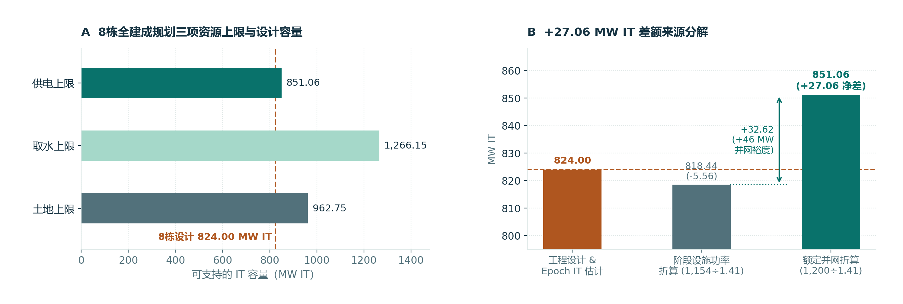
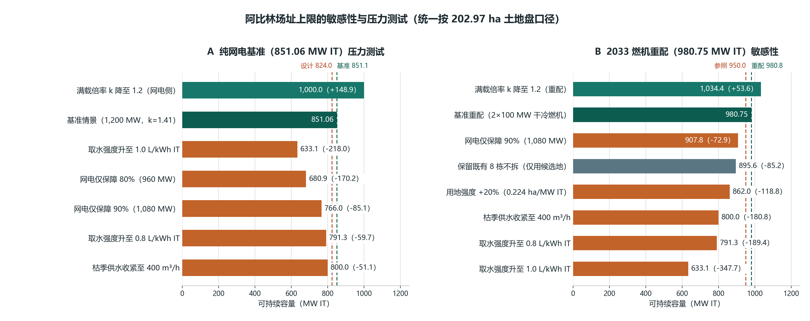
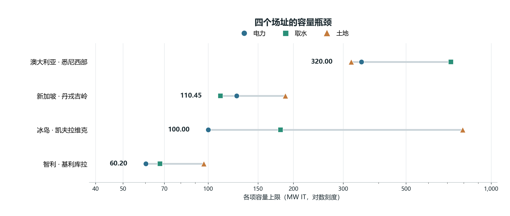
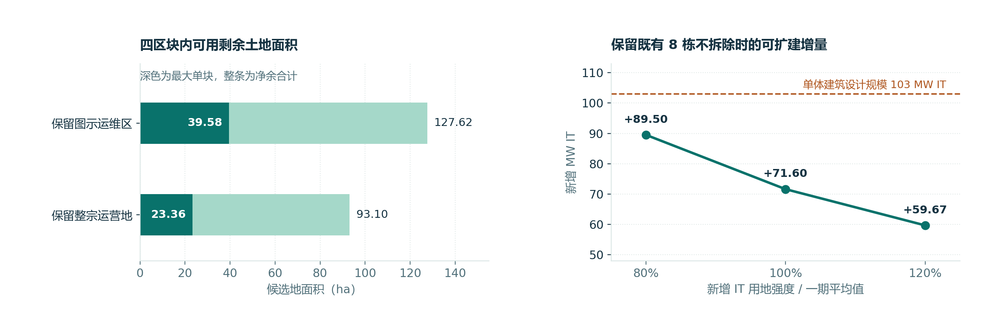

## 4　结果讨论

第 1–3 节分别处理能源、水资源与土地三类约束，并把它们折算成同一量纲——某一场址可持续供给的 IT 功率。本节用三组证据检验它：阿比林园区做同址、同阶段的基准校核；同一园区内四种电源做等资源对比；四个全球场址做迁移检验。[^ai]

### 4.1　基准校核：阿比林八栋园区的资源上限

得克萨斯州阿比林的 Stargate 园区由 Lancium 与 Crusoe 开发、Oracle 承租，毛地约 $1{,}100$ acre。校核对象限定为 **2026 年拟建成的 8 栋单体建筑**：每栋 4 个 $25$ MW IT 数据厅，另计每栋 $3$ MW IT 其他负载，合计 $8\times(4\times25+3)=824$ MW IT。选它作主校核场址，是因为供电、取水、供地三项边界分别能在并网披露、税收减免协议与州水资源规划中查到，施工范围另有总包披露可核。[4-1][4-2][4-3][4-4][4-9][4-11][4-12][4-13]

基准状态下园区全部使用公共电网，现场燃机仅作应急。代入三项边界得：供电上限 $P_E=1{,}200/1.41=851.06$ MW IT；取水上限 $P_W=633.07/0.50=1{,}266.15$ MW IT（供水取偏宽情景，2030 年市级规划盈余 $4{,}496$ acre-ft/年全年均摊）；土地上限 $P_L=179.61/0.18655=962.75$ MW IT（$a_s$ 由一期前两栋 $38.43$ ha、$206$ MW IT 标定）。三者取小得 **$851.06$ MW IT**，电力先触顶。

**图 4-1　阿比林 8 栋建成范围的资源上限与 $27.06$ MW IT 差额分解。** 左图虚线为 8 栋设备设计 $824$ MW IT；右图三根柱依次为工程设计容量、按阶段设施功率折算的容量、按额定并网折算的容量。

模型比同阶段设备设计高 **$27.06$ MW IT（$+3.28\%$，图 4-1）**。差额由两段口径差相抵而成：Epoch AI 估计该阶段设施侧功率为 $1{,}154$ MW，低于并网铭牌 $1{,}200$ MW，按 $1.41$ 折算得 $818.44$ MW IT，比设备设计低 $5.56$；铭牌多出的 $46$ MW 裕度则折算为 $+32.62$。两者相抵即 $+27.06$，说明差别来自"额定并网全额交付"与"分阶段实际接入"的口径，而非参数失真。[4-8]

反过来，$824$ MW IT 满载需 $1{,}161.84$ MW 网电（额定的 $96.82\%$）与 $412.00$ m³/h 到场水；网电只保 $90\%$ 时上限降到 $765.96$，枯季供水收紧到 $400$ m³/h 时瓶颈由电转水、上限降到 $800.00$。本节得到的精度因此是"与同阶段设备设计相差约 $3\%$"，而不是"能预测园区规模"——后者取决于业主分期与并网兑现，不属于资源约束。

把决策边界放宽到允许重排与增建，同一场址的上限落在 **$0.85$–$0.98$ GW IT**：纯网电 $851.06$；保留既有 8 栋、只在宗地之外的候选地上扩建 $895.60$；2033 年允许重排宗地并投运两台 $100$ MW 干冷燃机则连续分配上限为 $980.75$（按每栋 $103$ MW IT 整栋投运，向下取整为 9 栋、$927.00$）。也就是说，**对同址同阶段的设备设计偏高 $3.28\%$**；而这个量级与题面所举的 950 MW 档、以及同口径已投运的 New Carlisle（$1{,}037$ MW IT）相当。

### 4.2　同址同水额：煤、气、风、光四种方案

题面第一问末要求比较发电方式。我们在同一园区锁定网电 $1{,}200$ MW、可供水 $633.07$ m³/h、$\mathrm{WUE}=0.50$、$k=1.41$，允许在 $179.61$ ha 宗地内重排机房，并开放宗地之外、同属四区块的 $23.36$ ha 候选地用于新建电源；参照题面燃气轮机约七年交付期，对照组设在 2033 年。煤、气按 $100$ MW 整台（占地 $20$、$10$ ha），风光配 4 小时电池（充放功率 $25\%$、效率 $0.90$）。[4-5][4-7][4-14]

**图 4-2　同一场址四种增建电源对 IT 容量上限的增量与资源占用。** 四种电源按增量降序排列；以纯网电基准 $851.06$ MW IT 为零点，右侧两列给出新增电源占用的土地与系统峰时取水。

**表 4-1　同一电网与供水条件下四种电源的制约机制与容量上限（阿比林 2033 年重配情景）。**

| 供电方案（最优配置） | 发电占地（ha） | 电力上限（MW IT） | 土地上限（MW IT） | 峰时总取水（m³/h） | 最终容量（MW IT） | 较纯网电增量 | 首先触顶 |
|---|---:|---:|---:|---:|---:|---:|---|
| 纯网电基准 | $0.00$ | $851.06$ | $1{,}087.96$ | $425.53$ | $851.06$ | — | **电力** |
| 湿冷煤电 $1\times100$ MW | $20.00$ | $921.99$ | $980.75$ | **$633.07$** | $852.17$ | **$+1.11$** | **水资源** |
| 干冷燃气 $2\times100$ MW | $20.00$ | $992.91$ | **$980.75$** | $494.03$ | **$980.75$** | **$+129.69$** | **土地** |
| 风电 $0.78$ MW＋储能 | $23.36$ | $851.07$ | $962.75$ | $425.54$ | $851.07$ | **$+0.01$** | 电力 |
| 地面光伏 $6.49$ MWac＋储能 | $23.36$ | $851.18$ | $962.75$ | $425.59$ | $851.18$ | **$+0.12$** | 电力 |

注：表中"土地上限"按**允许重排时的总土地盘** $202.97$ ha（运营宗地 $179.61$ ha ＋宗地之外的候选地 $23.36$ ha，见附录 F.1）计算，与 4.1 节只算运营宗地 $179.61$ ha 的 $962.75$ MW IT 边界不同——候选地一旦被电源占用，被占部分便不能再用作机房用地，故光伏与风电两行按 $202.97-23.36=179.61$ ha 计、土地上限回落到 $962.75$ MW IT；"峰时总取水"为设计日机房与自建电源的合计取水量，不是许可额度。

四种方案的增量差两个数量级（图 4-2、表 4-1：$+1.11$、$+129.69$、$+0.01$、$+0.12$ MW IT），差异由"先消耗哪种资源"决定：

1. **湿冷煤电（$+1.11$）**：机组占 $20$ ha 把土地上限压到 $980.75$，取水系数 $132.5$ L/kWh 又把 $633.07$ m³/h 的水额吃满——机房冷却已用 $426.09$，余额只够机组持续出力约 $1.56$ MW。电和地都没触顶，是水锁死了它。[4-6]
2. **干冷燃气（$+129.69$）**：取水强度仅 $0.02$ L/kWh，两台机组占 $20$ ha 后电力上限推到 $992.91$，瓶颈转为土地（$980.75$），实际调用约 $182.86$ MW。前提是气源、环评与宗地重构同时成立；若保留既有 8 栋，只剩 $13.36$ ha 可扩建，即 $895.60$。
3. **风电与光伏（$+0.01$／$+0.12$）**：$23.36$ ha 只装得下 $0.78$ MW 风机或 $6.49$ MWac 光伏；AIDC 要的是逐时恒定功率而非年均电量，4 小时电池在夜间与低风时段无力平抑。改用未参与求解的 2024 年 $8{,}784$ 小时气象复算，可靠增量也只有 $0.15$ MW IT。[4-10]

时间维度上四者并不等价：风光 $1$–$2$ 年可建，燃气按题面约七年，故 2030 年前能新增的只有风光（$+0.01$／$+0.12$ MW IT），$+129.69$ 必须等到 2033 年。"时间上能建成"与"电量上够用"在本场址是两个答案。

### 4.3　敏感性与压力测试

一项结论应当经得起参数与资源的合理变动。我们从单因素敏感性、直接压力情景、跨年气象三个层次检验，结果按影响幅度排列于图 4-3，逐项网格见附录 F.4。

**图 4-3　阿比林上限的压力测试排序。** 横轴为可持续容量（MW IT）；左图为"只用网电"的交付边界，右图为"允许重排并投运两台干冷燃机"的边界。两图共用同一横轴量程与同一 $202.97$ ha 土地盘口径。

三点结论。第一，**水在两条分支上都排第一**：取水强度升至 $1.0$ L/kWh IT，重配分支的全部燃气增益被抹平、回落到 $633.07$，损失 $347.7$ MW IT，比任何电源方案的增量都大。第二，**参数改善的收益远小于恶化的损失**：$k$ 降到 $1.2$ 只多 $53.6$，一次水质导致的取水强度翻倍却抹掉 $347.7$，扩容应先锁住水再谈电源；且 $k$ 改善带来的是效率余量，不能读作资源变多。第三，**排序随分支而变**：纯网电分支的主导项是网电交付份额（$80\%$ 时 $-170.2$），重配分支一旦能自建电源，土地变成更紧的约束（用地 $+20\%$ 时 $-118.8$）；枯季供水收紧时瓶颈甚至会由电转水、上限掉到 $800.00$——"哪个约束先触顶"本身随水文年变化。

对 $950$ MW 档：重配分支只要网电保障降到 $90\%$，上限即跌到 $907.82$，低于该档；而 $k$ 改善到 $1.2$、或用地强度下降，都能把它推过 $950$（$1{,}034.36$、$992.92$）。跨年气象检验另给稳健性旁证：设计日可靠增量 $0.1172$ MW IT，2024 年整年复算 $0.1543$，同量级——"小面积风光不足以支撑恒定负荷"不是单日气象的偶然。[4-10]

### 4.4　迁移检验：四个全球场址

迁移检验取四处真实 AI 数据中心场址：冰岛凯夫拉维克、新加坡丹戎吉岭、智利基利库拉、澳大利亚悉尼西部，统一按 2030 年条件、2025 年逐时天气运行纯网电与屋顶光储，取较优者作为基准容量。[4-15]

**表 4-2　四个对比场址的 2030 年基准容量、首要瓶颈与公开参照的口径性质。**

| 场址与评估边界 | 基准上限（MW IT） | 首要瓶颈 | 同址可核对的公开参照（时点） | 参照的证据性质 | 主要待核缺项 |
|---|---:|---|---|---|---|
| **冰岛凯夫拉维克**（Verne 全园） | **$100.00$** | 电力 | 首期变电站 $120$ MW（2026 扩建公告）、年 PUE $1.20$（2025 披露）；VDC04 新模块按 $2.4$ ha 布局得 $100$ MW IT（模块密度约 $0.024$ ha/MW IT，高于场地平均 $0.02$）[4-16][4-17][4-18] | 运营披露 ＋ 拟扩建公告 ＋ 布局推算 | 未取得燃料与配气合同；VDC04 达 $120$ MW IT 需扩至 $7{,}200$ m² 或提柜密至 $120$ kW，并获配 $144$ MW |
| **新加坡丹戎吉岭** | **$110.45$** | **水资源** | 最高设施需求 $150$ MW（市场研究代理）、预期 PUE $1.19$；供水按等效 DN250 专管 $265.07$ m³/h、当地 $\mathrm{WUE}=2.4$ [4-19][4-20][4-21] | 市场研究代理 ＋ 情景假设 | 无实际配水合同；纯网电口径 $150/1.19=126.05$ MW IT，含屋顶光储为 $126.07$ |
| **智利基利库拉** | **$60.20$** | 电力 | 2025 年电网需求预测 $65$ MW、PUE $1.08$；环评水权 $50$ L/s（$180$ m³/h）；留存单段 $76$ MVA 回路情景 $66.85$ MW IT [4-22][4-23][4-24] | 需求预测 ＋ 环评水权 | 井群实测均值仅 $15$ L/s，对应上限 $20.28$ MW IT；2025 年全址平均取水 $120.2$ m³/h |
| **澳大利亚悉尼西部**（SYD3） | **$320.00$** | **土地** | 州规划审批总用电 $400$ MW（2022 核准）；运营商九期规划下限 $320^+$ MW IT；用地 $8.3$ ha [4-25][4-26][4-27] | 审批包络 ＋ 运营商目标（且参与标定） | $320$ 参与过用地强度标定（$a_s=0.02594$ ha/MW IT），属参数复现而非独立预测；$320$ MW IT 需 $368$ MW 设施供电与 $224$–$384$ m³/h 补水 |

**图 4-4　四个对比场址的三项资源上限与瓶颈归属。** 圆点、方块、三角分别为电力、取水与土地单项上限；每行最左侧的标记与标注值即该址联合取小后的基准可持续容量。

三点结论。

1. **容量与瓶颈高度场址化。** 四处基准上限分布在 $60.20$–$320.00$ MW IT：凯夫拉维克与基利库拉同主案例一样先受制于电力，丹戎吉岭受制于水（$110.45$），悉尼西部受制于土地（$320.00$）。表 4-2 第 5 列比第 4 列更值得注意：改造实测、运营披露、市场研究代理、需求预测与审批包络被放进同一张表，不加区分地取任何一个当"真值"，都会把口径差当成模型误差。
2. **电源排序在土地紧缺处逆转。** 四处都容不下 $20$ ha 煤电模块。冰岛与智利划出同样的 $10$ ha 给燃机：凯夫拉维克土地上限 $792.50\to292.50$ 仍高于电力，联合上限由 $100.00$ 升到 $136.36$（随后转水）；基利库拉总用地仅 $15.90$ ha，扣固定 $2.03$ ha 再划 $10$ ha 只剩 $3.87$ ha，土地上限压到 $26.92$，反而比纯网电腰斩，最优扩展转为约 $5.21$ ha 地面光储（$60.23$）。判据只需一个量：土地上限与电力上限之比——凯夫拉维克约 $7.9$，基利库拉约 $1.6$；两址的小风机按厂家功率曲线折算后装机不足 $1$ MW，不改变结论。[4-28]
3. **水压力、生态与外推风险。** Aqueduct 基线压力比显示基利库拉（$4.25$）处于极高压力流域，悉尼西部（$0.50$）高，凯夫拉维克（$0.017$）与丹戎吉岭（$0.043$）低；这与第 2 节的 $S\le S_{\max}$ 判据是同一类指标——$S$ 问流域还剩多少余量，$P_W$ 问项目能拿到多少可送达流量。基利库拉的井群若从水权 $50$ L/s 回落到设计平均 $15$ L/s，上限由 $60.20$ 跌到 $20.28$。生态敏感性以"只用已批复园区"处理：四处均为已建或已核准项目，约束以许可边界与可用连续地块上界进入；若折算为有效用地折减 $10\%$／$20\%$，阿比林仍有 $979$／$870$ MW IT（结论不变），而土地先触顶的悉尼西部会从 $320.00$ 掉到 $288.0$／$256.0$。三者说明外推到新场址必须先取得旱季保障配水量、可交付网电份额与真实可用占地，缺一项就会高估水与电网的支撑力。

综合四组证据：同址同阶段模型偏高 $3.28\%$，差额可拆到口径与阶段；换场址后容量与瓶颈逐址可解释。差异中来自资源禀赋的部分无法通过配置消除，来自口径与阶段的部分则可以通过统一口径对齐。本节在资料梳理、口径核对与图件整理环节使用了 AI 工具辅助，具体环节与工具版本见脚注与文献 [4-29]。

### 本节参考文献

[4-1] Crusoe. *An inside look at the Abilene AI data center* [EB/OL]. https://www.crusoe.ai/resources/blog/an-inside-look-at-the-abilene-ai-data-center
[4-2] Crusoe. *Crusoe expands AI data center campus in Abilene to 1.2 gigawatts* [EB/OL]. https://www.crusoe.ai/resources/newsroom/crusoe-expands-ai-data-center-campus-in-abilene-to-1-2-gigawatts
[4-3] DPR Construction. *Crusoe Abilene data center* [EB/OL]. https://www.dpr.com/projects/crusoe-abilene-data-center
[4-4] Oracle. *Abilene data center* [EB/OL]. https://www.oracle.com/data-centers/abilene/
[4-5] IMMC 2027 组委会. *Problem A: How big an AI data center to be?* [Z]. 2026, 第 1–2、5–6 页.
[4-6] Macknick J, Newmark R, Heath G, Hallett K C. Operational water consumption and withdrawal factors for electricity generating technologies: a review of existing literature[J]. *Environmental Research Letters*, 2012, 7: 045802. DOI: 10.1088/1748-9326/7/4/045802
[4-7] Ong S, Campbell C, Denholm P, Margolis R, Heath G. *Land-use requirements for solar power plants in the United States*[R]. NREL/TP-6A20-56290, 2013. DOI: 10.2172/1086349
[4-8] Epoch AI. *AI data centers* [DB/OL]. https://epoch.ai/data/ai-data-centers；分项容量 https://epoch.ai/graphs/largest-ai-data-centers-by-power-capacity
[4-9] Texas Water Development Board. *2026 Region G regional water plan, Volume I*[R]. 2026: 607. https://www.twdb.texas.gov/waterplanning/rwp/plans/2026/G/RegionG_2026_RWP_VolumeI.pdf
[4-10] Open-Meteo. *Historical weather API (ERA5)* [DB/OL]. https://open-meteo.com/en/docs/historical-weather-api
[4-11] City of Abilene. *Lancium LLC Abilene second amended and restated tax abatement agreement*[Z]. 2025: 25. https://abilenetx.gov/DocumentCenter/View/39456/Lancium-LLC-Abilene-Second-Amended-and-Restated-Tax-Abatement-Agreement-PDF
[4-12] City of Abilene. *SP-2026-77 (specific use permit)*[Z]. 2026. https://abilenetx.gov/DocumentCenter/View/43833/SP-2026-77-PDF
[4-13] Mortenson. *Abilene data center development* [EB/OL]. https://www.mortenson.com/projects/abilene-data-center-development
[4-14] Denholm P, Hand M, Jackson M, Ong S. *Land-use requirements of modern wind power plants in the United States*[R]. NREL/TP-6A2-45834, 2009. DOI: 10.2172/964608
[4-15] Kuzma S, Bierkens M F P, Lakshman S, et al. *Aqueduct 4.0: updated decision-relevant global water risk indicators*[R]. World Resources Institute, 2023. DOI: 10.46830/writn.23.00061
[4-16] Verne. *Iceland data sheet* [Z]. 2025. https://www.verneglobal.com/hubfs/Downloadable_Content/Datasheets%202025/Iceland_Datasheet%20.pdf
[4-17] Verne. *Launch of a high-capacity substation in Keflavík* [EB/OL]. 2026. https://www.verne.co/news/news-verne-and-landsnet-launch-high-capacity-substation
[4-18] Skipulagsstofnun (UUA). *Uppbygging gagnavers* [Z]. 2026. https://uua.is/urleits/uua2606003-uppbygging-gagnavers/
[4-19] Meta. *Rethinking data center design for Singapore* [EB/OL]. 2019. https://datacenters.atmeta.com/2019/01/rethinking-data-center-design-for-singapore/
[4-20] PUB, Singapore. *Sectoral water efficiency benchmark* [EB/OL]. https://www.pub.gov.sg/public/waterloop/water-conservation/resources-on-water-efficiency-measures/sectoral-water-efficiency-benchmark
[4-21] Monetary Authority of Singapore. *Singapore-Asia taxonomy for sustainable finance*[R]. 2023. https://www.mas.gov.sg/-/media/mas-media-library/development/sustainable-finance/singaporeasia-taxonomy-updated.pdf
[4-22] Servicio de Evaluación Ambiental (SEA), Chile. *Documento ambiental del proyecto de centro de datos en Quilicura*[Z]. 2022. https://infofirma.sea.gob.cl/DocumentosSEA/MostrarDocumento?docId=56%2F79%2F5da3b81f2f6e96f0e1740ab072571d17e39a
[4-23] Google. *10 datos sobre el centro de datos de Google en Quilicura, Chile* [EB/OL]. https://blog.google/intl/es-419/noticias-de-la-empresa/10-datos-sobre-el-centro-de-datos-de-google-en-quilicura-chile/
[4-24] Coordinador Eléctrico Nacional, Chile. *Minuta: solicitud nueva subestación Colina*[Z]. 2021. https://www.coordinador.cl/wp-content/uploads/2021/08/Minuta_Solicitud_Nueva_Subestacion_COLINA_24_08_2021.pdf
[4-25] AirTrunk. *AirTrunk expands western Sydney region with new SYD3 hyperscale data centre* [EB/OL]. 2023. https://airtrunk.com/airtrunk-expands-western-sydney-region-with-new-syd3-hyperscale-data-centre-asia-pacifics-largest/
[4-26] NSW Department of Planning. *51 Huntingwood Drive data centre (SSD-41589232)* [EB/OL]. https://www.planningportal.nsw.gov.au/major-projects/projects/51-huntingwood-drive-data-centre
[4-27] NSW Department of Planning. *SSD-41589232: water supply assessment*[Z]. 2022. https://majorprojects.planningportal.nsw.gov.au/prweb/PRRestService/mp/01/getContent?AttachRef=SSD-41589232%2120220916T041049.122+GMT
[4-28] NPS. *NPS-100C small wind turbine brochure*[Z]. 2019. https://www.nps100.com/wp/wp-content/uploads/2022/10/brochure-NPS-100C-24_ed2019_light_ENG.pdf
[4-29] OpenAI. *Codex CLI（开源编码代理工具）*[CP/OL]. 2026. https://github.com/openai/codex

[^ai]: 本节写作使用 OpenAI Codex 编码代理（2026 年 11 月 22–23 日），工具与版本信息见文献 [4-29]。具体环节为：梳理团队既有的场址分析报告、结果表与图件；核对各口径与单位换算关系；按竞赛论文的章节结构与表达习惯组织、改写与润色文字；绘制图 4-1、图 4-3、图 4-4 与附录 F 中的图件。全部数值结论与文字定稿由团队成员逐项复核，AI 未参与模型设定与结果计算。

## 附录 F　实证场址的数据凭据、扩展复算与季节性背景

### F.1　阿比林的四个规模数与宗地核查

同一个园区在不同边界下有四个不同的规模数，另有一个同边界下的整栋交付口径；混用会直接导致"高低"判断出错。表 F-1 给出五者的边界与用途，正文 4.1–4.2 的比较全部按此表取值。

**表 F-1　阿比林园区的规模数、对应边界与用途。**

| 规模（MW IT） | 对应边界 | 数据来源 | 在正文中的用途 |
|---:|---|---|---|
| $824.00$ | 2026 年拟建成的 8 栋单体建筑设备设计：$8\times(4\times25+3)$ | 总包逐项披露与开发商访谈 | 与同址、同阶段的资源上限直接对照 |
| $851.06$ | 上述 8 栋范围正常运行、全部使用网电时的资源上限（电、水、土地分别为 $851.06$、$1{,}266.15$、$962.75$） | 本模型计算 | 主校核结果，电力先触顶 |
| $895.60$ | 保留既有 8 栋不拆：在候选地上布 1 台 $100$ MW 干冷燃机（占 $10$ ha），余下 $13.36$ ha 用于扩建机房 | 本模型计算 | 业主不愿停运重建时的可行边界 |
| $980.75$ | 2033 年允许重排宗地并投运 $2\times100$ MW 干冷燃机的连续分配上限 | 本模型计算 | 回答"能否跨过 950 MW" |
| $927.00$ | 同上情景按每栋 $103$ MW IT 整栋投运，向下取整为 9 栋 | 本模型计算 | 交付口径的对照，第九栋布局尚未核实 |

宗地核查的做法是：先按 Taylor 县宗地快照与城市规划区边界圈定运营宗地，得 $179.61$ ha（宗地外两座变电站 $5.85$ ha 在有效面积中单列、再作为固定用地 $A_0$ 扣回，两项相抵）；再用一期前两栋的租赁宗地 $38.43$ ha 与设计容量 $206$ MW IT 标定单位扩建用地强度 $a_s=0.18655$ ha/MW IT。

这里必须把两块地分清，否则 $962.75$ 与 $1{,}087.96$ 两个土地上限会互相矛盾。$179.61$ ha 是**已建成的运营宗地**（七宗，1、2 栋共宗），8 栋建筑本身占去其中大部分，只有允许重排之后才能整体用于 IT；真正的新增用地是四区块内、**宗地之外**的一块 $23.36$ ha 连续候选地（四区块内净余合计 $93.10$ ha，但分散在多个不相连的小块，最大连续单块即此 $23.36$ ha；若连同图示运维区一并计入，净余 $127.62$ ha、最大单块 $39.58$ ha）。这组数可以闭合检验：$179.61+93.10+48.37=321.08$ ha，与四区块 $330.19$ ha 相差 $9.11$ ha（道路与洪泛避让），其中 $48.37$ ha 是整带避让的规划缓冲——可见 $93.10$ ha 是**宗地之外**、四区块之内的净余，不是宗地内部的空地，两者不能相加两次，也不能互相替代。需要交代一处口径差：$179.61$ ha 是宗地面积（已含宗内道路与缓冲），$23.36$ ha 是扣除路网、站地、调蓄与规划缓冲后的净余，两者净毛口径不同，相加会略微高估可用地；因此 $1{,}087.96$ MW IT 只作为土地约束的**上界**使用，而由于电力先触顶，本节没有一个结论依赖它。两种边界对应两条扩建路径：**允许重排**时总土地盘为 $179.61+23.36=202.97$ ha，扣掉电源占地后全部可给 IT；**保留既有 8 栋**时只有这块候选地可用，扣掉一台燃机的 $10$ ha 后余 $13.36$ ha，正是 $895.60$ MW IT 的来源。之所以取 $23.36$ ha 而不取 $93.10$ ha，是因为机房必须落在连续地块上，分散的小块无法拼成机房。图 F-1 左半给出两种宗地口径下的剩余面积，右半给出保留 8 栋时扩建增量对用地强度的敏感性。

**图 F-1　候选地剩余面积与"保留 8 栋"扩建增量。** 右图三点对应用地强度取一期平均值的 $80\%$、$100\%$、$120\%$，对应新增 $+89.50$、$+71.60$、$+59.67$ MW IT；按 $100\%$ 计即正文的 $895.60$ MW IT。

### F.2　四地工程输入的取值与证据性质

表 F-2 逐项给出正文 4.4 节所用的四项输入及其证据性质。"披露"表示取自项目方公开文件，"运行统计"表示取自同址实测，"设计代理"表示用相邻口径的代用值，"同阶段标定"表示由该址自身的已建成规模反算，"情景假设"表示本研究设定的对照情景。读者可据此判断每个数能承受到什么程度的质疑。

**表 F-2　四个场址的模型输入、取值与证据性质（2030 年基准）。**

| 场址 | 电网功率（MW） | 满载倍率 $k$ | 可供水（m³/h） | 取水强度（L/kWh IT） | 有效用地（ha） | 固定用地（ha） | 用地强度（ha/MW IT） | 证据性质 |
|---|---:|---:|---:|---:|---:|---:|---:|---|
| 冰岛凯夫拉维克 · Verne | $120$ | $1.20$ | $3.6$ | $0.02$ | $16$ | $0.15$ | $0.02$ | 运营披露 ＋ 情景假设 |
| 新加坡丹戎吉岭 | $150$ | $1.19$ | $265.07$ | $2.4$ | $4.856$ | $0$ | $0.02594$ | 市场研究代理 ＋ 情景假设 |
| 智利基利库拉 · Google | $65$ | $1.08$ | $180$ | $2.66$ | $15.9$ | $2.03$ | $0.1437$ | 需求预测 ＋ 环评水权 |
| 澳大利亚悉尼西部 · SYD3 | $400$ | $1.15$ | $864$ | $1.2$ | $8.3$ | $0$ | $0.02594$ | 审批包络 ＋ 同阶段标定 |

两处亚太场址共用同一份参数，是本研究为可比较性所作的处理，须在引用时保留：丹戎吉岭的用地强度直接转移自悉尼西部的整园平均值（$0.02594$ ha/MW IT），因为两地同为亚太高密度园区，而新加坡项目为 11 层建筑、实际密度尚未核实；凯夫拉维克的取水强度 $0.02$ L/kWh IT 取自闭式循环液冷的量级估计，运营商未公布同口径 WUE 数值。

### F.3　四地风光的季节性与弱光压力复算

正文 4.2 节关于"小面积风光不足以支撑恒定负荷"的判断，依赖两点：一是各址风光资源本身存在季节性与年际差异，二是储能时长有限时连续低出力时段会直接决定可靠增量。四个场址 2016–2025 年的逐月统计见表 F-3，辐照与风速均取十年中位数，"月最低–最高"给出季节摆动的上下界。

**表 F-3　四个场址的光照、风速季节性（2016–2025 年十年中位数）与光储可靠增量。**

| 场址 | 年均日均辐照（kWh/m²/日） | 辐照月最低–最高 | 年均风速（m/s） | 风速月最低–最高 | 光储可靠增量：全年／最低七天（MW IT） | 资源特征 |
|---|---:|---|---:|---|---|---|
| 冰岛凯夫拉维克 | $2.28$ | $0.05$–$5.01$ | $8.48$ | $6.34$–$10.22$ | $0.0022$／$0.0006$ | 冬月辐照近零（$100\times$ 摆动），平均风速四处最高 |
| 新加坡丹戎吉岭 | $4.92$ | $4.31$–$5.68$ | $4.13$ | $2.93$–$5.58$ | $0.0175$／$0.0234$ | 辐照季节摆动最小（$1.3\times$），可用屋面极小 |
| 智利基利库拉 | $5.93$ | $2.60$–$9.13$ | $1.88$ | $1.43$–$2.36$ | $0.0162$／$0.0131$ | 年均辐照四处最高，但夏冬差 $3.5\times$、风速最低 |
| 澳大利亚悉尼西部 | $4.62$ | $2.44$–$6.65$ | $3.98$ | $3.62$–$4.53$ | $0.0382$／$0.0239$ | 辐照与风速均较平缓，风光本身不是限制因素 |

注："光储可靠增量"指在固定电池配置下逐时调度可稳定多支撑的 IT 功率；"最低七天"取 2016–2025 年间光伏总出力最低的连续七天。两列均按附录 F.2 的同一组参数计算。

表 F-3 说明三件事。第一，**资源的绝对量与可用量不是一回事**：基利库拉年均辐照最高（$5.93$ kWh/m²/日）却受土地限制，丹戎吉岭季节摆动最小（$1.3\times$）却只有屋面可用，两地最终都拿不到与资源相称的增量。第二，**冰岛的"低辐照高风速"是唯一的互补结构**：冬季辐照近零而平均风速达 $8.48$ m/s，风电可以部分补上光伏的季节缺口，但该址的瓶颈始终在电网与水，不在风光。第三，**弱光窗口的影响是二阶的**：把电池配置固定，分别用 2025 年全年与十年最低七天求可靠增量，多数场址压到全年值的 $27\%$–$81\%$（凯夫拉维克最低，由 $0.0022$ 降到 $0.0006$），丹戎吉岭因水先触顶反而由 $0.0175$ 升至 $0.0234$（$+34\%$）；但所有数值都低于 $0.04$ MW IT，与各址联合容量相差两个数量级以上，瓶颈归属一个也没有改变。这说明"风光不可靠"不是某一年气象的偶然，而是 4 小时储能在恒定负荷要求下的结构性结果。

### F.4　敏感性与压力测试的复算网格

正文图 4-3 的两列基准（$851.06$ 与 $980.75$ MW IT）来自两条不同的分配路径：前者不设新增电源、只用网电，后者允许 $2\times100$ MW 干冷燃机投运并参与逐时调度。两条路径的敏感性不能互相代入，故分开列出。

**表 F-4　网电额度与供水额度的二维复算（单位：MW IT）。** 每格为"纯资源上限／允许 $2\times100$ MW 燃机时的最优容量"。

| 网电（MW） | 供水 $300$ m³/h | 供水 $400$ m³/h | 供水 $500$ m³/h | 供水 $633.07$ m³/h |
|---|---:|---:|---:|---:|
| $840$ | $595.74$／$599.78$ | $595.74$／$737.61$ | $595.74$／$737.61$ | $595.74$／$737.61$ |
| $960$ | $600.00$／$600.00$ | $680.85$／$793.64$ | $680.85$／$822.71$ | $680.85$／$822.71$ |
| $1{,}080$ | $600.00$／$600.00$ | $765.96$／$798.19$ | $765.96$／$907.82$ | $765.96$／$907.82$ |
| $1{,}200$ | $600.00$／$600.00$ | $800.00$／$800.00$ | $851.06$／$980.75$ | $851.06$／$980.75$ |

由表 F-4 可以读出三点。第一，**纯资源口径下只有供水 $300$ m³/h 的三格（网电 $960$、$1{,}080$、$1{,}200$ MW）与 $1{,}200$ MW 配 $400$ m³/h 这一格由水先触顶**，其余全部由电先触顶；这说明"水比电更紧"只在低供水、高并网的角落成立。第二，**允许燃机后瓶颈是否转移取决于网电**：网电 $1{,}200$ MW 且供水不低于 $500$ m³/h 时，瓶颈由电彻底转向土地，容量升到 $980.75$；网电降到 $1{,}080$ MW 或以下，燃机无法充分发挥，瓶颈仍落在电或水上。增量随供水额度单调上升：$1{,}200$ MW 配 $633.07$ m³/h 时最大（$+129.69$ MW IT），供水降到 $400$ m³/h 时增量归零（$800.00$／$800.00$），因为燃气与机房的取水已把额度用尽。第三，**$840$ MW 一栏的 $595.74\to599.78$ 说明燃机在强电约束下几乎无用**：电是硬上限，多一台机组只能补 $4$ MW 量级的调度缺口。

其余单因素复算如下：满载倍率 $k=1.3$ 时纯网电分支 $923.08$、重配分支 $1{,}000.03$；$k=1.4$ 时 $857.14$ 与 $980.75$。用地强度降至 $0.14924$ ha/MW IT 时重配分支升至 $992.92$。取水强度取 $0.2$ L/kWh IT 时两支均不受水约束（纯网电仍为 $851.06$，重配仍为 $980.75$）。候选地的规模还涉及一个口径选择：若**规定候选地只用于布置电源、剩余空地不并入机房**（保守口径），逐档放开 $0$／$10$／$20$／$23.36$ ha 时重配容量依次为 $851.06$／$921.99$／$962.75$／$962.75$ MW IT——$20$ ha 已足够容纳两台机组，再多的空地不再提升上限；若**允许剩余空地并入机房**（正文 4.3 采用的口径），$23.36$ ha 中扣掉两台机组的 $20$ ha 后还有 $3.36$ ha 可给 IT，容量才升到 $980.75$ MW IT。两种口径相差 $18.00$ MW IT，差别全部来自这 $3.36$ ha。需要强调的是，图 4-3 与表 F-4 的数值都是**资源上限**：若园区仍按 8 栋 $824$ MW IT 交付，$k$ 改善只增加资源余量而不改变交付规模——$k=1.2$ 时的 $1{,}000.00$ MW IT 并不意味着实际可多投运 $148.9$ MW IT。

