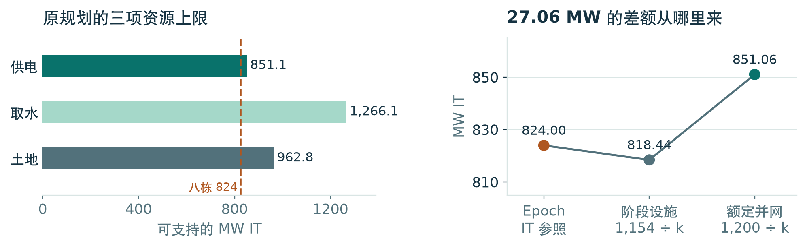
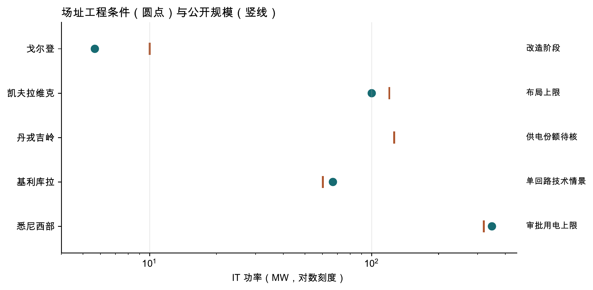
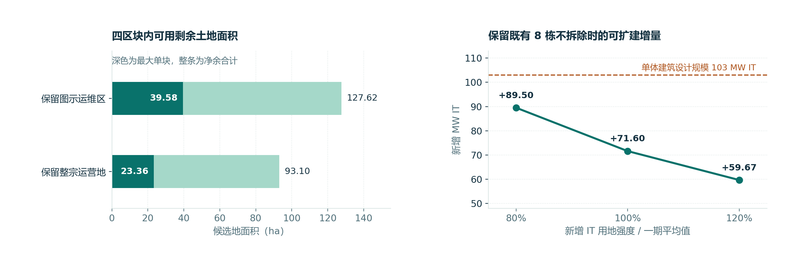

# 第一问补充稿 · 六个场址的规模上限与验证

> 第 4 节接在第一问 3.3 之后，用 Abilene 原八栋校核电、水、土地三项上限，再与另外五个场址的工程记录对照。附录 F 给出数据与复算依据。文末列出摘要用句及插图位置。全文以 MW IT 表示服务器等 IT 设备的用电容量，以 MW 表示设施侧或发电侧功率。

## 4　给定场址能支撑多大的集中式数据中心？

### 4.1　用 Abilene 原八栋校核电、水、土地三项上限

得克萨斯州 Abilene 园区披露了 1,200 MW 的并网容量。这些电力除了驱动服务器，还要供冷却和配电设备使用。究竟有多少能用于 IT？我们选取 2026 年原八栋的建设范围，先只给模型电、水和土地，再用逐栋工程设计检验答案。若保留已有设备，能承载的 IT 容量还须与设备设计容量取较小值。

原八栋以网电正常运行，燃机留作备用。设 1,200 MW 均可持续交付，以 $k=1.41$ 近似满载时设施功率与 IT 功率之比，则电力可支持 **851.06 MW IT**。供水采用偏宽的条件，把 2030 年市级规划盈余全额分给园区并在年内均摊，可得 633.07 m³/h。若现场取水强度为 0.50 L/kWh IT，水可支持 **1,266.15 MW IT**。一期两栋的租赁面积为 38.43 ha，设计为 206 MW IT。以此平均强度估算，179.61 ha 运营宗地可支持 **962.75 MW IT**。因此，在这组条件下最先用尽的是电力。枯季实际可交付水量和满载倍率均待同期记录核实。[并网披露](https://www.crusoe.ai/resources/newsroom/crusoe-expands-ai-data-center-campus-in-abilene-to-1-2-gigawatts) · [原始输入及来源](../../data/geographic_case_abilene_20261122/plan_vs_optimizer/input_register.csv) · [三项上限](../../data/geographic_case_abilene_20261122/plan_vs_optimizer/results/plan_limits.csv)

工程资料给出了另一种算法。每栋有四个 25 MW IT 数据厅，另有 3 MW IT，八栋合计 $8(4\times25+3)=824$ MW IT。Epoch 对同一建设阶段的估计也是 824 MW IT，设施侧估计为 1,154 MW。图 Q1-1 右侧解释了模型多出的 **27.06 MW IT（3.28%）**。将额定并网的 1,200 MW 换成该阶段的 1,154 MW，按同一倍率折算便减少 32.62 MW IT，得到 818.44 MW IT，较 824 低 5.56 MW IT。工程复原与阶段估计共享八栋的设计信息，二者相合只能检验口径。要验证实际满载，还需同一时段的设施和 IT 分表记录。[DPR 工程说明](https://www.dpr.com/projects/crusoe-abilene-data-center) · [建设阶段与对照来源](../../data/geographic_case_abilene_20261122/plan_vs_optimizer/README.md)

**图 Q1-1　Abilene 八栋设计容量与资源上限。** 左图的竖线为 824 MW IT。右图三点采用同一建设范围，后两点分别将阶段设施功率和额定并网容量除以 $k$。

反过来问，要用满八栋，供给至少要达到什么水平？在上述参数下，园区需持续取得 $824\times1.41=1{,}161.84$ MW 网电和 $824\times0.50=412$ m³/h 的水。网电若只能保证额定容量的 90%，其余条件不变，可运行容量降至 **765.96 MW IT**。只把供水改为 400 m³/h，则上限变为 **800 MW IT**，瓶颈也由电转为水。这给出了可用接入协议和枯季供水记录直接检验的两个门槛。[单因素复算](../../data/geographic_case_abilene_20261122/plan_vs_optimizer/results/sensitivity.csv)

### 4.2　把新增电源放进同一块地

假如允许园区重新布置，新建电源能把 851.06 MW IT 推高多少？我们保持并网、供水及冷却参数不变，允许在 179.61 ha 运营宗地内重排机房，并开放一块 23.36 ha 的连续候选地。新增电源只能建在该地块，余地可用于 IT 配套。题面以 Hyperion 的燃机交付为例给出约七年等待期，我们据此设定一个 **2033 年可投运**的对照情景。原八栋的备用机组在两种规划中均只承担备用。煤、气分别按 100 MW 整台选取，风、光与电池联合逐时调度。目标是使各小时都能维持的 IT 功率最大。[题面第 2 页](../../IMMC2027%20Problems_Greater%20China%20Autumn/IMMC2027%20Problem%20A-How%20big%20an%20AI%20data%20center%20to%20be_.pdf#page=2) · [求解设置与分支](../../data/geographic_case_abilene_20261122/plan_vs_optimizer/results/integer_branches.csv)

**表 Q1-1　同一并网和供水条件下，四种新增电源如何改变 Abilene 的容量。** 峰时取水为可行调度下机房与新增发电合计的现场取水，发电占地为该方案实际划给新增电源的面积。

| 新增电源及最优装机 | 发电占地（ha） | 峰时取水（m³/h） | 上限（MW IT） | 比纯网电增加（MW IT） | 首先触及的约束 |
|---|---:|---:|---:|---:|---|
| 纯网电基准 | 0 | 425.53 | 851.06 | — | 电力 |
| 湿冷煤电，1 × 100 MW | 20.00 | 633.07 | 852.17 | 1.11 | 水 |
| 干冷燃气，2 × 100 MW | 20.00 | 494.03 | **980.75** | **129.69** | 土地 |
| 风电 0.78 MW 加储能 | 23.36 | 425.54 | 851.07 | 0.01 | 电力 |
| 地面光伏 6.49 MWac 加储能 | 23.36 | 425.59 | 851.18 | 0.12 | 电力 |

湿冷煤电按每发 1 kWh 取水 132.5 L 的高取水工况估算。现场冷却与机组共用一份水额，100 MW 机组只能持续调用约 1.56 MW。干冷燃气按 0.02 L/kWh 发电量计，两台机组虽可将电力上限抬至 992.91 MW IT，却先占去 20 ha，余地仅够 **980.75 MW IT**。即使允许四种电源混合，在给定候选中仍选两台燃机。这个上限以燃料充足、获准投运及宗地可重排为条件，目标函数只衡量容量。[电源与取水系数](../../data/geographic_case_abilene_20261122/plan_vs_optimizer/input_register.csv) · [各方案调度结果](../../data/geographic_case_abilene_20261122/plan_vs_optimizer/results/portfolio.csv)

风电按机组间距取 30 ha/MW，地面光伏阵列约需 3.60 ha/MWac。同一块 23.36 ha 的地因此分别只能容纳约 0.78 MW 和 6.49 MWac。能逐小时供给的功率还会受到夜间、低风时段和电池储能时长的限制。固定表中的光储装机后，更换为留出的 2024 年连续 8,784 小时，可靠增益从设计日的 0.117 变为 **0.154 MW IT**。两段天气中，6.49 MWac 的装机都只带来不足 0.2 MW IT 的全天增量。[跨年天气检验](../../data/geographic_case_abilene_20261122/plan_vs_optimizer/results/weather_check.csv)

若业主要求保留八栋原状，新增机房和电源就只能分享那块 23.36 ha 的地。布置一台燃机要占 10 ha，剩余约 13.36 ha。按一期用地强度可增 **71.60 MW IT**，连同八栋为 **895.60 MW IT**。即使将新增单位用地降至一期平均的 80%，新增容量也只有 89.50 MW IT，仍小于一整栋的 103 MW IT。保留建筑与允许重排对应两种不同的扩建决策，详见图 F-1。[保留八栋的扩建复算](../../data/geographic_case_abilene_20261122/plan_vs_optimizer/results/anchored_extension.csv)

### 4.3　与题面的三个参照规模相比

Abilene 原八栋的资源上限约为 **0.85 GW IT**，允许重排并建设常态燃机时约为 **0.98 GW IT**。所以，在有吉瓦级并网条件的这个场址，所得上限的数量级是 **$10^3$ MW IT**。若将题面的 950 MW、2,263 MW 和 5 GW 均理解为 IT 功率，原布局分别低约 **99、1,412 和 4,149 MW IT**。重新配置可超过 950 MW 约 31 MW，另两个参照仍高于模型结果。例如，在 $k=1.41$ 下，5 GW IT 需要 7.05 GW 设施侧功率，已远超本址 1.2 GW 并网和候选自建机组能提供的规模。

计量边界会改变高低判断。题面称 Hyperion 的 5 GW 为规划电力需求，未逐一给出三个参照的 IT 换算口径。若三者均按设施功率计，仅为说明换算影响而统一除以 1.41，则对应约 **674、1,605、3,546 MW IT**。此时 Abilene 的 851.06 MW IT 高于第一档，仍低于后两档。题面另有明确标为 IT 的同量纲参照，New Carlisle 当前估计 1,037 MW IT，比 Abilene 的资源上限高约 186 MW IT。各项目的接入规模、建设阶段和满载倍率不同，同址阶段检验采用图 Q1-1。[题目背景及参照口径，第 1–2 页](../../IMMC2027%20Problems_Greater%20China%20Autumn/IMMC2027%20Problem%20A-How%20big%20an%20AI%20data%20center%20to%20be_.pdf#page=1)

### 4.4　五个场址的工程记录能检验哪些上限？

在 Abilene，我们能把电、水、土地三项估计与同一阶段的八栋设备设计对照。换到另外五址，能够检验哪一项，取决于当地公开了什么。我们把配电改造文件用于电力约束，把机房面积用于布局约束，把审批总用电用于核对规划规模，再反求各项目需要取得的电力和补水量。表 Q1-2 给出每个数字对应的建设阶段。五址均缺少足以确认同阶段电、水、土地联合上限的完整记录。[五地工程资料与来源](../../data/q1_plan_comparison/README.md) · [逐项计算结果](../../data/q1_plan_comparison/comparison.csv)

**表 Q1-2　五个场址的工程估计与公开规模。** 中间两列统一为 MW IT。最右列的供电量以设施侧 MW 计，补水量按所述冷却工况估算。

| 场址与建设阶段 | 工程资料能给出的估计（MW IT） | 同址公开参照（MW IT） | 对照结果或待核条件 |
|---|---|---|---|
| 美国 Golden，ESIF 配电改造 | 5.66，按改造方案的 6 MW 可用功率含辅机计算。若计在 IT 侧，则为 6.00 | 10，实验室终态设计 | 终态需 10.6 MW 及约 7.0 m³/h 补水。与改造阶段须分期核对 |
| 冰岛 Keflavík，VDC04 新增模块 | 100，按 2.4 ha 地块和假设的机柜布局计算 | 120，三期各 40 | 模块需获配 144 MW，按闭路干冷假设需补水 2.4 m³/h |
| 新加坡 Tanjong Kling，整栋终态 | 待核，项目获配的可靠电力未公开 | 约 126.05，工程方披露最高 150 MW 设施需求，按 $k=1.19$ 折算 | 达到这一规模需 150 MW。两种取水强度下分别需约 252、303 m³/h |
| 智利 Quilicura，Data Luna | 66.85，仅按一个 76 MVA 线路段留存一回且全部供给项目计算 | 约 60.19，来自电网研究对 2025 年的 65 MW 需求预测 | 在该供电情景下，其他负荷最多可占 7.2 MW。项目可靠配水量待核 |
| 澳大利亚 Huntingwood，SYD3 九期 | 347.83，按审批的 400 MW 总用电和 $k=1.15$ 折算 | 至少 320，运营商九期目标下限 | 按下限计算需 368 MW，低于审批值 32 MW。两种取水强度下需 224、384 m³/h |

**图 Q1-2　工程资料给出的容量能否覆盖同址公开规模？** 青色圆点为表 Q1-2 的条件估计，橙色竖线为公开参照，横轴为对数刻度。新加坡只有参照线，独立估计留缺。悉尼的竖线标出运营商公布的下限。两种标记的间距需要结合各行证据解释。[原始矢量图](../../data/q1_plan_comparison/五地规划对照.pdf)

Golden 与冰岛的圆点均落在规划线左侧，原因却不同。Golden 的配电改造方案把可用功率从 4 MW 提到 6 MW，10 MW IT 则属于实验室终态。冰岛比较的是同一个扩建模块。在单层、建筑占地一半、机房占楼面一半的假设下，2.4 ha 地块给出 6,000 m² 可排柜面积。每柜 6 m²、100 kW，只能容纳 100 MW IT。要达到 120 MW IT，需把机房扩大至 **7,200 m²**，或把平均柜功率提高至 **120 kW**，同时取得表中的供电份额。园区变电站公布的终态规模为 240 MW，若届时能够全额交付，其他负荷和预留合计须在 96 MW 以内，才留得出该模块所需的 144 MW。[美国能源部改造预算，第 484 页](https://www.energy.gov/sites/default/files/2021-06/doe-fy2022-budget-volume-3.1_0.pdf#page=484) · [NREL 终态设计](https://docs.nlr.gov/docs/fy21osti/79712.pdf) · [冰岛模块环境文件](https://uua.is/urleits/uua2606003-uppbygging-gagnavers/) · [冰岛园区变电站资料](https://www.verne.co/news/news-verne-and-landsnet-launch-high-capacity-substation)

智利与悉尼的圆点都在规划线右侧。智利的线路段须与其他负荷共享，66.85 MW IT 只在所设分配条件下成立。悉尼的 400 MW 则是审批文件中的总用电规模。运营商如按 320 MW IT 运行，368 MW 的设施需求落在审批范围内。两地能否持续取得相应电力，仍分别取决于实际线路分配及园区接入协议。[智利线路资料 E07-05](https://www.cne.cl/wp-content/uploads/2022/03/Respuesta-Observaciones-ITP-Plan-de-Expansion-2021.pdf) · [智利电网需求预测，第 15 页](https://www.coordinador.cl/wp-content/uploads/2021/08/Minuta_Solicitud_Nueva_Subestacion_COLINA_24_08_2021.pdf#page=15) · [悉尼州规划审批](https://www.planningportal.nsw.gov.au/major-projects/projects/51-huntingwood-drive-data-centre) · [运营商九期规划](https://airtrunk.com/airtrunk-expands-western-sydney-region-with-new-syd3-hyperscale-data-centre-asia-pacifics-largest/)

水约束还须区分园区实际取用了多少水，以及枯季还能稳定取得多少水。WRI 将 Golden、Quilicura 所在子流域列为极高水压力，Huntingwood 为高，Keflavík、Tanjong Kling 为低。智利的常规水源为 Aguas Andinas 供水系统，Alphabet 披露 2025 年全址取水 2.782 亿美制加仑，折合年均 **120.2 m³/h**。缺少同期 IT 电量和旱季保障流量，现场取水强度与水侧上限均留待核实。新加坡则可从规划反问，若按 2.0 或 2.4 L/kWh IT 取水，项目能否在旱季分别取得约 **252 或 303 m³/h** 的正常补水？这个问题需要项目配水协议来回答。[WRI 流域压力方法](https://www.wri.org/research/aqueduct-40-updated-decision-relevant-global-water-risk-indicators) · [Google 智利供水说明](https://blog.google/intl/es-419/noticias-de-la-empresa/10-datos-sobre-el-centro-de-datos-de-google-en-quilicura-chile/) · [Alphabet 分场址取水表](https://storage.googleapis.com/gweb-mobius-cdn/sustainability/uploads/6b09a7cbecbf228f4d30ad089301578eb599425e.pdf) · [新加坡供水资料](../../data/q1_sg_tanjongkling/site_evidence.csv)

## 附录 F　输入边界与复算

### F.1　区分已知数、情景参数和待测量

| 对象 | 可核对的记录 | 本文如何代入 | 最影响结论的缺项 |
|---|---|---|---|
| Abilene 电力、设备 | 1,200 MW 额定并网，8 栋 × 103 MW IT 设计 | 基准按额定量全额交付，$k=1.41$ 由年度指标近似 | 同阶段保障网电、满载设施及 IT 分表 |
| Abilene 水源 | 市规划列 2030 年盈余 4,496 acre-ft/年 | 全额均摊为 633.07 m³/h，现场 WUE 取 0.50 L/kWh IT | 枯季项目份额、高温日取水与 IT 用电、维持生态流量后的可分配余量 |
| Abilene 用地 | 1,100 英亩毛地，前两栋租约 94.963 英亩，GIS 可复核四区块 | $a_s=38.4302/206=0.18655$ ha/MW IT，采用一期平均代理扩建边际用地 | 同一边界下的分期增量面积、全园红线、生态与用地许可 |
| 另外五地 | 各址配电改造、模块地块、建筑需求、线路额定值或总用电审批。智利另有年度取水披露 | 表 Q1-2 与图 Q1-2 共用逐址工程结果。换算倍率、机柜密度及取水强度的适用范围见 F.3 | 项目获配的保障电力、枯季供水合同、可排柜楼面及同期满载计量 |

本算例按 m³/h 计算。正文第 2 节的日水量（m³/day）除以 24 后可与本表的小时平均流量比较。将小时平均流量换回日水量时乘以 24。WUE 用 L/kWh IT 时，$Q_{\rm site}=\mathrm{WUE}\,P_{\rm IT}$ 可直接得到 m³/h。湿冷煤电与干冷燃气的系数以发电量为分母，表 Q1-1 使用现场**取水**这一共同口径。风光运行取水在本算例取零，电池使用配套设备空间，清洗水与独立电池用地可在获得设计资料后另计。[Abilene 输入登记](../../data/geographic_case_abilene_20261122/plan_vs_optimizer/input_register.csv) · [五地参数依据](../../data/q1_plan_comparison/README.md)

若关心流域里实际少了多少水，则应从取水中扣除回流。作为量级参照，Macknick 等汇总的运行期**耗水**中位数折合为直流冷却常规煤电约 0.95、干冷联合循环燃气约 0.008、风电约 0、公用事业规模光伏约 0.004 L/kWh 发电量。表 Q1-1 中煤电受 633.07 m³/h 的取水能力限制。若改评净耗水约束，应另用当地可消耗水量与同口径系数重新求解。[Macknick 等，表 1–3](https://openei.org/datasets/files/969/pub/1748-9326_7_4_045802.pdf)

### F.2　固定用地与连续候选地

在边界可核对的四个规划区块内，八栋机房对应的运营宗地合计 179.61 ha，其中已包含宗内道路、备用设施和调蓄池。模型将宗地外的两座变电站另列为固定用地 $A_0$，合计约 5.85 ha。按含站边界计算时，从 $179.61+5.85$ ha 中扣除一次站地，留给机房及宗内配套的面积为 179.61 ha。承建商披露的新站面积为 12.5 英亩，它与公告所列 1,100 英亩园区红线的交叠范围仍待核实。[用地输入与工程资料](../../data/geographic_case_abilene_20261122/plan_vs_optimizer/input_register.csv)

图 F-1 在这四个区块合计 330.19 ha 的范围内筛选可用土地。保留整宗运营地，并避让道路、备用设施、调蓄池和规划缓冲带后，各处候选地合计 93.10 ha，其中最大连续单块为 **23.36 ha**。表 Q1-1 的地面光伏取这块地，按约 3.60 ha/MWac 折算，装机的面积上限约为 **6.49 MWac**。若仅保留图示运维区，候选地合计 127.62 ha，最大单块为 39.58 ha。实际布设还须核对坡度、生态退界和施工图。[QGIS 宗地复核](../../data/geographic_case_abilene_20261122/eight_building_land_review/parcel_check/README.md) · [光伏装机复算](../../data/geographic_case_abilene_20261122/plan_vs_optimizer/results/portfolio.csv)

**图 F-1　净余面积、最大连续地块与保留八栋的扩建量。** 左图深色部分为最大单块。右图横轴为新增单位用地相对一期平均值的比例，纵轴只计八栋以外的增量。三个情景均小于一栋 103 MW IT 的设计容量。

### F.3　五地的计算边界与复算

以各址公开目标 $P_{\rm ref}$ 为起点，达到目标所需的设施功率为 $kP_{\rm ref}$，所需正常补水为 $wP_{\rm ref}$，其中 $w$ 以 L/kWh IT 计。$Q$ 只有取项目在设计期能持续取得的水量时，$Q/w$ 才能作为水侧上限。工程表保存了各项原值、计算所用的 $k$ 和证据范围。运行同目录的计算程序可重建综合表、五份单站结果和图 Q1-2。[五地分项原表](../../data/q1_plan_comparison/comparison.csv) · [复算程序](../../data/q1_plan_comparison/compare.py)

**表 F-1　表 Q1-2 中各项估计的算法。** 功率结果除特别标注外均为 MW IT，所有中间量保留未舍入值。

| 场址 | 由工程记录或规划算出的量 | 参数与边界 |
|---|---|---|
| Golden | 设施侧解读为 $6/1.06=5.66$。终态 10 对应 $10\times0.70=7.0$ m³/h 补水 | $k$ 借用历史运行指标，$w=0.70$ 来自热虹吸冷却运行期。改造文件中 6 MW 的计量位置待核。[单站结果](../../data/q1_us_golden/plan_comparison.csv) |
| Keflavík | 由 $24{,}000\times0.5\times0.5=6{,}000$ m² 得 1,000 个机柜，合计 100。目标设施功率为 $120\times1.20=144$ MW | 单层、建筑覆盖率、机房占比及 100 kW/柜均为布局假设。0.02 L/kWh IT 是闭路干冷辅助补水假设。[单站结果](../../data/q1_is_keflavik/plan_comparison.csv) |
| Tanjong Kling | 整栋最高需求给出参照 $150/1.19=126.05$。取 $w=2.0$ 或 $2.4$，分别需 252.1、302.5 m³/h | 工程方披露的地址、11 层及约 17 万 m² 与业主设计对应。实际供电份额和枯季再生水配额待核。[工程方资料](https://www.peri.sg/projects/data-center-at-sunview-drive-singapore.html) · [业主设计](https://engineering.fb.com/2019/01/14/data-center-engineering/singapore-data-center/) |
| Quilicura | 单段情景为 $76\times0.95/1.08=66.85$。预测参照为 $65/1.08=60.19$ | 取功率因数 0.95，单段可供设施功率为 72.2 MW。2025 年取水量可换算年均流量，缺同期 IT 电量，$w$ 留空。[单站结果](../../data/q1_cl_quilicura/plan_comparison.csv) |
| Huntingwood | 审批用电折算为 $400/1.15=347.83$。按规划下限 320 与 $w=0.7$ 或 $1.2$，需 224、384 m³/h | 两个 $w$ 取自同组运营商参数。系统管网最大流量 240 L/s，高温时本项目获配的流量须由供水合同核实。[单站结果与依据](../../data/q1_plan_comparison/README.md) |

各址的流域压力等级取自 WRI 子流域图层。场址参数表保存了取点、子流域编号、基线压力值和查询链接，可逐站核对。[Golden](../../data/q1_us_golden/parameters.json) · [Keflavík](../../data/q1_is_keflavik/parameters.json) · [Tanjong Kling](../../data/q1_sg_tanjongkling/parameters.json) · [Quilicura](../../data/q1_cl_quilicura/parameters.json) · [Huntingwood](../../data/q1_au_huntingwood/parameters.json)

## 合稿位置与插图说明

以下为编辑备注。正文、附录或摘要均可单独选用。

| v1 中的位置 | 可选用的内容及图件 |
|---|---|
| 第一问 2.2 与附录 E.3 的供水说明 | 对使用再生水的场址，按同一设计时段可送达项目的流量计。有单列的许可或合同上限时，再与可送达流量取较小值。 |
| 第一问 3.3“最大场址”的逐址比较说明之后 | 第 4 节整体可放在此处。[图 Q1-1](图片和附件/Q1-1_原八栋容量校核.png) 放在 4.1 的 27.06 MW 差值分解之后，表 Q1-1 放在 4.2 的重配条件之后。4.4 先放表 Q1-2，随即插入[图 Q1-2](图片和附件/Q1-2_五地工程条件与公开规模.png)，再接 Golden 与冰岛的读图段落。 |
| 附录 E.3“供水单位可交付水量”之后 | 可选用附录 F，将[图 F-1](图片和附件/F-1_候选地与扩建容量.png) 放在 F.2 两种用地保留范围的比较之后，与表 Q1-1 的地面光伏行对应。表 F-1 放在 F.3 的目标功率与补水换算式之后。图表暂用 Q1 或 F 前缀，合稿时随全文编号。 |

**摘要可选句。** 在 Abilene 原八栋的建设范围内，按额定网电全额交付及给定供水条件，我们估计资源可支持 851 MW IT，与 824 MW IT 的同阶段设计相差 3.3%。保留原楼扩建与允许重排宗地的新建电源情景分别可达约 896 和 981 MW IT。五地对照显示，冰岛扩建模块要达到 120 MW IT，按每柜 100 kW、6 m² 需 7,200 m² 有效机房及 144 MW 设施供电。悉尼规划下限 320 MW IT 所需的 368 MW 落在 400 MW 审批范围内。两处实现规划均须核实项目实际可获配的电力和水量。

本稿借鉴 Collingwood 在主案例中“先给方案结果，再由目标反求所需资源”的写法，并沿用其把压力测试放在迁移到其他场址之前的组织方式。对应位置为样例第 16–18 页的情景表与目标反算、第 19–21 页的压力检验及第 23–24、58–59 页的异地应用。这里选用同阶段工程记录、留出天气年和独立取水披露检验各自能检验的结论。[Collingwood 情景与反算](../../2026-IMMC-赛题与教学视频/2026-IMMC-Outstanding-2026025-Collingwood-Canada.pdf#page=17) · [压力检验](../../2026-IMMC-赛题与教学视频/2026-IMMC-Outstanding-2026025-Collingwood-Canada.pdf#page=20) · [异地复算附录](../../2026-IMMC-赛题与教学视频/2026-IMMC-Outstanding-2026025-Collingwood-Canada.pdf#page=58)
