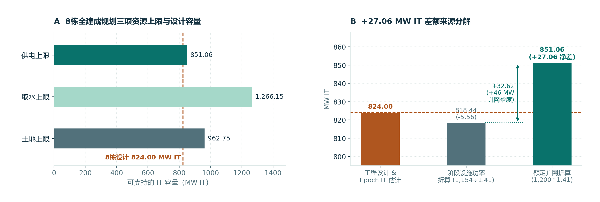
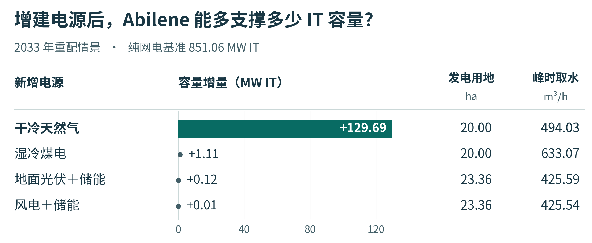
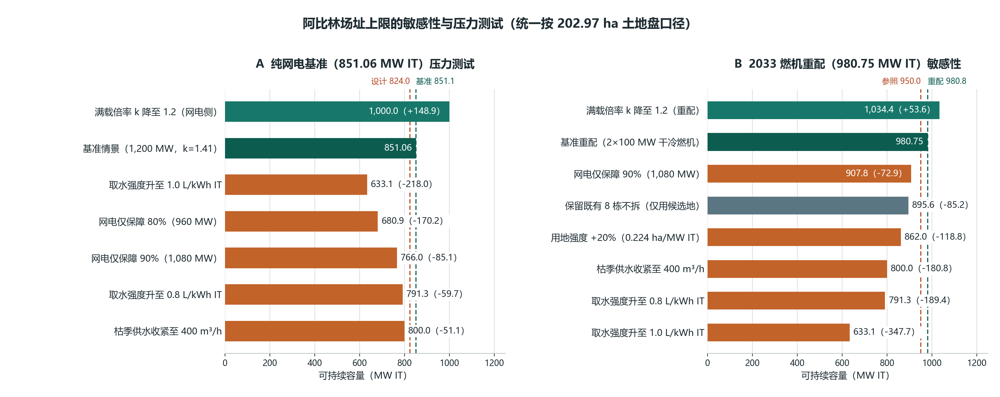
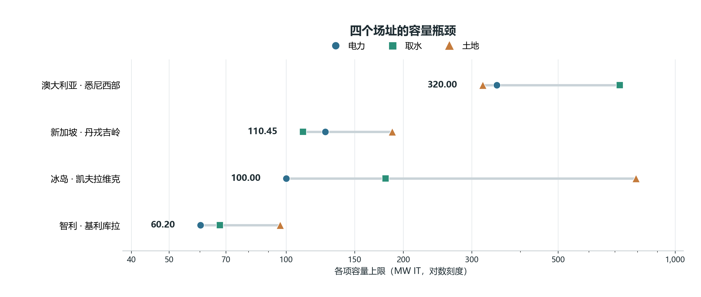
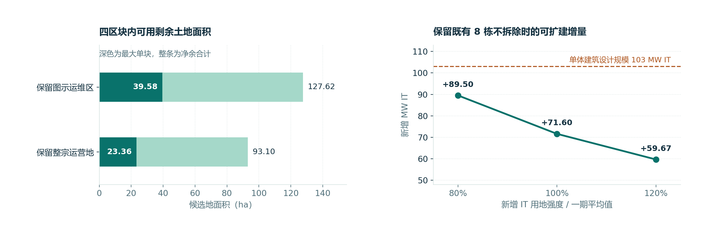

# 论文起草

# 摘要

# 致WAICO的一封信

# 目录

# 引言

全球 AI 算力需求正大幅增长，部分规划中的超大规模园区，电力需求已达到城市级量级。然而，电网容量、生态基流、土地刚性约束，使超大规模集中式园区受局部资源的上限限制；与此同时，AI 基础设施高度集中于少数热点地区，广大资源欠发达地区仍处于算力版图之外。

为解决这一问题，本文通过数学建模回答一个核心政策问题：**集中式 AI 数据中心的规模上限由什么因素决定？弹性分布式网络能否在环境代价、资源压力与普惠性之间找到更优解？**

## 问题重述

本题的核心，是对“集中式扩张”与“弹性分布式协同”两条路线进行量化边界测算与优劣比较：

## **1　问题一：集中式 AIDC 的最大可持续规模**

只要一项资源触及当地极限，园区就无法继续扩容，呈现典型的木桶效应。

因此，对给定地理场址与建设运行配置 $x$（供电、冷却与用地组合，且受电源建设工期制约），分别测算其在能源、水资源和土地三类约束下可长期维持的额定 IT 功率上限 $P_E(x)$、$P_W(x)$ 和 $P_L(x)$（单位：MW IT）。在可行配置集合 $\mathcal X$ 中，该场址的最大可持续规模为：

$P(x)=\min\{P_E(x),P_W(x),P_L(x)\}
\qquad
$

$P_{\max}(y)=\max_{x\in\mathcal X_y}P(x)$\.

在此基础上，将模型测算的上限量级与 950 MW、2,263 MW、5 GW 等现实项目对标以解释差异成因，并评估煤电、燃气、风电与光伏因水耗和占地不同而对上限带来的改变。

## **2　问题二：弹性分布式算力网络的替代效益与边界**

在总算力需求相同的条件下，需要同时考察环境足迹总量与资源消耗的空间分布。分散部署可能降低单个地区的资源压力；与此同时，节点间通信和冷却耗能差异也可能带来额外消耗，增加总用电、耗水或占地。

为比较两种模式，在给定总算力需求 $O_{\mathrm{ut}}$ 下，我们引入环境足迹指数 $F$。以集中式方案的碳、水、地足迹 $C_0,W_0,A_0$ 为基准，对数加权衡量全系统总消耗的相对增减。

$F=\ln (w_C\frac{C}{C_{\mathrm{ref}}}+w_W\frac{W}{W_{\mathrm{ref}}}+w_A\frac{A}{A_{\mathrm{ref}}})$

以及局地资源压力指数 $S$。用非线性惩罚函数 $\phi(R)=\frac{R}{1-R}$ 刻画各节点水、电、地占用情况。分布式取最紧张节点，且任意 $R\geq1$ 则判为不可行。构造综合代价得分 $\Omega$：

$S=\sum_{k\in\{W,E,A\}}m_k\phi(R_k).$

$\Omega=F+\lambda S.$

其中 $\sum w=\sum m=1$，$\lambda$ 权衡局地减压与全局足迹的相对重要性。若 $\Omega_{\mathrm{dis}}<\Omega_{\mathrm{cen}}$，则分布式方案综合占优；由此可界定分布式网络成立的条件，并进一步讨论其提升边缘地区算力可及性，即普惠性对应的环境与网络效率代价。

# 第一问

*说明：大部分关键数学符号会在正文中随用随引。完整变量清单见附录*

## 可持续规模上限

我们考虑最大可持续规模，根据题意，是指 **给定****的****地区地理条件与资源**** ****所能支持单个集成AI数据中心正常运营的最大规模，以技术设备所需电力容量兆瓦度量。**

> **集中式 AIDC**：本研究沿用题目对 AIDC 的定义，将“集中式 AIDC”界定为主要 IT 设备集中部署于单一场址或地理相邻园区，并由相应的供配电和冷却基础设施支持运行的设施整体。其中，IT 设备包括服务器、GPU 等加速设备、存储及网络设备；供配电损耗、冷却等辅助需求另行核算。
> 
> 

“最大可持续规模”的核心决定因素是什么？在具体抽丝剥茧前，我们先从**集成AI数据中心**的可持续运行**状态**开始讨论。一个运营中的AI数据中心会用到以下生产要素：

从中，我们可以先概括出**能源约束，水资源约束与土地约束**这三项核心约束，它们在给定地理条件下是**确定且有限**的，而三者共同决定这片土地到底能支撑多大的AI数据中心。

> **假设1 固定场址与建成配置:** 模型只考虑某一给定场址的建成状态，认为所有候选设施视为已经建成并处于设计运行状态。对于地理条件，允许出现正常的日夜、季节性波动等，认为不存在长期大范围变更。
> 
> **假设2 正常运营:** 模型认为所有设施始终处于正常运营条件下，认为运营期不会出现随机不可控事故。枯水、高温和风光低出力属于正常波动，而极端灾害不在基准结果内，必要时作为敏感性情景另行讨论。
> 
> 

对给定场址，设 x 为一套确定的建设和运行配置，包括供电方式、冷却方式及用地分配。分别计算这套配置在能源、水和土地约束下可支撑的 IT 额定功率 $P_E(x)$、$P_W(x)$ 和 $P_L(x)$，单位均为 MW IT。三项约束须同时满足，因此该配置的容量为

$P(x) = \min\{P_E(x), P_W(x), P_L(x)\}
\qquad$

比较多个候选配置时，设 $X_y$ 为评估年份 $y$ 已具备投运条件的候选集合。建设工期决定方案最早能在哪一年计入。若该集合非空，当年的最大可持续规模为

$P_{\max}(y)=\max_{x\in\mathcal X_y}P(x)$

每当发电预留地或设备配置改变，均按同一配置重新计算三项上限，再比较候选方案。用地分配的计算见附录 C。

接下来，我们会详细剖析这三大约束中的具体因素与限制机理。

## 1 能源约束

对于一个集中式AIDC，需要计算园区的**可靠供电容量**，即在假设 2 的正常运行条件下，经历所选天气和资源波动时，各时段都能维持的恒定设施负荷，单位为 MW。对给定方案 $x$，电力来自当地电网和园区自建电源。两部分均按园区进线处的净功率计量。

${P_{\mathrm{总}}(x)=P_{\mathrm{电网}}+P_{\mathrm{自发电}}(x).}
\tag{1}$

其中，$P_{\mathrm{电网}}$ 表示项目接入点可持续稳定交付给园区的电功率。；$P_{\mathrm{自发电}}(x)$ 表示电网承担相应负荷后，自建电源能够持续补充的净功率。

> **假设3 配套设施能够输送设计功率**： 自建电源配备与其净供电能力相匹配的变电设施，园区内部配电系统不会过载。因此，电网购电与自发电均按园区进线处的净功率计量。
> 
> 

对于园区**可靠供电容量**，既供给服务器、存储和网络设备，也维持冷却与配电。按照设施侧与 IT 侧分项计量的口径\[1\]，设 $k(x)$ 为设计满载时设施总功率与同一工况 IT 功率的比值。将可靠供电容量除以 $k(x)$，即可得到能源约束下的额定 IT 容量。

$k(x)=\frac{\text{设计满载时的设施总功率}}{\text{同一工况的 IT 功率}},
\qquad
{P_E(x)=\frac{P_{\mathrm{电网}}+P_{\mathrm{自发电}}(x)}{k(x)}.}
\tag{2}$

> 对每套方案采用固定的满载设计倍率。若仅有同类设施公布的年度 PUE，可用其近似 $k(x)$，并注明取值的设施类型和统计周期。采用年度 PUE 近似设计满载倍率，意味着假设所研究工况下辅助用电占比接近年度平均水平。若高温等条件显著提高冷却功率，该近似可能高估可承载的 IT 容量；逐时工况扩展见附录 A。
> 
> 

对于自发电容量，可以有多种发电方案，我们考虑比较普遍可行的方案：火力发电，风力发电，光伏发电和水力发电。对每种电源，依次回答两个问题：**当地可布置多少设备，这些设备又能持续供给多少功率？**

### **1\.1 火力发电**

对燃煤或燃气机组，设 $N_j$ 为场址可布置且能同时正常运行的同型号机组数，$p_j^{\mathrm{net}}$ 为单台机组在当地设计条件下的持续净功率，则

$P_j=N_jp_j^{\mathrm{net}}, \qquad j\in\{\text{煤电},\text{燃气}\}. \tag{3}$

单机净功率已扣除电厂自身用电。对采用湿冷的机组，若枯水期的冷却水条件限制出力，则采用该工况下能够维持的净功率 \[2\]。

> **假设4 燃气等****燃料****条件充足**： 对当地法规允许建设的燃气方案，假设外部气源及输送设施能持续满足机组的燃料需求，因此燃气方案所得容量为供气充足条件下的可持续电力承载上界；其环境影响由后续用水、土地及碳排放指标另行评价。
> 
> 

### **1\.2 风力发电**

设 $A_{\mathrm{风}}$ 为分配给风电的合格面积，$\rho_{\mathrm{风}}$ 为单位面积可布置的装机容量。按该密度布置时，风电装机 $X_{\mathrm{风}}$ 为

$X_{\mathrm{风}}=A_{\mathrm{风}}\rho_{\mathrm{风}}, \qquad P_{\mathrm{风}}=\alpha_{\mathrm{风}}X_{\mathrm{风}}. \tag{4}$

对无储能、独立承担恒定负荷的风电方案，设 $X_风$ \> 0，$P_{风净,t}$ 为时段 $t$ 的可用净出力，𝒯 为所选天气样本覆盖的时段。以逐时净出力估算时，保障比例为

$\alpha_{\mathrm{风}}=\frac{\min_{t\in\mathcal T}P_{\mathrm{风净},t}}{X_{\mathrm{风}}}$

该比例由样本期出力最低的时段决定。可用面积与装机密度决定可布置的装机量，当地风况和机组特性决定各时段的出力 \[3\]。若风电与光伏共用电池，则将两者同一时段的出力相加，按附录 A 的功率与电量平衡求组合可维持的恒定负荷。

### **1\.3 光伏与储能**

光伏装机同样由合格面积和装机密度确定。设 $A_{\mathrm{光}}$ 与 $\rho_{\mathrm{光}}$ 分别为光伏可用面积与装机密度，则充分布置后的光伏装机为 $X_{\mathrm{光}}=A_{\mathrm{光}}\rho_{\mathrm{光}} \tag{5}$

由于光伏提供能源存在昼夜波动，要提高全天可维持的恒定负荷，还需将白天的富余电转移到发电不足的时段，因此要考虑储能。电池可以将白天的富余电量转移到出力不足的时段，能够维持的恒定负荷取决于白天可充入的电量，以及电池的充放电功率和可用电量。Goiri 等在 Parasol 实验机房中用 GreenSwitch 协调光伏和电池运行\[4\]。本文沿用其功率与电量平衡关系，求给定配置在整个考察期内可持续承担的最大恒定负荷。

$P_{\mathrm{光储}}=
f_{\mathrm{光储}}\!\left(X_{\mathrm{光}},\,\mathcal W,\,
C_{\max},\,D_{\max},\,E_{\mathrm{可用}},\,\eta_c,\,\eta_d\right).
\tag{6}$

其中，$\mathcal W$ 包含考察期内当地日照与气温；$C_{\max}$ 和 $D_{\max}$ 分别为电池最大充、放电功率（MW）；$E_{\mathrm{可用}}$ 为扣除应急预留后可动用的电量（MWh）；$\eta_c$ 和 $\eta_d$ 分别为充、放电效率。关于该$f_{储}$的具体信息，请参考附录A

### 1\.4 水力发电

对适宜开发水电的场址，根据可用流量、净落差和转换效率估算可持续供电功率 \[6\]。设 $Q$ 为预留生态下泄并满足其他用水需求后可持续通过机组的流量（m³/s），$H$ 为同一工况下的净落差（m），$η_水$ 为净发电效率，$X_水$ 为机组装机容量（MW）。可计入园区自发电的水电功率取水能条件与机组容量两者中的较小值。

$P_{\mathrm{水}}=\min\!\left\{X_{\mathrm{水}},\,0.00981\,\eta_{\mathrm{水}}QH\right\}\quad (7)$

系数 0\.00981 包含淡水密度、重力加速度和瓦到兆瓦的换算。若要求枯水期仍能维持额定负荷，式（7）应采用枯水期能同时维持的 $Q$ 和 $H$。推导见附录 B。

## 2 水资源约束

我们最终需要得出的是水资源约束下的最大IT功率，为此，需先计算实际用于冷却等用途的现场用水（不包括自发电用水），再通过WUE进行转化。经过单位换算，得出以下模型：

$P_{\text{W}}= \frac{Q_{\text{现场}}}{24\cdot\mathrm{WUE}}\quad(\text{MW})$

其中，$Q_{\mathrm{现场}}$ 为数据中心正常运营所需的现场耗水流量，包括冷却及辅助设施耗水，不含供电过程的间接耗水。其由数据中心可取用水量上限减去发电耗水求得。$Q_{\mathrm{现场}}$及下文提及其他流量均以m³/day为单位。$WUE$ （水资源使用效率，Water Usage Effectiveness）是同期现场取水量与 IT 用电量之比，其在高温等情况中需要特殊取值，具体见附录D。\[4\]

为数据中心提供服务的供排水设施的用电，理论上也应包含在数据中心耗水中，但由于其不及总耗水0\.1%，将其忽略不计。\[9\]

> **假设 取输水条件理想：**当可供流量仅来自河流余量或模型控制点时，暂时假设可设置取水口，取水、处理和输水设施有足够能力，且沿途没有输水损失。
> 
> 

$Q_{\text{现场}}=Q_{\text{DC,max}}-Q_{\text{发电耗水}}$

估算数据中心最多可取用的水流量，需同时考虑水压力与政策两个限制。其中，水压力的物理意义为取水需求占水资源的比例，水压力值越高，数据中心给当地带来的资源竞争越大。\[1\]因此耗水后的水压力应当被限制在一个合理范围内。

$Q_{\text{DC,max}}= \min\left\{\;Q_{\text{DC,压力上限}},\;Q_{\text{DC,政策上限}}\right\}$

式中，$Q_{DC,max}$ 是的数据中心最大流量；$Q_{\mathrm{发电耗水}}$ 是自发电水耗流量；$Q_{DC,压力上限}$ 是设置本地水压力阈值后允许的新增流量；$Q_{DC,政策上限}$ 是项目适用的取水许可或合同上限。

### 2\.1 水压力限制

水压力在运算中的定义为“耗水量与可用可再生水资源之比”。\[1\]对选定河段，在 $Q_{河流} > Q_{生态}$ 且各项属于同一时段时，定义本地耗水压力并设置阈值：

> **假设 以河流为主要水源：**为简化分析，仅考虑从河流中取水，暂不考虑地下水、跨流域调水及水库调蓄的补充作用。
> 
> 

$S_{水}=\frac{Q_{\text{其他耗水}}+Q_{\text{DC,max}}}{Q_{\text{河流}}-Q_{\text{生态}}}\leq S_{水\max}$ 

式中，$S_{水}$ 是加入数据中心用水的河段耗水压力；$Q_{其他耗水}$ 是同一水源及同一时段内，生活、工业、农业等已有用户的净耗水量；$Q_{河流}$ 是取水河段在扣除所计其他取耗水之前的同一时段基准流量；$Q_{\text{生态}}$是出于环境保护考虑的生态保留水量；$S_{水max}$ 是本研究设定的允许压力阈值。

将上式对 $Q_{DC}$ 求解，可得压力所允许的新增取水上限：

$Q_{\text{DC,压力上限}}
= \max\left\{0,\; S_{水\max}\left(Q_{\text{河流}}-Q_{\text{生态}}\right)-Q_{\text{其他耗水}}\right\}$ 

水源数据缺失时的补偿方法见附录E。

### 2\.2 水源可支持的新增取水量

我们计算了河流剩余的可用水量，用以证明水压力产生的上限不会出现取不到的情况。水源可支持的新增取水量可用河流流量减去生态保留流量、其他耗水流量得到。

$Q_{\text{可用}}
= \max\left\{0,\;
Q_{\text{河流}}-Q_{\text{生态}}-Q_{\text{其他耗水}}
\right\}$

式中，$Q_{\text{可用}}$为河流中可额外取用的水量；$Q_{河流}$ 是取水河段在扣除所计其他取水之前的同一时段基准流量；$Q_{其他耗水}$ 是同一水源及同一时段内，生活、工业、农业等已有用户的净耗水量。各项均使用相同流量单位。保留 $max(0, ...)$ 是因为新增取水不能为负。\[2\]\[3\]\[8\]

因为$S_{水\max}$\<1，所以$Q_{\text{可用}}$\>$Q_{\text{DC,压力上限}}$恒成立。

### 2\.3 自发电耗水

在AI数据中心设有自发电厂时，园区自建电厂的运行用水应被纳入考虑，计入同一场址的水量预算 \[10\]。对电源$i$，取与发电技术、冷却方式及水量预算口径一致的运行用水系数 $c_i$（L/kWh）。设 $P̄_i$ 为该电源当天实际调用的平均净功率（MW），则日用水量为

$Q_{\mathrm{发电耗水}}=24\sum_i c_i\bar P_i$

电网优先供电时，按给定 IT 负载超过电网可供部分的缺口确定自发电调用量，并校核该方案的供电上限。式中 1 MW 持续运行 1 小时对应 1,000 kWh，1,000 L 合 1 m³。若水预算按取水量建立，则 $c_i$ 也按取水量取值。采用净耗水预算时，两者均按净耗水取值。

## 3 土地资源约束

土地模型固定为一个**静态选址模型**：假设数据中心及其配套设施已经建成，问在某片具体地区，土地条件最多允许建设多少 MW 的 **IT 设备功率**。

> 假设 静态建成状态：我们认为土地条件牵制下，“最大可持续规模”是给定土地条件，即给定物理土地空间的方位与可用性条件下，某片地区最多可承载的 IT 额定功率。这一数值取决于土地性质，在我们讨论的尺度下不随时间改变，默认为静态。
> 
> 

### 3\.1 候选场址选定

为建成可运行的AI数据中心，我们首先需要找到有效的，可用于园区内设施建造的物理空间，也就是土地。

> 假设2 固定研究边界：主结果只计园区本体及明确归属项目的配套电力设施，不考虑远处发电厂，污水处理厂等间接占地。“园区边界内总用地”，包含机房、园区内部变配电、冷却设施、道路、安全间距及预留的必要配套空间。
> 
> 

先选定较大的候选地理区域，根据法律划地、地形特点及生态保护规则等因素，排除不可建造的土地。对于剩下的可选土地，考虑土地空间上的连续性，以完整连续的土地作为单个候选场址。由此得到每块连续候选场址的面积 $A_{\mathrm{eff},s}$。

> 假设3 “可持续”——通过城市规划确定行政划地，避开（当下与未来规划的）居住区，工业区，自然保育区等；避开有潜在自然灾害区域，如洪泛区；不考虑后续意外情况可能带来的地区风险，如地震，陨石等。
> 
> 禁建、适宜性和生态避让标准不随计算结果临时更改。
> 
> 

具体选择规范见附录C\.1。

### 3\.2 功率与需地

考虑实际园区给定土地后IT容量的计算，也就是“这片地能塞进几台机子”——现实中，这一关系取决于园区内的具体建筑规划，采用的设备方案，安全规范等等，因素多且复杂，且每个算力中心各不相同。

但是，在给定工程设计方案下，某一特定园区在扩建过程中很可能会保持相近的机柜功率密度、建筑布局、冷却方式及供配电配置。此时机房和配套设施的面积会新增 IT 额定功率**按稳定比例增加**；园区入口、管理设施等共用部分的面积则大致固定不变。

我们考虑到，现实中确实可能有数据中心在后续扩建中采用新方案，即$a_s$可能变化。但在计算某一用地理论支持容量上限时，固定 $a_s$ 指向全园区采用最高效平均布局。

因此，我们不妨做出假设：

> 假设4 园区采用同质扩张，因此每增加 1 MW IT 功率，新增园区用地大致相同，园区需地可用 IT 额定功率的一次函数近似。
> 
> 

在这一假设下，我们可以估算给定IT容量所需的土地面积大小：

$ A_{\mathrm{req}}(P_{it})=A_{0}+A_{e}+a_sP_{it},\qquad P_{it}>0$

含义是：启动一个园区先占用固定用地与发电区域，随后需地随功率以线性增加。

这里 $a_{\text{s}}$ 的单位是“公顷/MW IT”，是**边际扩张的用地强度**；$A_0$ 则容纳初始道路、管理区等固定用地。$A_e$表示园区内规划的自建发电站用地，若只使用电网购电或园区外发电站则置$0
$

$a_s$由现实园区规划中IT设施总面积除以IT 电力容量，或者以现实园区扩建前后的IT容量与面积增量算出，具体算法见附录C\.2。

### **3\.3 最大场址**

因此，对每一块候选场址：

$P_{\mathrm{land},s}=\max\left\{P>0:A_{\mathrm{req}}(P)\leq A_{\mathrm{eff},s}\text{ 且布局在该地块内可行}\right\}$

在基础线性模型下，若 $A_{\mathrm{eff},s}>A_{0,s}+A_{e,s}$，则说明选地足够支持IT设施的建设，而当需地与该选地面积一致，即所有土地充分开发时，由3\.2中式子可得该选地最大支撑IT容量：

$P_{\mathrm{land},s} =\frac{A_{\mathrm{eff},s}-A_{e,s}-A_{0,s}}{a_s}$ 

若 $A_{\mathrm{eff},s}<A_{0,s}+A_{e,s}$，则意味着土地面积不足，该场址不能按设定方案建设。

最终，在所有的候选场址方案中，理论最大可支持容量为：

$ P_L=\max_{s\in S}P_{\mathrm{land},s}$

> 若一个地区有多个候选场址，应逐址按同一配置计算能源、水及土地上限，取三者中的最小值，再比较各可行场址和配置的联合容量。
> 
> 

## 4　结果讨论

第 1–3 节分别处理能源、水资源与土地三类约束，并把它们折算成同一量纲——某一场址可持续供给的 IT 功率。本节用三组证据检验它：阿比林园区做同址、同阶段的基准校核；同一园区内四种电源做等资源对比；四个全球场址做迁移检验。

### 4\.1　基准校核：阿比林八栋园区的资源上限

得克萨斯州阿比林的 Stargate 园区由 Lancium 与 Crusoe 开发、Oracle 承租，毛地约 $1{,}100$ acre。校核对象限定为 **2026 年拟建成的 8 栋单体建筑**：每栋 4 个 $25$ MW IT 数据厅，另计每栋 $3$ MW IT 其他负载，合计 $8\times(4\times25+3)=824$ MW IT。选它作主校核场址，是因为供电、取水、供地三项边界分别能在并网披露、税收减免协议与州水资源规划中查到，施工范围另有总包披露可核。\[4\-1\]\[4\-2\]\[4\-3\]\[4\-4\]\[4\-9\]\[4\-11\]\[4\-12\]\[4\-13\]

基准状态下园区全部使用公共电网，现场燃机仅作应急。代入三项边界得：

供电上限 $P_E=1{,}200/1.41=851.06$ MW IT；取水上限 $P_W=633.07/0.50=1{,}266.15$ MW IT（供水取偏宽情景，2030 年市级规划盈余 $4{,}496$ acre\-ft/年全年均摊）；土地上限 $P_L=179.61/0.18655=962.75$ MW IT（$a_s$ 由一期前两栋 $38.43$ ha、$206$ MW IT 标定）。三者取小得 $851.06$** MW IT**，电力先触顶。

**图 4\-1　阿比林 8 栋建成范围的资源上限与 **$27.06$** MW IT 差额分解。** 左图虚线为 8 栋设备设计 $824$ MW IT；右图三根柱依次为工程设计容量、按阶段设施功率折算的容量、按额定并网折算的容量。

模型比同阶段设备设计高 $27.06$** **MW IT（$+3.28\%$，图 4\-1）。差额由两段口径差相抵而成：Epoch AI 估计该阶段设施侧功率为 $1{,}154$ MW，低于并网铭牌 $1{,}200$ MW，按 $1.41$ 折算得 $818.44$ MW IT，比设备设计低 $5.56$；铭牌多出的 $46$ MW 裕度则折算为 $+32.62$。两者相抵即 $+27.06$，说明差别来自"额定并网全额交付"与"分阶段实际接入"的口径，而非参数失真。\[4\-8\]

反过来，$824$ MW IT 满载需 $1{,}161.84$ MW 网电（额定的 $96.82\%$）与 $412.00$ m³/h 到场水；网电只保 $90\%$ 时上限降到 $765.96$，枯季供水收紧到 $400$ m³/h 时瓶颈由电转水、上限降到 $800.00$。本节得到的精度因此是"与同阶段设备设计相差约 $3\%$"，而不是"能预测园区规模"——后者取决于业主分期与并网兑现，不属于资源约束。

把决策边界放宽到允许重排与增建，同一场址的上限落在 $0.85$\~$0.98$** **GW IT：纯网电 $851.06$；保留既有 8 栋、只在宗地之外的候选地上扩建 $895.60$；2033 年允许重排宗地并投运两台 $100$ MW 干冷燃机则连续分配上限为 $980.75$（按每栋 $103$ MW IT 整栋投运，向下取整为 9 栋、$927.00$）。也就是说，**对同址同阶段的设备设计偏高 **$3.28\%$；而这个量级与题面所举的 950 MW 档、以及同口径已投运的 New Carlisle（$1{,}037$ MW IT）相当。

### 4\.2　同址同水额：煤、气、风、光四种方案

题面第一问末要求比较发电方式。我们在同一园区锁定网电 $1{,}200$ MW、可供水 $633.07$ m³/h、$\mathrm{WUE}=0.50$、$k=1.41$，允许在 $179.61$ ha 宗地内重排机房，并开放宗地之外、同属四区块的 $23.36$ ha 候选地用于新建电源；参照题面燃气轮机约七年交付期，对照组设在 2033 年。煤、气按 $100$ MW 整台（占地 $20$、$10$ ha），风光配 4 小时电池（充放功率 $25\%$、效率 $0.90$）。\[4\-5\]\[4\-7\]\[4\-14\]

**图 4\-2　同一场址四种增建电源对 IT 容量上限的增量与资源占用。** 四种电源按增量降序排列；以纯网电基准 $851.06$ MW IT 为零点，右侧两列给出新增电源占用的土地与系统峰时取水。

**表 4\-1　同一电网与供水条件下四种电源的制约机制与容量上限（阿比林 2033 年重配情景）。**

|供电方案（最优配置）|发电占地（ha）|电力上限（MW IT）|土地上限（MW IT）|峰时总取水（m³/h）|最终容量（MW IT）|较纯网电增量|首先触顶|
|---|---|---|---|---|---|---|---|
|纯网电基准|$0.00$|$851.06$|$1{,}087.96$|$425.53$|$851.06$|—|**电力**|
|湿冷煤电 $1\times100$ MW|$20.00$|$921.99$|$980.75$|$633.07$|$852.17$|$+1.11$|**水资源**|
|干冷燃气 $2\times100$ MW|$20.00$|$992.91$|$980.75$|$494.03$|$980.75$|$+129.69$|**土地**|
|风电 $0.78$ MW＋储能|$23.36$|$851.07$|$962.75$|$425.54$|$851.07$|$+0.01$|电力|
|地面光伏 $6.49$ MWac＋储能|$23.36$|$851.18$|$962.75$|$425.59$|$851.18$|$+0.12$|电力|

注：表中"土地上限"按**允许重排时的总土地盘** $202.97$ ha（运营宗地 $179.61$ ha ＋宗地之外的候选地 $23.36$ ha，见附录 F\.1）计算，与 4\.1 节只算运营宗地 $179.61$ ha 的 $962.75$ MW IT 边界不同——候选地一旦被电源占用，被占部分便不能再用作机房用地，故光伏与风电两行按 $202.97-23.36=179.61$ ha 计、土地上限回落到 $962.75$ MW IT；"峰时总取水"为设计日机房与自建电源的合计取水量，不是许可额度。

四种方案的增量差两个数量级（图 4\-2、表 4\-1：$+1.11$、$+129.69$、$+0.01$、$+0.12$ MW IT），差异由"先消耗哪种资源"决定：

1. **湿冷煤电（**$+1.11$**）**：机组占 $20$ ha 把土地上限压到 $980.75$，取水系数 $132.5$ L/kWh 又把 $633.07$ m³/h 的水额吃满——机房冷却已用 $426.09$，余额只够机组持续出力约 $1.56$ MW。电和地都没触顶，是水锁死了它。\[4\-6\]

2. **干冷燃气（**$+129.69$**）**：取水强度仅 $0.02$ L/kWh，两台机组占 $20$ ha 后电力上限推到 $992.91$，瓶颈转为土地（$980.75$），实际调用约 $182.86$ MW。前提是气源、环评与宗地重构同时成立；若保留既有 8 栋，只剩 $13.36$ ha 可扩建，即 $895.60$。

3. **风电与光伏（**$+0.01$**／**$+0.12$**）**：$23.36$ ha 只装得下 $0.78$ MW 风机或 $6.49$ MWac 光伏；AIDC 要的是逐时恒定功率而非年均电量，4 小时电池在夜间与低风时段无力平抑。改用未参与求解的 2024 年 $8{,}784$ 小时气象复算，可靠增量也只有 $0.15$ MW IT。\[4\-10\]

时间维度上四者并不等价：风光 $1$–$2$ 年可建，燃气按题面约七年，故 2030 年前能新增的只有风光（$+0.01$／$+0.12$ MW IT），$+129.69$ 必须等到 2033 年。"时间上能建成"与"电量上够用"在本场址是两个答案。

### 4\.3　敏感性与压力测试

一项结论应当经得起参数与资源的合理变动。我们从单因素敏感性、直接压力情景、跨年气象三个层次检验，结果按影响幅度排列于图 4\-3，逐项网格见附录 F\.4。

**图 4\-3　阿比林上限的压力测试排序。** 横轴为可持续容量（MW IT）；左图为"只用网电"的交付边界，右图为"允许重排并投运两台干冷燃机"的边界。两图共用同一横轴量程与同一 $202.97$ ha 土地盘口径。

三点结论。第一，**水在两条分支上都排第一**：取水强度升至 $1.0$ L/kWh IT，重配分支的全部燃气增益被抹平、回落到 $633.07$，损失 $347.7$ MW IT，比任何电源方案的增量都大。第二，**参数改善的收益远小于恶化的损失**：$k$ 降到 $1.2$ 只多 $53.6$，一次水质导致的取水强度翻倍却抹掉 $347.7$，扩容应先锁住水再谈电源；且 $k$ 改善带来的是效率余量，不能读作资源变多。第三，**排序随分支而变**：纯网电分支的主导项是网电交付份额（$80\%$ 时 $-170.2$），重配分支一旦能自建电源，土地变成更紧的约束（用地 $+20\%$ 时 $-118.8$）；枯季供水收紧时瓶颈甚至会由电转水、上限掉到 $800.00$——"哪个约束先触顶"本身随水文年变化。

对 $950$ MW 档：重配分支只要网电保障降到 $90\%$，上限即跌到 $907.82$，低于该档；而 $k$ 改善到 $1.2$、或用地强度下降，都能把它推过 $950$（$1{,}034.36$、$992.92$）。跨年气象检验另给稳健性旁证：设计日可靠增量 $0.1172$ MW IT，2024 年整年复算 $0.1543$，同量级——"小面积风光不足以支撑恒定负荷"不是单日气象的偶然。\[4\-10\]

### 4\.4　迁移检验：四个全球场址

迁移检验取四处真实 AI 数据中心场址：冰岛凯夫拉维克、新加坡丹戎吉岭、智利基利库拉、澳大利亚悉尼西部，统一按 2030 年条件、2025 年逐时天气运行纯网电与屋顶光储，取较优者作为基准容量。\[4\-15\]

**表 4\-2　四个对比场址的 2030 年基准容量、首要瓶颈与公开参照的口径性质。**

|场址与评估边界|基准上限（MW IT）|首要瓶颈|同址可核对的公开参照（时点）|参照的证据性质|主要待核缺项|
|---|---|---|---|---|---|
|**冰岛凯夫拉维克**（Verne 全园）|$100.00$|电力|首期变电站 $120$ MW（2026 扩建公告）、年 PUE $1.20$（2025 披露）；VDC04 新模块按 $2.4$ ha 布局得 $100$ MW IT（模块密度约 $0.024$ ha/MW IT，高于场地平均 $0.02$）\[4\-16\]\[4\-17\]\[4\-18\]|运营披露 ＋ 拟扩建公告 ＋ 布局推算|未取得燃料与配气合同；VDC04 达 $120$ MW IT 需扩至 $7{,}200$ m² 或提柜密至 $120$ kW，并获配 $144$ MW|
|**新加坡丹戎吉岭**|$110.45$|**水资源**|最高设施需求 $150$ MW（市场研究代理）、预期 PUE $1.19$；供水按等效 DN250 专管 $265.07$ m³/h、当地 $\mathrm{WUE}=2.4$ \[4\-19\]\[4\-20\]\[4\-21\]|市场研究代理 ＋ 情景假设|无实际配水合同；纯网电口径 $150/1.19=126.05$ MW IT，含屋顶光储为 $126.07$|
|**智利基利库拉**|$60.20$|电力|2025 年电网需求预测 $65$ MW、PUE $1.08$；环评水权 $50$ L/s（$180$ m³/h）；留存单段 $76$ MVA 回路情景 $66.85$ MW IT \[4\-22\]\[4\-23\]\[4\-24\]|需求预测 ＋ 环评水权|井群实测均值仅 $15$ L/s，对应上限 $20.28$ MW IT；2025 年全址平均取水 $120.2$ m³/h|
|**澳大利亚悉尼西部**（SYD3）|$320.00$|**土地**|州规划审批总用电 $400$ MW（2022 核准）；运营商九期规划下限 $320^+$ MW IT；用地 $8.3$ ha \[4\-25\]\[4\-26\]\[4\-27\]|审批包络 ＋ 运营商目标（且参与标定）|$320$ 参与过用地强度标定（$a_s=0.02594$ ha/MW IT），属参数复现而非独立预测；$320$ MW IT 需 $368$ MW 设施供电与 $224$–$384$ m³/h 补水|

**图 4\-4　四个对比场址的三项资源上限与瓶颈归属。** 圆点、方块、三角分别为电力、取水与土地单项上限；每行最左侧的标记与标注值即该址联合取小后的基准可持续容量。

三点结论。

1. **容量与瓶颈高度场址化。** 四处基准上限分布在 $60.20$–$320.00$ MW IT：凯夫拉维克与基利库拉同主案例一样先受制于电力，丹戎吉岭受制于水（$110.45$），悉尼西部受制于土地（$320.00$）。表 4\-2 第 5 列比第 4 列更值得注意：改造实测、运营披露、市场研究代理、需求预测与审批包络被放进同一张表，不加区分地取任何一个当"真值"，都会把口径差当成模型误差。

2. **电源排序在土地紧缺处逆转。** 四处都容不下 $20$ ha 煤电模块。冰岛与智利划出同样的 $10$ ha 给燃机：凯夫拉维克土地上限 $792.50\to292.50$ 仍高于电力，联合上限由 $100.00$ 升到 $136.36$（随后转水）；基利库拉总用地仅 $15.90$ ha，扣固定 $2.03$ ha 再划 $10$ ha 只剩 $3.87$ ha，土地上限压到 $26.92$，反而比纯网电腰斩，最优扩展转为约 $5.21$ ha 地面光储（$60.23$）。判据只需一个量：土地上限与电力上限之比——凯夫拉维克约 $7.9$，基利库拉约 $1.6$；两址的小风机按厂家功率曲线折算后装机不足 $1$ MW，不改变结论。\[4\-28\]

3. **水压力、生态与外推风险。** Aqueduct 基线压力比显示基利库拉（$4.25$）处于极高压力流域，悉尼西部（$0.50$）高，凯夫拉维克（$0.017$）与丹戎吉岭（$0.043$）低；这与第 2 节的 $S\le S_{\max}$ 判据是同一类指标——$S$ 问流域还剩多少余量，$P_W$ 问项目能拿到多少可送达流量。基利库拉的井群若从水权 $50$ L/s 回落到设计平均 $15$ L/s，上限由 $60.20$ 跌到 $20.28$。生态敏感性以"只用已批复园区"处理：四处均为已建或已核准项目，约束以许可边界与可用连续地块上界进入；若折算为有效用地折减 $10\%$／$20\%$，阿比林仍有 $979$／$870$ MW IT（结论不变），而土地先触顶的悉尼西部会从 $320.00$ 掉到 $288.0$／$256.0$。三者说明外推到新场址必须先取得旱季保障配水量、可交付网电份额与真实可用占地，缺一项就会高估水与电网的支撑力。

综合四组证据：同址同阶段模型偏高 $3.28\%$，差额可拆到口径与阶段；换场址后容量与瓶颈逐址可解释。差异中来自资源禀赋的部分无法通过配置消除，来自口径与阶段的部分则可以通过统一口径对齐

# 第二问

**分布式算力网络**是一个随现代互联网发展，人们对计算需求的增加，尤其是近年AI训练与推理需求的增加而出现并兴起的概念。早期最有代表性的构想与实践之一是1995年的**SETI@home项目\[1\]。 **

其核心在于将地理上互相分离、已经存在、分属不同机构或个人的计算机连接起来，共享昂贵算力，利用闲置容量，处理单个中心难以独自承担的数据量，并让不同地区的使用者参与。在题目探讨背景下，具体而言，它带来了一种分摊环境压力，使资源条件脆弱的社区也能获得充足算力的方案。

因此，我们希望能够建立这一替代模式的模型，评估它相较于集中式数据中心可能带来的不同维度下的额外效益或者损失。

## 1 分布式算力网络模式

分布式算力网络的硬件根基仍然是算力设施。各算力设施在得到信息任务分配后完成计算，随后通过网络联络交换任务与输出。因此，对于网络中的单个节点，我们依旧以集中式数据中心的性质描述它。

> 假设：单体小园区即单个小规模集中式数据中心，各自拥有独立地理条件与建设运营方案，包括分配到的IT功率，发电功率配比，发电方式，建筑布局等。在计算时，这些条件输入第1问所建的集中式数据中心模型。
> 
> 

网络联络所带来的额外能源消耗以及算力的损失取决于调度方式，算力任务与地区访问次数等众多因素\[2\]\[3\]，全部建模极为困难，因此我们考察其中影响较为显著者：

考虑到小园区自身设施配置限制与园区间联络成本，其具有特点：

年度PUE高于大型园区，通常在1\.5以上，表征其需要花费更多电力在设施运维与通讯联络上

$a_s$大于大型园区，表征其IT设施密度较低

考虑评估分布式算力网络造成的资源压力。分布式算力网络中各节点的一大显著特征就是地理上的分散性，从而实现了资源压力的分摊。为了考察这一效应带来的影响，不妨假设：

> 假设 各单体数据中心所用资源互不重叠
> 
> 

## 2 环境足迹

**根据联合国大学水、环境与健康研究所的探讨与报告，**AI 的环境成本不仅取决于电力使用，更在于对土地和水资源的占用\[1\]**。**电力使用带来的环境成本则主要源于发电过程产生的温室气体排放，部分能源生产过程的用水以及发电设施占地（本文讨论中合并到信息设施土地占用下）

基于这一报告，在题目讨论框架下，我们认为AI数据中心产生的**环境足迹要素主要**包含**碳足迹，水足迹，以及土地足迹**。我们比较总算力需求给定情况下不同方案**运行时**环境足迹的多少，分别对应以下三个量：

$C_{out}$代表给定算力需求下**单位时间内**产生的碳足迹后文cout表示总量，没有除以时间

$W_{out}$为给定算力需求下**单位时间内**产生的水足迹

$A_{out}$为给定算力需求下产生的土地足迹

对于给定算力需求$O_{ut}$，由Epoch AI提供的数据可知，对于现有算力设施，能量消耗与算力需求大致呈线性关系。

[compute\_power\_fit\.svg](图片和附件/compute_power_fit.svg)

由数据进行过原点最小二乘拟合，得到$η_{proxy}=1.0538$，单位H100\-equivalent/kW。

$R^2=0.8948$，说明算力大小与报告的IT容量在样本内具有较强的近似比例关系。

因此，对于给定算力要求，可以大致对应其所需的IT容量：

${P_{\text{IT}}=\frac{O_{ut}}{\eta}} $

其中 $O_{ut}$ 是持续提供的算力，$\eta$ 是单位 IT 功率对应的算力。以下统一令 $P_{\mathrm{IT}}$ 的单位为 **kW**。后文式子用的是MW还是kW

> 我们假设的时间尺度下，η是定值，黄仁勋重新当上英伟达CEO前不太会变
> 
> 

对于每一种资源限制，按照$P_{IT}$强度反推出对应的足迹或对当地资源的压力。

### **集中式数据设施 **

#### 碳足迹

**1　核算边界与近似假设**

本文以运行用电相关的二氧化碳排放量表征数据设施的碳足迹。考虑到运行阶段温室气体排放以 CO₂ 为主，为降低模型复杂度，采用 CO₂ 排放因子，不单独核算 CH₄、N₂O 等其他温室气体，也不计入燃料开采与运输、设备制造等环节的排放。因此，本文的“碳足迹”仅指上述边界内的运行用电相关 CO₂ 排放。

统计期划分为若干运行时段。保留时段是为了描述用电及供电来源的变化，并累计排放。设施用电包含 IT 设备、冷却及配电等，站外广域网用电计入系数k计算。

**2****　计算步骤**

所有功率均指实际运行功率或时段平均功率。电量 E 为功率乘以时段长度所得的中间计算量，单位 MWh。

**第一步：确定园区设施用电功率**

对于碳足迹，分布式模型沿用集中式模型的设施用电核算方法。新增网络传输等损耗，非线性增长，需根据设施规模估算，此处计入系数k计算。

${
P_{\mathrm{设施},t}=k_tP_{IT,t}
}
\tag{1}$

设施倍率 $k_t$ 将 IT 功率换算为包含冷却、供配电等辅助用电的设施总功率。可近似等于PUE。

**第二步：区分电网供电与自发电**

在无储能的情景下，各时段满足：

${
P_{\mathrm{电网},t}
+\sum_mP_{\mathrm{自发电},m,t}
=P_{\mathrm{设施},t}.
}
\tag{2}$

电网与自发电的份额由前述供电分配模型确定，并满足电网额度及电源出力限制。式（2）本身只规定供需平衡，不唯一决定各电源的份额。

**第三步：将功率换算为电量**

${
E_{\mathrm{电网},t}=P_{\mathrm{电网},t}\Delta t,
\qquad
E_{\mathrm{自发电},m,t}=P_{\mathrm{自发电},m,t}\Delta t.
}
\tag{3}$

功率单位 MW 乘以时长单位 h，得到电量单位 MWh。

**第四步：计算并累加各时段排放**

${
C_{out}{\mathrm{}}
=\sum_t\left[
P_{\mathrm{电网},t}f_{\mathrm{电网},t}
+\sum_mP_{\mathrm{自发电},m,t}f_{\mathrm{自发电},m,t}
\right]\Delta t.
}
\tag{4}$

各来源电量分别乘以对应排放因子，再将所有时段的排放相加，得到 $C_{\mathrm{out}}$，单位为 t CO₂。

**3****　官方因子取值及简化公式**

采用中国全国平均电网数据进行近似时，取：

${
f_{\mathrm{电网},t}=0.5306\ \mathrm{t\ CO_2/MWh}.
}
\tag{5}$

当自发电全部采用化石能源混合平均情景时，取：

${
f_{\mathrm{自发电},t}\approx0.8273\ \mathrm{t\ CO_2/MWh}.
}
\tag{6}$

采用中国全国平均数据进行近似时，电网因子取 2023 年全国电力平均二氧化碳排放因子；自发电采用 2023 年全国化石能源电力二氧化碳排放因子。数据发布于 2025 年 12 月 31 日。在缺少最新数据的情况下将上述历史数据作为近似，并在各运行时段保持不变。

风电、光伏在本文发电运行边界内，CO₂ 排放近似取零。

#### 水足迹

${ Q_{\mathrm{现场}} =\mathrm{WUE}\,P_{\mathrm{IT}} }$

其中$Q_{\mathrm{现场}}$ 为数据中心正常运营所需的现场耗水流量，包括冷却及辅助设施耗水，不含供电过程的间接耗水。

另外考虑自发电情形产生的耗水：

$Q_{\mathrm{发电耗水}}=24\sum_i c_i\bar P_i$

则数据中心总耗水流量为正常运营流量与发电耗水流量之和，即数据中心水足迹$W_{out}$：

$W_{out}=Q_{\mathrm{DC}}=Q_{\mathrm{现场}}+Q_{\mathrm{发电耗水}}$

#### **土地足迹**

在给定功率计划下，按照上文定义以及取值方法，可计算得总需地：

$A_{\mathrm{req}}=A_{0}+A_{e}+a_sP_{IT
}$

### 分布式数据设施

达到给定算力需求的分布式方案，其额外消耗主要来自通讯成本与设备异质性的兼容问题等，主要造成电资源的消耗，在上文已涵盖入模型的电资源压力计算。考虑到因素众多，在此我们做出算力需求可以线性分配到各分布园区的假设。

> 假设 算力需求不随分配到各园区而衰减
> 
> 

将总算力需求分散到各个小园区，有：

$\sum O_{i}=O_{ut}$

随后对于每个小园区，按照独立集中式园区模型，与上同理计算出C，W，和L

最后将每个园区C,W,A求和得到总足迹：

$C_{out} = \sum C_i$

$W_{out} = \sum W_i$

$A_{out} = \sum A_i$

## 3  资源压力

对于给定的地理条件，由第一问假设，该地区资源存在一个确定的供给上限，当数据中心消耗资源逼近上限时会对当地资源产生巨大压力。

（美国中期选举的例子）

为表征这种资源压力，我们依次计算数据中心使用资源在当地总剩余可调配资源中的占比。

### **集中式数据设施**

#### 水资源压力

为评估数据中心实际运行对当地造成的**水资源压力**，考虑到生态基流与已有社会经济用水具有优先保障权，新增项目带来的压力本质上取决于其对河流剩余水资源的消耗程度。因此，我们采用数据中心实际总耗水流量 $Q_{\mathrm{DC}}$ 与第一问所求得的河流剩余可用水量 $Q_{\mathrm{可用}}$ 之比来定义数据中心的**水资源压力** $R_{\mathrm{W}}$：

$R_{\mathrm{W}} = \frac{Q_{\mathrm{DC}}}{Q_{\mathrm{可用}}} = \frac{Q_{\mathrm{DC}}}{Q_{\mathrm{河流}} - Q_{\mathrm{生态}} - Q_{\mathrm{其他耗水}}}$

其中，分母 $Q_{\mathrm{可用}} = Q_{\mathrm{河流}} - Q_{\mathrm{生态}} - Q_{\mathrm{其他耗水}}$ 即为第一问中扣除生态保留水量与已有用户取水量后，河段尚可额外分配的剩余可用水量。$R_{\mathrm{W}}$ 直观反映了数据中心对本地剩余水资源空间的占用水平：

- 当 $R_{\mathrm{W}} \ll 1$ 时，表明数据中心仅消耗了少量剩余可用水量，造成的**水资源压力**较低，对当地原有供水格局及抗旱缓冲能力影响有限；

- 当 $R_{\mathrm{W}}$ 趋近于 $1$ 时，说明数据中心几乎耗尽了河流的全部剩余可用水量，意味着当地**水资源压力**已处于极高水平，水资源竞争激烈且项目抗风险能力较弱。

#### 电资源压力

**确定当地电网剩余可供功率**

${
P_{\mathrm{余量}}
=P_{\mathrm{项目购电}}-P_{\mathrm{其他负荷}}.
}
\tag{1}$

**确定项目实际购电功率**

园区在设计工况下的实际购电功率记为 $P_{项目购电}$，直接采用前述供电分配模型的结果。

**计算集中式电力资源压力**

${
R_{\mathrm{E}}
=\frac{P_{\mathrm{项目购电}}}{P_{\mathrm{余量}}}.
}
\tag{2}$

#### 土地资源压力

由上文算得需地，结合选定地图中的地块，按照上文选择标准得到候选场址的 $A_{\mathrm{eff}}$，即可调配的土地资源面积。随后计算可得土地资源压力，即用地在调配的土地资源的占比：

$R_A=\frac{A_{\mathrm{req}}}{A_\mathrm{eff}}$

### 分布式数据设施

继承上文对分布式数据设施假设，我们同理将其按单个集中式中心处理，特别地：

> 假设各分算力中心资源占用无交叉
> 
> 

计算每个算力中心对**当地**资源的资源消耗以及当地可用资源，得到各自的各项资源占用率$R$。为衡量总体压力表现，我们**以最紧张节点作为压力指标：**

$R_W=\max R_i^W$，

$R_E=\max R_i^E$，

$R_A=\max R_i^A$，

## 综合评价

### **环境足迹**

对于**环境足迹**维度，我们取定该算力规模下的基准环境足 $C_{\mathrm{ref}}，W_{\mathrm{ref}}，A_{\mathrm{ref}}$（可直接取集中式方案足迹作为基准），以将这三个足迹指标转化为可比较的无量纲指标。

赋予三者权重$w_C,w_W,w_A$并加和。

考虑到资源使用量的绝对量级：10吨相对于1吨碳排放，100吨相对于10吨碳排放，这两次比较从绝对量级的角度而言，后者差异显著更大，但从横向比较的角度而言这种差异是一致的。我们希望比较方案间相对的增长，为了避免绝对量级对评价造成的影响，我们选择再加一层对数抹除绝对量级。

最终得到综合环境足迹指数$F$：

$F=\ln (w_C\frac{C}C_{\mathrm{ref}}+w_W\frac{W}W_{\mathrm{ref}}+w_A\frac{A}A_{\mathrm{ref}}), \qquad w_C+w_W+w_A=1$

若以集中式方案作为基准方案，即取$C_{\mathrm{ref}}=C_{cen},W_{\mathrm{ref}}=W_{cen},A_{\mathrm{ref}}=A_{cen}$有

$F_{cen}=0$

### **资源压力**

对于**资源压力**维度，我们希望构建惩罚项，使得资源在迫近当地资源上限时有显著的边际效应。

因此，我们先构建压力函数：

$\phi(R)=\frac{R}{1-R}$

它具有性质：

$\phi(0)=0, \qquad \lim_{R\to1^-}\phi(R)=+\infty,$

并且其边际效应为：

$\frac{\mathrm d\phi}{\mathrm dR} = \frac{1}{(1-R)^2}.$

因此，资源占比较小时增长影响有限，但接近极限时会受到强烈惩罚。

例如：

$\phi(0.5)=1,\qquad \phi(0.9)=9,\qquad \phi(0.99)=99.$

这正好表达“当地资源接近耗尽时，新增消耗的环境代价快速上升”。

如果任何一项资源达到或超过当地可用上限，直接规定：

$R_k\ge 1 \quad\Longrightarrow\quad \phi=+\infty,$

也就是方案不可行。

为综合三项压力表现，我们赋予三者权重$m_W,m_E,m_A$，得压力表现加权平均值$S$:

$S=m_W\phi(R_W)+m_E\phi(R_E)+m_A\phi(R_A), \qquad m_W+m_E+m_A=1$

### **最终评价**

我们的终极目标是比较集中与分布式方案在**降低环境足迹和资源压力**这两方面的综合优劣。二者往往不可得兼：分布式算力中心能分摊对当地资源的压力，但同时也可能需要更多资源来代偿设施不集中带来的效率折损问题。

因此，我们最后的评价兼并二者。为比较同等算力任务下集中式与分布式方案在**环境足迹与资源压力**这两个评价向度下的综合表现，构造综合得分：

$Ω = F + \lambda S $

$Ω$反映该方案的环境足迹与资源压力的综合评价：$Ω$越大，说明该方案环境足迹更严重或对当地资源挤压更严重。$\lambda$表示S项的权重，实际应按F可能的大小差异估计调整。

分别代入两个方案，

$Ω_{cen}<Ω_{dis}$说明集中式方案更具优势，反之说明分布式方案更具优势。

# 结果讨论

## 分布式算力网络的普惠性

# 讨论与推广

# 结论

# 参考文献

### 第一问

\[1\] International Telecommunication Union\. \*Best practices for green data centres\*\. Recommendation ITU\-T L\.1300, 2014, §12\.1\. [ITU 标准目录](https://www.itu.int/rec/T-REC-L.1300-201406-I/en)\.

\[2\] Jones E\. R\., et al\. A multi\-model assessment of global freshwater temperature and thermoelectric power supply under climate change\. *Environmental Research: Water*, 2025, 1, 025002\. [DOI](https://doi.org/10.1088/3033-4942/addffa)

\[3\] Parzen M\., et al\. PyPSA\-Earth\. A new global open energy system optimization model demonstrated in Africa\. *Applied Energy*, 2023, 341, 121096\. [DOI](https://doi.org/10.1016/j.apenergy.2023.121096)

\[4\] Goiri I\., et al\. Parasol and GreenSwitch: Managing datacenters powered by renewable energy\. *Proceedings of ASPLOS*, 2013\. [DOI](https://doi.org/10.1145/2451116.2451123)

\[5\] Macknick J\., Newmark R\., Heath G\., Hallett K\. C\. Operational water consumption and withdrawal factors for electricity generating technologies: A review of existing literature\. *Environmental Research Letters*, 2012, 7, 045802\. [DOI](https://doi.org/10.1088/1748-9326/7/4/045802)

\[6\] EG\&G Idaho, Inc\. *Microhydropower Handbook, Volume 2*\. Prepared for the U\.S\. Department of Energy, 1983\. Report IDO\-10107 的编号应以原件为准；本段引用位置为 Appendix A\-1, “Development of the Power Equation,” p\. A1\-1\. [美国能源部](https://www.energy.gov/sites/default/files/2019/01/f59/Microhydropower_Handbook_2.pdf)

\[1\] WRI Aqueduct 4\.0 方法说明：Kuzma, S\., et al\. \(2023\)\. *Aqueduct 4\.0: Updated Decision\-Relevant Global Water Risk Indicators*\. [DOI](https://doi.org/10.46830/writn.23.00061)。

\[2\] Hoekstra, A\. Y\., et al\. \(2012\)\. “Global monthly water scarcity: Blue water footprints versus blue water availability\.” *PLOS ONE*, 7\(2\), e32688\. [DOI](https://doi.org/10.1371/journal.pone.0032688)。

\[3\] Pastor, A\. V\., et al\. \(2014\)\. “Accounting for environmental flow requirements in global water assessments\.” *Hydrology and Earth System Sciences*, 18, 5041–5059\. [DOI](https://doi.org/10.5194/hess-18-5041-2014)。

\[4\] Mytton, D\. \(2021\)\. “Data centre water consumption\.” *npj Clean Water*, 4, 11\. [DOI](https://doi.org/10.1038/s41545-021-00101-w)。

\[5\] Sickinger, D\. E\., et al\. \(2018\)\. *Thermosyphon Cooler Hybrid System for Water Savings in an Energy\-Efficient HPC Data Center: Results from 24 Months and the Impact on Water Usage Effectiveness*\. NREL\. [DOI](https://doi.org/10.2172/1471661)。

\[6\] Wurbs, R\. A\. \(2005\)\. “Texas Water Availability Modeling System\.” *Journal of Water Resources Planning and Management*, 131\(4\), 270–279\. [DOI](https://doi.org/10.1061/%28ASCE%290733-9496%282005%29131%3A4%28270%29)。

\[7\] Okeola, O\. G\., \& Balogun, S\. O\. \(2015\)\. “Estimating a municipal water supply reliability\.” *Cogent Engineering*, 2\(1\), 1012988\. [DOI](https://doi.org/10.1080/23311916.2015.1012988)。

\[8\] Dieter, C\. A\., et al\. \(2018\)\. *Estimated use of water in the United States in 2015*\. U\.S\. Geological Survey Circular 1441\. [DOI](https://doi.org/10.3133/cir1441)。

\[9\]  SIDDIK M A B, SHEHABI A, MARSTON L\. The environmental footprint of data centers in the United States\[J\]\. *Environmental Research Letters*, 2021, 16\(6\): 064017\. DOI: [10\.1088/1748\-9326/abfba1](https://doi.org/10.1088/1748-9326/abfba1)\. 

\[10\] Colorado’s Decision Support Systems \(CDSS\)\. **StateMod**\[EB/OL\]\. \[2026\-11\-22\]\. [https://cdss\.colorado\.gov/software/statemod](https://cdss.colorado.gov/software/statemod)\.

\[4\-1\] Crusoe\. *An inside look at the Abilene AI data center* \[EB/OL\]\. https://www\.crusoe\.ai/resources/blog/an\-inside\-look\-at\-the\-abilene\-ai\-data\-center

\[4\-2\] Crusoe\. *Crusoe expands AI data center campus in Abilene to 1\.2 gigawatts* \[EB/OL\]\. https://www\.crusoe\.ai/resources/newsroom/crusoe\-expands\-ai\-data\-center\-campus\-in\-abilene\-to\-1\-2\-gigawatts

\[4\-3\] DPR Construction\. *Crusoe Abilene data center* \[EB/OL\]\. https://www\.dpr\.com/projects/crusoe\-abilene\-data\-center

\[4\-4\] Oracle\. *Abilene data center* \[EB/OL\]\. https://www\.oracle\.com/data\-centers/abilene/

\[4\-5\] IMMC 2027 组委会\. *Problem A: How big an AI data center to be?* \[Z\]\. 2026, 第 1–2、5–6 页\.

\[4\-6\] Macknick J, Newmark R, Heath G, Hallett K C\. Operational water consumption and withdrawal factors for electricity generating technologies: a review of existing literature\[J\]\. *Environmental Research Letters*, 2012, 7: 045802\. DOI: 10\.1088/1748\-9326/7/4/045802

\[4\-7\] Ong S, Campbell C, Denholm P, Margolis R, Heath G\. *Land\-use requirements for solar power plants in the United States*\[R\]\. NREL/TP\-6A20\-56290, 2013\. DOI: 10\.2172/1086349

\[4\-8\] Epoch AI\. *AI data centers* \[DB/OL\]\. https://epoch\.ai/data/ai\-data\-centers；分项容量 https://epoch\.ai/graphs/largest\-ai\-data\-centers\-by\-power\-capacity

\[4\-9\] Texas Water Development Board\. *2026 Region G regional water plan, Volume I*\[R\]\. 2026: 607\. https://www\.twdb\.texas\.gov/waterplanning/rwp/plans/2026/G/RegionG\_2026\_RWP\_VolumeI\.pdf

\[4\-10\] Open\-Meteo\. *Historical weather API \(ERA5\)* \[DB/OL\]\. https://open\-meteo\.com/en/docs/historical\-weather\-api

\[4\-11\] City of Abilene\. *Lancium LLC Abilene second amended and restated tax abatement agreement*\[Z\]\. 2025: 25\. https://abilenetx\.gov/DocumentCenter/View/39456/Lancium\-LLC\-Abilene\-Second\-Amended\-and\-Restated\-Tax\-Abatement\-Agreement\-PDF

\[4\-12\] City of Abilene\. *SP\-2026\-77 \(specific use permit\)*\[Z\]\. 2026\. https://abilenetx\.gov/DocumentCenter/View/43833/SP\-2026\-77\-PDF

\[4\-13\] Mortenson\. *Abilene data center development* \[EB/OL\]\. https://www\.mortenson\.com/projects/abilene\-data\-center\-development

\[4\-14\] Denholm P, Hand M, Jackson M, Ong S\. *Land\-use requirements of modern wind power plants in the United States*\[R\]\. NREL/TP\-6A2\-45834, 2009\. DOI: 10\.2172/964608

\[4\-15\] Kuzma S, Bierkens M F P, Lakshman S, et al\. *Aqueduct 4\.0: updated decision\-relevant global water risk indicators*\[R\]\. World Resources Institute, 2023\. DOI: 10\.46830/writn\.23\.00061

\[4\-16\] Verne\. *Iceland data sheet* \[Z\]\. 2025\. https://www\.verneglobal\.com/hubfs/Downloadable\_Content/Datasheets%202025/Iceland\_Datasheet%20\.pdf

\[4\-17\] Verne\. *Launch of a high\-capacity substation in Keflavík* \[EB/OL\]\. 2026\. https://www\.verne\.co/news/news\-verne\-and\-landsnet\-launch\-high\-capacity\-substation

\[4\-18\] Skipulagsstofnun \(UUA\)\. *Uppbygging gagnavers* \[Z\]\. 2026\. https://uua\.is/urleits/uua2606003\-uppbygging\-gagnavers/

\[4\-19\] Meta\. *Rethinking data center design for Singapore* \[EB/OL\]\. 2019\. https://datacenters\.atmeta\.com/2019/01/rethinking\-data\-center\-design\-for\-singapore/

\[4\-20\] PUB, Singapore\. *Sectoral water efficiency benchmark* \[EB/OL\]\. https://www\.pub\.gov\.sg/public/waterloop/water\-conservation/resources\-on\-water\-efficiency\-measures/sectoral\-water\-efficiency\-benchmark

\[4\-21\] Monetary Authority of Singapore\. *Singapore\-Asia taxonomy for sustainable finance*\[R\]\. 2023\. https://www\.mas\.gov\.sg/\-/media/mas\-media\-library/development/sustainable\-finance/singaporeasia\-taxonomy\-updated\.pdf

\[4\-22\] Servicio de Evaluación Ambiental \(SEA\), Chile\. *Documento ambiental del proyecto de centro de datos en Quilicura*\[Z\]\. 2022\. https://infofirma\.sea\.gob\.cl/DocumentosSEA/MostrarDocumento?docId=56%2F79%2F5da3b81f2f6e96f0e1740ab072571d17e39a

\[4\-23\] Google\. *10 datos sobre el centro de datos de Google en Quilicura, Chile* \[EB/OL\]\. https://blog\.google/intl/es\-419/noticias\-de\-la\-empresa/10\-datos\-sobre\-el\-centro\-de\-datos\-de\-google\-en\-quilicura\-chile/

\[4\-24\] Coordinador Eléctrico Nacional, Chile\. *Minuta: solicitud nueva subestación Colina*\[Z\]\. 2021\. https://www\.coordinador\.cl/wp\-content/uploads/2021/08/Minuta\_Solicitud\_Nueva\_Subestacion\_COLINA\_24\_08\_2021\.pdf

\[4\-25\] AirTrunk\. *AirTrunk expands western Sydney region with new SYD3 hyperscale data centre* \[EB/OL\]\. 2023\. https://airtrunk\.com/airtrunk\-expands\-western\-sydney\-region\-with\-new\-syd3\-hyperscale\-data\-centre\-asia\-pacifics\-largest/

\[4\-26\] NSW Department of Planning\. *51 Huntingwood Drive data centre \(SSD\-41589232\)* \[EB/OL\]\. https://www\.planningportal\.nsw\.gov\.au/major\-projects/projects/51\-huntingwood\-drive\-data\-centre

\[4\-27\] NSW Department of Planning\. *SSD\-41589232: water supply assessment*\[Z\]\. 2022\. https://majorprojects\.planningportal\.nsw\.gov\.au/prweb/PRRestService/mp/01/getContent?AttachRef=SSD\-41589232%2120220916T041049\.122\+GMT

\[4\-28\] NPS\. *NPS\-100C small wind turbine brochure*\[Z\]\. 2019\. https://www\.nps100\.com/wp/wp\-content/uploads/2022/10/brochure\-NPS\-100C\-24\_ed2019\_light\_ENG\.pdf

\[4\-29\] OpenAI\. *Codex CLI（开源编码代理工具）*\[CP/OL\]\. 2026\. https://github\.com/openai/codex

\[^ai\]: 本节写作使用 OpenAI Codex 编码代理（2026 年 11 月 22–23 日），工具与版本信息见文献 \[4\-29\]。具体环节为：梳理团队既有的场址分析报告、结果表与图件；核对各口径与单位换算关系；按竞赛论文的章节结构与表达习惯组织、改写与润色文字；绘制图 4\-1、图 4\-3、图 4\-4 与附录 F 中的图件。全部数值结论与文字定稿由团队成员逐项复核，AI 未参与模型设定与结果计算。

### 第二问

\[1\]**https://unu\.edu/sites/default/files/2026\-10/UNU\-INWEH\-Report\-The\_Env\_Cost\_of\_AI\-2026\.pdf**

**碳足迹参考文献**

［1］生态环境部，国家统计局．关于发布2023年电力二氧化碳排放因子的公告：公告2025年第47号［EB/OL］．2025\-12\-31．

https://www\.mee\.gov\.cn/xxgk2018/xxgk/xxgk01/202512/t20251231\_1139517\.html

附件：https://www\.mee\.gov\.cn/xxgk2018/xxgk/xxgk01/202512/W020251231726284332528\.pdf

［2］生态环境部．生态环境部应对气候变化司有关负责人就《关于发布2023年电力二氧化碳排放因子的公告》答记者问［EB/OL］．2026\-01\-05．

https://www\.mee\.gov\.cn/ywdt/zbft/202601/t20260105\_1139911\.shtml

集中式数据设施

\[1\]https://setiathome\.berkeley\.edu/sah\_about\.php

\[1\]https://doi\.org/10\.1109/JLT\.2014\.2301450

\[2\]https://doi\.org/10\.1016/j\.dcan\.2025\.11\.006

### 附录

\[L1\] Wu G C, Torn M S, Williams J H\. Incorporating land\-use requirements and environmental constraints in low\-carbon electricity planning for California\. *Environmental Science \& Technology*, 2015, 49\(4\), 2013–2021\. \[DOI\]\(https://doi\.org/10\.1021/es502979v\)\.

\[L2\] Epoch AI\. *AI Data Centers* \[dataset\]\. \[数据库与来源说明\]\(https://epoch\.ai/data/ai\-data\-centers\)\.

\[L3\] Lovering J, Swain M, Blomqvist L, Hernandez R R\. Land\-use intensity of electricity production and tomorrow’s energy landscape\. *PLOS ONE*, 2022, 17\(7\), e0270155\. \[DOI\]\(https://doi\.org/10\.1371/journal\.pone\.0270155\)\.

\[L4\] Ong S, Campbell C, Denholm P, Margolis R, Heath G\. *Land\-Use Requirements for Solar Power Plants in the United States*\. National Renewable Energy Laboratory, 2013, NREL/TP\-6A20\-56290\. \[DOI\]\(https://doi\.org/10\.2172/1086349\)\.

\[L5\] Denholm P, Hand M, Jackson M, Ong S\. *Land\-Use Requirements of Modern Wind Power Plants in the United States*\. National Renewable Energy Laboratory, 2009, NREL/TP\-6A2\-45834\. \[DOI\]\(https://doi\.org/10\.2172/964608\)\.

# 附录

## 附录 A　光储可靠容量的计算

Goiri 等在 GreenSwitch 中按时段分配电网、光伏和电池功率，并追踪电池剩余电量 \[7, §5\.2，原式（6）–（13）\]。本文沿用其功率与能量平衡，将目标改为求整个考察期均可供给的最大附加负荷 $L$。公共电网的持续供电已由式（1）计入，附录仅核算自建电源增加的部分。

将考察期划分为 $T$ 个长度为 $\Delta t$ 小时的时段。设备配置始终固定，$t$ 仅标记运行时段。设 $r_t$ 为可用光伏净功率（MW），由装机与同期气象条件转换得到 \[5\]；$c_t,d_t$ 分别为充、放电功率（MW）；$e_t$ 为时段初的可动用电量（MWh）。每个时段须满足

$r_t+d_t\ge L+c_t,\qquad
e_{t+1}=e_t+\eta_c c_t\Delta t-\frac{d_t\Delta t}{\eta_d}.
\tag{A1}$

该式允许弃电。充电使用当时的供电余量，电池还需满足

$0\le c_t\le C_{\max},\quad 0\le d_t\le D_{\max},\quad
0\le e_t\le E_{\mathrm{可用}},\quad e_{T+1}=e_1 .
\tag{A2}$

式（A2）的电量上下限覆盖全部状态，包括期末。每个时段仅采用一种充放方向。周期首尾电量相同是本模型的边界条件，确保一个周期的供电可由该周期内的发电补回。于是

$f_{\mathrm{光储}}=\max\{L\ge0:\ \text{存在满足式（A1）、（A2）的全周期运行安排}\}.
\tag{A3}$

考察期决定结果的可外推范围。若仅校核一个晴天，所得上限只说明该昼夜循环能够维持。要估计场址在连续低日照期间的可保障容量，记录也应覆盖相应天气过程。若温度同时影响发电与机房冷却，可在式（A1）左端加入固定的 $P_{\mathrm{电网}}$，将右端的 $L$ 换成当时的设施负荷 $k_tP$，求所有时段均可维持的最大 IT 容量 $P$。

在给定总 IT 功率需求的条件下，分布式模型沿用集中式模型的设施用电核算方法，并将负荷分配至不同节点，同时计入跨节点通信所需的广域网功率。本文以 IT 功率作为算力需求的代理指标，设 D 为给定的总 IT 功率需求（MW），Dⱼ,ₜ 为时段 t 分配至节点 j 的 IT 功率，其中包含服务器、存储和站内网络设备用电。各节点的分配应满足：

设 kⱼ,ₜ 为节点 j 在时段 t 的设施总功率与 IT 功率之比，用于计入冷却、配电等辅助用电；P广域网,ₜ 为归属于该计算任务的站外传输设备功率。全网实际所需功率为：

式（2）中，站内网络设备已计入 IT 功率，并随节点 IT 负荷统一乘以设施用电倍率；站外广域网功率单独计入，不再乘以节点的设施用电倍率，以避免重复计算。分布式部署的供电灵活性体现为负荷可在满足节点供电额度、任务时延、带宽及所有者授权要求的地点之间分配，而不意味着总用电必然降低。上述结论以给定 IT 功率需求为前提，不直接等同于完成相同计算任务时的能耗比较。

## 附录 B　水电可持续供电功率的推导

沿用《微型水电手册》附录 A\-1 的水力功率推导\[6\]。在流量 $Q$ 和净落差 $H$ 近似恒定的 $\Delta t$ 秒内，通过机组的水体体积为 $Q\Delta t$，质量为 $\rho Q\Delta t$，其中 $\rho$ 为水的密度。由重力势能关系，这部分水可提供的水力能量为

$\Delta E=\rho Q\Delta t\,gH.
\tag{B1}$

其中 $g$ 为重力加速度。若水力能转化为净电能的综合效率为 $\eta_{\mathrm{水}}$，则将净电能除以时长，得到以瓦计的净电功率：

$P_{\mathrm{净}}=\frac{\eta_{\mathrm{水}}\Delta E}{\Delta t}
=\eta_{\mathrm{水}}\rho gQH.
\tag{B2}$

取淡水密度 $\rho\approx1000\ \mathrm{kg/m^3}$、$g\approx9.81\ \mathrm{m/s^2}$。由于 $1\ \mathrm{MW}=10^6\ \mathrm W$，将式（B2）换算为 MW 后，系数为 $1000\times9.81/10^6=0.00981$。最后取该净功率与机组装机容量 $X_{\mathrm{水}}$ 中的较小值，即得正文式（5）。

## 附录 C　有效用地与土地上限的估计

### C\.1　识别可建设的连续场址

将当地规划地块与地形、洪泛区和生态保护资料叠加，按事先声明的选址标准标出用途不符、地形不适宜或需要避让的区域 \[L1\]。只在同一候选场址的边界内计算可用面积，重叠的排除区域合并后扣减一次。若剩余土地被道路、河道或保护区分隔，则分别检查各连续地块能否布置机房、配套设施和必要通道。即使面积充足，地块过窄或通行条件不足也可能使布局不可行。仅完成地图筛选时，所得容量应标明为基于面积的初筛上界。

若一个地区内有多个备选场址，可逐址重复以上步骤，分别记录 $A_{\mathrm{eff}}$ 和 $P_L(x)$。研究对象为单个集中式园区，各分散地块的容量不相加。只有在允许选择场址时，才在完成电、水、土地联合校核后比较各场址的可行容量。

### C\.2　估计每增加 1 MW IT 所需的土地

同质化扩张方案更易于工程设计。mc生电区自古有“可堆叠”一说，即体现了这一设计哲学。

可用同一园区两期扩建资料估计 $a_{\mathrm{site}}$。令 $A_{\mathrm{IT},1}$ 和 $A_{\mathrm{IT},2}$ 为两期实际用于机房及其配套的地面面积，均已剔除发电用地和未动用的土地储备。若两期的共用固定设施基本相同，且同期额定 IT 容量从 $P_1$ 增至 $P_2$，则

$a_{\mathrm{site}}\approx
\frac{A_{\mathrm{IT},2}-A_{\mathrm{IT},1}}{P_2-P_1},
\qquad P_2>P_1 .
\tag{C1}$

同样，若设计资料给出一个标准机房模块的新增占地与新增 IT MW，两者之比可直接作为边际用地强度。若只有某一期的资料，应先从机房侧用地中扣除可识别的 $A_0^{\mathrm{IT}}$，再除以额定 IT 容量。用地面积取地面占用范围；多层建筑应以总平面图核对建筑基底及室外配套。Epoch AI 可用于核对场址、建设阶段和 IT 功率，并追溯原始披露 \[L2\]。项目面积仍须由同阶段的总平面图、规划文件或地块资料补齐。

线性近似要求扩建模块的机柜密度、建筑层数、冷却和配电布局大致稳定，新增地块也要能容纳相同布局。若跨越新建变电站、增设专用道路或改变建筑层数的设计节点，应分段估计固定用地和边际强度。若完整模块才可投运，式（L2）给出连续近似，实际容量应向下取到能够完整布置的模块数。在其他条件相同时，$a_{\mathrm{site}}$ 越大，土地可支撑的 IT 容量越低。缺少当地校准值时，可用有依据的区间展示这一影响。

### C\.3　发电预留地与配套设施的边界

设 $A_{\mathrm{gen}}(x)$ 为自建电源及专属配套实际需要的园区内用地。对于给定预留方案，应满足

$A_{\mathrm{gen}}(x)\le A_e(x).
\tag{C2}$

式（C2）检验发电配置能否建成，式（L1）按整块预留地扣减机房可用面积。若希望把未用完的预留地转给机房，可另设一个 $A_e$ 较小的候选方案。光伏场区内已含的升压站和道路只计一次；独立电池区有明确地块时计入实际需求。风电机位与道路的直接扰动面积、风机间距覆盖的整个项目面积应区分使用。采用哪种口径，取决于其余空间能否合法且实际用于机房建设 \[L3–L5\]。

园区外电源的土地另列为外部足迹，园区内为其服务的专属设施仍计入园区用地。按本研究水电方案的边界，水电设施自身占地不计入园区容量，采用该方案时应随结果说明。

给定发电预留面积后，火电按能完整布置的机组数计入供电。若分给某类机组的面积为 $A$，每台机组连同分摊后的专属配套需地 $a_{\mathrm{unit}}>0$，则最多容纳 $\lfloor A/a_{\mathrm{unit}}\rfloor$ 台。对风电和光伏，按分配到的合格面积乘以相应用地口径下的装机密度估算可建规模 \[L4, L5\]。比较不同的 $A_e$ 时，每次用同一份用地分配重新计算电、水、土地三项上限，取三者中的最低值，再比较各方案的可持续容量。

## 附录 D  WUE特殊情况修正

## 附录 E  水源数据缺失修补

计算本地水压力通常需要河流基准流量 $Q_{\mathrm{河流}}$、生态保留水量 $Q_{\mathrm{生态}}$ 以及已有用户的净耗水量 $Q_{\mathrm{其他耗水}}$。然而在实际工程中，上述数据（尤其是分散于生活、工业、农业各部门的 $Q_{\mathrm{其他耗水}}$）常存在统计缺失。为此，当直接数据不足时，可通过以下三种途径先行获取水源可支持的新增取水量 $Q_{\mathrm{可用}}$，再结合已知的 $Q_{\mathrm{河流}}$ 与 $Q_{\mathrm{生态}}$ 反推已有用户耗水量：

$Q_{\mathrm{其他耗水}} = \max\left\{0,\; Q_{\mathrm{河流}} - Q_{\mathrm{生态}} - Q_{\mathrm{可用}}\right\}$

### E\.1 流域管理部门公开数据

优先检索取水河段对应的水文站实测流量、生态基流标准及分行业取用水统计数据，以补齐各项参数。若流域管理部门已直接发布对应断面与时段的**剩余可分配水量**或**可靠可供水量**，且该指标在核算时已扣除生态需水、现状取水及已批复的承诺额度，则可直接将其作为 $Q_{\mathrm{可用}}$ 的取值依据。\[2\]\[3\]\[8\]\[9\]

### E\.2 区域水资源分配模型

部分水资源管理较为成熟的地区建有区域水资源分配模型，能够将水权（即用户依法享有的取水权利，与 $Q_{\mathrm{其他耗水}}$ 直接相关）、天然径流、回归水及水库调度纳入统一情景进行模拟。通过输入所在流域与拟建取水口位置等参数，即可输出该断面的**剩余可分配水量**，并将其作为 $Q_{\mathrm{可用}}$。此类模型的典型代表包括美国得克萨斯州的 WAM/WRAP 模型、科罗拉多州的 StateMod 模型等。\[6\]\[11\]

### E\.3 供水单位可交付水量

若数据中心并非直接从自然河道取水，而是接入市政或工业园区供水管网，则无需自行核算河道水压力，可改由供水单位针对该项目出具的**确认新增可交付水量**或正式**供水合同额度**作为项目侧的水量上限依据。

## 附录 F　实证场址的数据凭据、扩展复算与季节性背景

### F\.1　阿比林的四个规模数与宗地核查

同一个园区在不同边界下有四个不同的规模数，另有一个同边界下的整栋交付口径；混用会直接导致"高低"判断出错。表 F\-1 给出五者的边界与用途，正文 4\.1–4\.2 的比较全部按此表取值。

**表 F\-1　阿比林园区的规模数、对应边界与用途。**

|规模（MW IT）|对应边界|数据来源|在正文中的用途|
|---|---|---|---|
|$824.00$|2026 年拟建成的 8 栋单体建筑设备设计：$8\times(4\times25+3)$|总包逐项披露与开发商访谈|与同址、同阶段的资源上限直接对照|
|$851.06$|上述 8 栋范围正常运行、全部使用网电时的资源上限（电、水、土地分别为 $851.06$、$1{,}266.15$、$962.75$）|本模型计算|主校核结果，电力先触顶|
|$895.60$|保留既有 8 栋不拆：在候选地上布 1 台 $100$ MW 干冷燃机（占 $10$ ha），余下 $13.36$ ha 用于扩建机房|本模型计算|业主不愿停运重建时的可行边界|
|$980.75$|2033 年允许重排宗地并投运 $2\times100$ MW 干冷燃机的连续分配上限|本模型计算|回答"能否跨过 950 MW"|
|$927.00$|同上情景按每栋 $103$ MW IT 整栋投运，向下取整为 9 栋|本模型计算|交付口径的对照，第九栋布局尚未核实|

宗地核查的做法是：先按 Taylor 县宗地快照与城市规划区边界圈定运营宗地，得 $179.61$ ha（宗地外两座变电站 $5.85$ ha 在有效面积中单列、再作为固定用地 $A_0$ 扣回，两项相抵）；再用一期前两栋的租赁宗地 $38.43$ ha 与设计容量 $206$ MW IT 标定单位扩建用地强度 $a_s=0.18655$ ha/MW IT。

这里必须把两块地分清，否则 $962.75$ 与 $1{,}087.96$ 两个土地上限会互相矛盾。$179.61$ ha 是**已建成的运营宗地**（七宗，1、2 栋共宗），8 栋建筑本身占去其中大部分，只有允许重排之后才能整体用于 IT；真正的新增用地是四区块内、**宗地之外**的一块 $23.36$ ha 连续候选地（四区块内净余合计 $93.10$ ha，但分散在多个不相连的小块，最大连续单块即此 $23.36$ ha；若连同图示运维区一并计入，净余 $127.62$ ha、最大单块 $39.58$ ha）。这组数可以闭合检验：$179.61+93.10+48.37=321.08$ ha，与四区块 $330.19$ ha 相差 $9.11$ ha（道路与洪泛避让），其中 $48.37$ ha 是整带避让的规划缓冲——可见 $93.10$ ha 是**宗地之外**、四区块之内的净余，不是宗地内部的空地，两者不能相加两次，也不能互相替代。需要交代一处口径差：$179.61$ ha 是宗地面积（已含宗内道路与缓冲），$23.36$ ha 是扣除路网、站地、调蓄与规划缓冲后的净余，两者净毛口径不同，相加会略微高估可用地；因此 $1{,}087.96$ MW IT 只作为土地约束的**上界**使用，而由于电力先触顶，本节没有一个结论依赖它。两种边界对应两条扩建路径：**允许重排**时总土地盘为 $179.61+23.36=202.97$ ha，扣掉电源占地后全部可给 IT；**保留既有 8 栋**时只有这块候选地可用，扣掉一台燃机的 $10$ ha 后余 $13.36$ ha，正是 $895.60$ MW IT 的来源。之所以取 $23.36$ ha 而不取 $93.10$ ha，是因为机房必须落在连续地块上，分散的小块无法拼成机房。图 F\-1 左半给出两种宗地口径下的剩余面积，右半给出保留 8 栋时扩建增量对用地强度的敏感性。

**图 F\-1　候选地剩余面积与"保留 8 栋"扩建增量。** 右图三点对应用地强度取一期平均值的 $80\%$、$100\%$、$120\%$，对应新增 $+89.50$、$+71.60$、$+59.67$ MW IT；按 $100\%$ 计即正文的 $895.60$ MW IT。

### F\.2　四地工程输入的取值与证据性质

表 F\-2 逐项给出正文 4\.4 节所用的四项输入及其证据性质。"披露"表示取自项目方公开文件，"运行统计"表示取自同址实测，"设计代理"表示用相邻口径的代用值，"同阶段标定"表示由该址自身的已建成规模反算，"情景假设"表示本研究设定的对照情景。读者可据此判断每个数能承受到什么程度的质疑。

**表 F\-2　四个场址的模型输入、取值与证据性质（2030 年基准）。**

|场址|电网功率（MW）|满载倍率 $k$|可供水（m³/h）|取水强度（L/kWh IT）|有效用地（ha）|固定用地（ha）|用地强度（ha/MW IT）|证据性质|
|---|---|---|---|---|---|---|---|---|
|冰岛凯夫拉维克 · Verne|$120$|$1.20$|$3.6$|$0.02$|$16$|$0.15$|$0.02$|运营披露 ＋ 情景假设|
|新加坡丹戎吉岭|$150$|$1.19$|$265.07$|$2.4$|$4.856$|$0$|$0.02594$|市场研究代理 ＋ 情景假设|
|智利基利库拉 · Google|$65$|$1.08$|$180$|$2.66$|$15.9$|$2.03$|$0.1437$|需求预测 ＋ 环评水权|
|澳大利亚悉尼西部 · SYD3|$400$|$1.15$|$864$|$1.2$|$8.3$|$0$|$0.02594$|审批包络 ＋ 同阶段标定|

两处亚太场址共用同一份参数，是本研究为可比较性所作的处理，须在引用时保留：丹戎吉岭的用地强度直接转移自悉尼西部的整园平均值（$0.02594$ ha/MW IT），因为两地同为亚太高密度园区，而新加坡项目为 11 层建筑、实际密度尚未核实；凯夫拉维克的取水强度 $0.02$ L/kWh IT 取自闭式循环液冷的量级估计，运营商未公布同口径 WUE 数值。

### F\.3　四地风光的季节性与弱光压力复算

正文 4\.2 节关于"小面积风光不足以支撑恒定负荷"的判断，依赖两点：一是各址风光资源本身存在季节性与年际差异，二是储能时长有限时连续低出力时段会直接决定可靠增量。四个场址 2016–2025 年的逐月统计见表 F\-3，辐照与风速均取十年中位数，"月最低–最高"给出季节摆动的上下界。

**表 F\-3　四个场址的光照、风速季节性（2016–2025 年十年中位数）与光储可靠增量。**

|场址|年均日均辐照（kWh/m²/日）|辐照月最低–最高|年均风速（m/s）|风速月最低–最高|光储可靠增量：全年／最低七天（MW IT）|资源特征|
|---|---|---|---|---|---|---|
|冰岛凯夫拉维克|$2.28$|$0.05$–$5.01$|$8.48$|$6.34$–$10.22$|$0.0022$／$0.0006$|冬月辐照近零（$100\times$ 摆动），平均风速四处最高|
|新加坡丹戎吉岭|$4.92$|$4.31$–$5.68$|$4.13$|$2.93$–$5.58$|$0.0175$／$0.0234$|辐照季节摆动最小（$1.3\times$），可用屋面极小|
|智利基利库拉|$5.93$|$2.60$–$9.13$|$1.88$|$1.43$–$2.36$|$0.0162$／$0.0131$|年均辐照四处最高，但夏冬差 $3.5\times$、风速最低|
|澳大利亚悉尼西部|$4.62$|$2.44$–$6.65$|$3.98$|$3.62$–$4.53$|$0.0382$／$0.0239$|辐照与风速均较平缓，风光本身不是限制因素|

注："光储可靠增量"指在固定电池配置下逐时调度可稳定多支撑的 IT 功率；"最低七天"取 2016–2025 年间光伏总出力最低的连续七天。两列均按附录 F\.2 的同一组参数计算。

表 F\-3 说明三件事。第一，**资源的绝对量与可用量不是一回事**：基利库拉年均辐照最高（$5.93$ kWh/m²/日）却受土地限制，丹戎吉岭季节摆动最小（$1.3\times$）却只有屋面可用，两地最终都拿不到与资源相称的增量。第二，**冰岛的"低辐照高风速"是唯一的互补结构**：冬季辐照近零而平均风速达 $8.48$ m/s，风电可以部分补上光伏的季节缺口，但该址的瓶颈始终在电网与水，不在风光。第三，**弱光窗口的影响是二阶的**：把电池配置固定，分别用 2025 年全年与十年最低七天求可靠增量，多数场址压到全年值的 $27\%$–$81\%$（凯夫拉维克最低，由 $0.0022$ 降到 $0.0006$），丹戎吉岭因水先触顶反而由 $0.0175$ 升至 $0.0234$（$+34\%$）；但所有数值都低于 $0.04$ MW IT，与各址联合容量相差两个数量级以上，瓶颈归属一个也没有改变。这说明"风光不可靠"不是某一年气象的偶然，而是 4 小时储能在恒定负荷要求下的结构性结果。

### F\.4　敏感性与压力测试的复算网格

正文图 4\-3 的两列基准（$851.06$ 与 $980.75$ MW IT）来自两条不同的分配路径：前者不设新增电源、只用网电，后者允许 $2\times100$ MW 干冷燃机投运并参与逐时调度。两条路径的敏感性不能互相代入，故分开列出。

**表 F\-4　网电额度与供水额度的二维复算（单位：MW IT）。** 每格为"纯资源上限／允许 $2\times100$ MW 燃机时的最优容量"。

|网电（MW）|供水 $300$ m³/h|供水 $400$ m³/h|供水 $500$ m³/h|供水 $633.07$ m³/h|
|---|---|---|---|---|
|$840$|$595.74$／$599.78$|$595.74$／$737.61$|$595.74$／$737.61$|$595.74$／$737.61$|
|$960$|$600.00$／$600.00$|$680.85$／$793.64$|$680.85$／$822.71$|$680.85$／$822.71$|
|$1{,}080$|$600.00$／$600.00$|$765.96$／$798.19$|$765.96$／$907.82$|$765.96$／$907.82$|
|$1{,}200$|$600.00$／$600.00$|$800.00$／$800.00$|$851.06$／$980.75$|$851.06$／$980.75$|

由表 F\-4 可以读出三点。第一，**纯资源口径下只有供水 **$300$** m³/h 的三格（网电 **$960$**、**$1{,}080$**、**$1{,}200$** MW）与 **$1{,}200$** MW 配 **$400$** m³/h 这一格由水先触顶**，其余全部由电先触顶；这说明"水比电更紧"只在低供水、高并网的角落成立。第二，**允许燃机后瓶颈是否转移取决于网电**：网电 $1{,}200$ MW 且供水不低于 $500$ m³/h 时，瓶颈由电彻底转向土地，容量升到 $980.75$；网电降到 $1{,}080$ MW 或以下，燃机无法充分发挥，瓶颈仍落在电或水上。增量随供水额度单调上升：$1{,}200$ MW 配 $633.07$ m³/h 时最大（$+129.69$ MW IT），供水降到 $400$ m³/h 时增量归零（$800.00$／$800.00$），因为燃气与机房的取水已把额度用尽。第三，$840$** MW 一栏的 **$595.74\to599.78$** 说明燃机在强电约束下几乎无用**：电是硬上限，多一台机组只能补 $4$ MW 量级的调度缺口。

其余单因素复算如下：满载倍率 $k=1.3$ 时纯网电分支 $923.08$、重配分支 $1{,}000.03$；$k=1.4$ 时 $857.14$ 与 $980.75$。用地强度降至 $0.14924$ ha/MW IT 时重配分支升至 $992.92$。取水强度取 $0.2$ L/kWh IT 时两支均不受水约束（纯网电仍为 $851.06$，重配仍为 $980.75$）。候选地的规模还涉及一个口径选择：若**规定候选地只用于布置电源、剩余空地不并入机房**（保守口径），逐档放开 $0$／$10$／$20$／$23.36$ ha 时重配容量依次为 $851.06$／$921.99$／$962.75$／$962.75$ MW IT——$20$ ha 已足够容纳两台机组，再多的空地不再提升上限；若**允许剩余空地并入机房**（正文 4\.3 采用的口径），$23.36$ ha 中扣掉两台机组的 $20$ ha 后还有 $3.36$ ha 可给 IT，容量才升到 $980.75$ MW IT。两种口径相差 $18.00$ MW IT，差别全部来自这 $3.36$ ha。需要强调的是，图 4\-3 与表 F\-4 的数值都是**资源上限**：若园区仍按 8 栋 $824$ MW IT 交付，$k$ 改善只增加资源余量而不改变交付规模——$k=1.2$ 时的 $1{,}000.00$ MW IT 并不意味着实际可多投运 $148.9$ MW IT。

